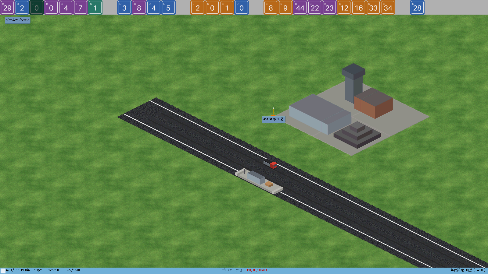
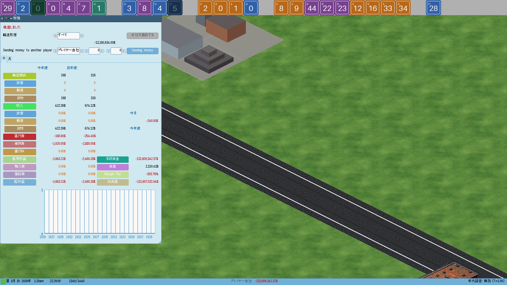
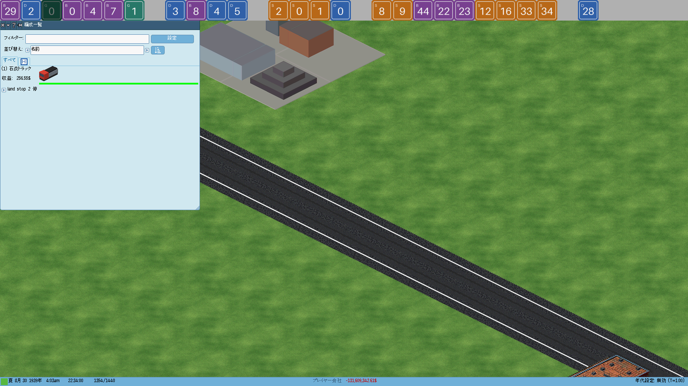
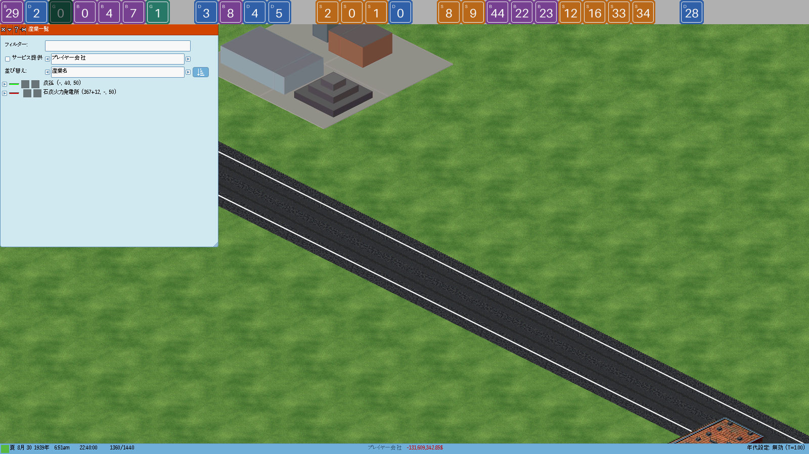

# 石炭のトラックを炭鉱から発電所へ走らせた記録（2026-11-25）

## 背景

[#42](https://github.com/128-bit-net/pak256/issues/42) の石炭のトラック（`pak256_coal_truck`。[vehicles.md](../vehicles.md)）が、炭鉱（`pak256_coal_mine`）から発電所（`pak256_coal_kraftwerk`）へ石炭を運び、収入が出るかを OTRP v64（`sim-WinGDI64-OTRPv64.exe`）で確かめた。

## 手順

1. `python -X utf8 tools/build.py` で組む。makeobj のログに `Warning`・`ERROR` は無い（`vehicle.road.coal_truck.pak` ができた）。`tools/test_*.py` は通る。
2. [game-check.md](../game-check.md) の `tools/game.py` で、検証環境（`addon_check`）を写した作業フォルダに、組んだ pak と AMI の 256 版の道路を入れて起動（保存データ `flat_512_left_v64`、ポート 47885）。道路の車庫は pak256 にも AMI にも無いので、`pak256poc` の `infrastructure.depots_rail_road_tram.all.pak`（2 倍にした pak128）だけ借りた（コミットしない）。
3. `2026-11-25_coal-truck-screens/chain.nut`（配置とダイヤだけ）を流した。東西の道路（28 タイル）の北に炭鉱（2x2）と発電所（3x3）を置き、`tool_link_factory` でつなぎ、道路の上に仮の荷役所（#44）を炭鉱の脇と発電所の脇に置き、車庫から石炭のトラック 1 台を出した。ダイヤは「炭鉱の荷役所で 20% 積む → 発電所の荷役所」。本体の速さを 128 にして走らせ、通る所で速さ 1 に戻して撮った（昼夜は止めてある）。窓は別に `gui.open_dialog_tool` で財務（5）・編成一覧（15）・産業一覧（18）の窓を開いて撮った。

## 結果

- **炭鉱から発電所へ石炭が運ばれ、収入が出た。** 1 台の石炭のトラックが、炭鉱の荷役所で積み、発電所の荷役所で降ろす往復を続けた（本体の速さ 128 で走らせ、窓を開いた時点のゲーム内の日付は 1939 年 8 月）。
  - 財務の窓（`4_finances.png`）: 1939 年に貨物の輸送 198、貨物の収入 422.39$（前年度 316・674.12$）。旅客・郵便は 0。
  - 編成一覧（`5_convoys.png`）: 石炭トラックの収益 256.55$。一覧の絵が荷台に石炭を積んでいる。
  - 産業一覧（`6_factories.png`）: 石炭火力発電所の行が「(367+12, -, 50)」。括弧の読みは本体の表示形式を確かめていないが、入力の在庫 367 と輸送中 12 とみられる（累計ではない）。炭鉱は「(-, 40, 50)」で、出力側の在庫が 40 とみられる。どちらも石炭が炭鉱から発電所へ動いた跡。
- **収入は経費より少ない**（運行費 −165.60$、維持費 −1,920.00$。同じ窓）。値の釣り合い（荷役所の維持費・車両の値）は roadmap の段階 4 で見直す。プレイヤーの所持金が大きなマイナス（−131,609,342.37$、窓に「破産しました」）の保存データなので、黒字・赤字では判断していない。
- **車両の読み込み**: `freight=Kohle`、`capacity=12`、`length=4`。
- **積んだ絵が出る**: 炭鉱から発電所へ向かうトラックの荷台に石炭の山（暗い塊）が見え、帰りは空の荷台。
- 左側通行の地図で、車線に乗って走る（#40 の決まりのとおり）。
- 画面の左に見える赤れんがの建物（`2_empty_115.png` の左下など）は、借りた車庫（2 倍にした pak128。コミットするのは画面の写真だけで、pak には入れていない。#40 の記録と同じ扱い）。

| 画像 | 見所 |
|---|---|
| `2026-11-25_coal-truck-screens/1_loaded_103.png` | 炭鉱（右上）の荷役所（座標 103,103。左）のそばを東へ走る、石炭を積んだトラック |
| `2026-11-25_coal-truck-screens/2_empty_115.png` | 帰りの空のトラック（115,103） |
| `2026-11-25_coal-truck-screens/3_loaded_107.png` | 道路の途中（107,103）の積んだトラック |
| `2026-11-25_coal-truck-screens/crops_x4.png` | 上の 3 枚のトラックを 4 倍（最近傍）に切り抜いた物。左から積んだ・空・積んだ |
| `2026-11-25_coal-truck-screens/4_finances.png` | 財務の窓。貨物の収入 |
| `2026-11-25_coal-truck-screens/5_convoys.png` | 編成一覧。石炭トラックの収益 |
| `2026-11-25_coal-truck-screens/6_factories.png` | 産業一覧。発電所に届いた石炭 |

## 確かめていないこと

- 発電所の電気の出力（産業の窓を開けていない。届いた石炭の数は産業一覧で見た）。
- 車両を買う窓（車庫の窓）・ツールバーでの見え方。
- 台数を増やしたときの渋滞（炭鉱の荷役所で 2 台が待つと「立ち往生」の知らせが出た。1 台で撮り直した）。
- 右側通行の地図、冬・雪、夜の見え方。本家 125.0.1 は未確認（[concept.md](../concept.md) の F）。車庫は借り物。
