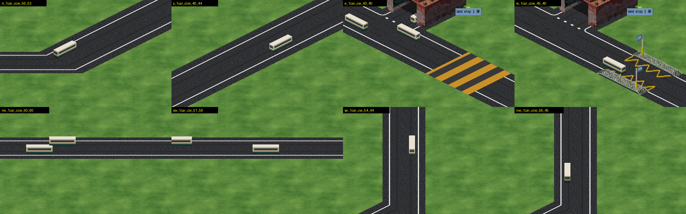
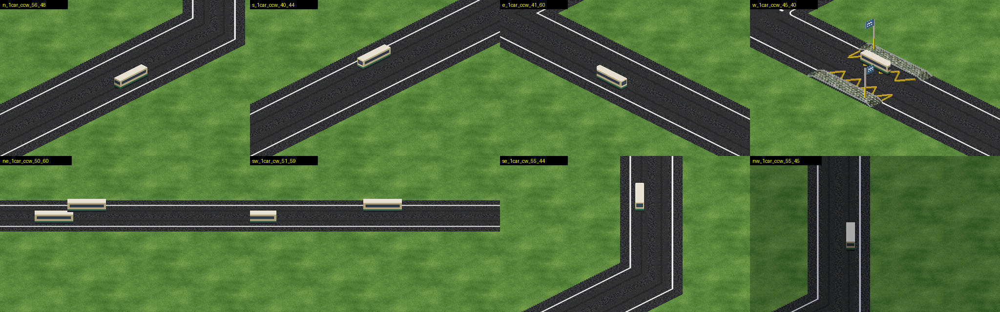
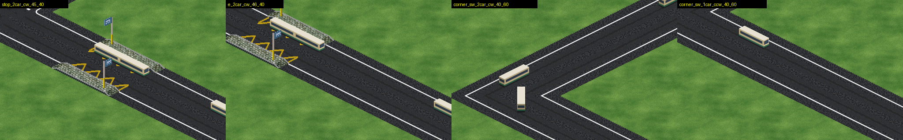
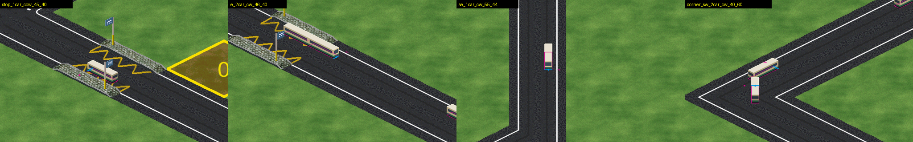

# 車両の描画位置をゲームで確かめた記録（2026-11-25）

[#40](https://github.com/128-bit-net/pak256/issues/40) で決めた車両の長さと描画位置（[vehicles.md](../vehicles.md)）が、AMI の 256 版の道路（`ami-256-alpha.1` の `ami_road_local`）の車線に乗ることを、OTRP v64（`sim-WinGDI64-OTRPv64.exe`）で見本のバス（`pak256_sample_bus`、`length=7`）を走らせて確かめた。

## 手順

1. `python -X utf8 tools/build.py` で組む。見本のバスは `draw_bus.py` の普通の絵・`--emulate-right`（右側通行の写し）・`--marker`（試験の印）の 3 通りを、それぞれ makeobj で組んだ。
2. 検証環境（`addon_check`）の実行ファイル・`themes/`・`font/`・`text/`・`script/` を写した作業フォルダ（`-set_workdir`）に、組んだ pak と、道路の車庫・停留所だけ `work/pak256poc`（2 倍にした pak128）から借りた物を入れた（コミットしない）。
3. `tools/vehicle_check/run.py --save flat_512_left_v64 --port 47802` で起動し、`course.nut` で温帯の平地（北西の角が 40,40）に輪を敷いて、時計回りの 1 両・2 両連結と反時計回りの 1 両を走らせ、向きごとに撮った。拡大 3、1600x900。下の絵は撮った画面の編成のまわりを切り抜いた物。
4. 保存データは左側通行（手元の右側通行の保存データは起動画面で止まって使えなかった）。右側通行は `--emulate-right` の絵を左側通行の地図で走らせて見た（本体は左側通行で絵をずらすだけなので、右側通行の地図と同じ所に出る）。

## 結果

- 8 方向とも、左側通行・右側通行の写しのどちらでも、車体が進む向きの車線（白線と道路の中心の間）に乗って見えた。
- 東向き（軸の向き）で、車線の中心は白線との距離から測って道路の中心から 0.184 タイル（決まりの 3/16 = 0.1875 タイル。AMI の車線の中心 0.1685 より約 0.5m 外）。斜めは画面で測っていない。
- 2 両連結の継ぎ目にすき間も重なりも無い（`length` × 1.65m に描くため）。
- 停留所に止まった先頭は、タイルの出口の辺から約 1.6 単位手前。車体はタイルの中に収まる。
- 直角の曲がり（北西・南西の角）でも、曲がる途中で車線から外れて見える所は無かった。

### 左側通行の 8 方向

ラベルは「向き_両数_回る向き_タイルの座標」。`e` の絵の赤れんがの建物は借りた車庫、`w` の絵の旗と黄色の印は借りた停留所。

### 右側通行の写しの 8 方向

### 停留所・2 両連結・曲がり

左から: 停留所（45,40）に止まった 2 両連結、東向きの 2 両連結（46,40）、南西の角（40,60）を曲がる 2 両連結、同じ角の手前の反時計回りの 1 両。

### 試験の印

`--marker` の絵。桃色の枠が車体の地面の枠、青の線が前の端、青の点が基準点、桃色の十字がタイルの中心。左から: 停留所（45,40）に止まった反時計回りの 1 両、東向きの 2 両連結（46,40）、SE 向き（55,44）、南西の角（40,60）の 2 両連結。前の端（青の線）が車体の前に、基準点が車線の上に来ている。

## 確かめていないこと

- 本当の右側通行の保存データ（写しで見ただけ）。本家 125.0.1（OTRP だけで見た。左側通行のずれの表が本家と同じことは、コードを読んで確かめた）。
- 斜めの車線の位置の測り（見た目だけ）。逆向き運転（`reverse_base_offset`）・追い越し・512 のセルの車両。
- 自前の車庫・停留所（借り物で走らせた）。
