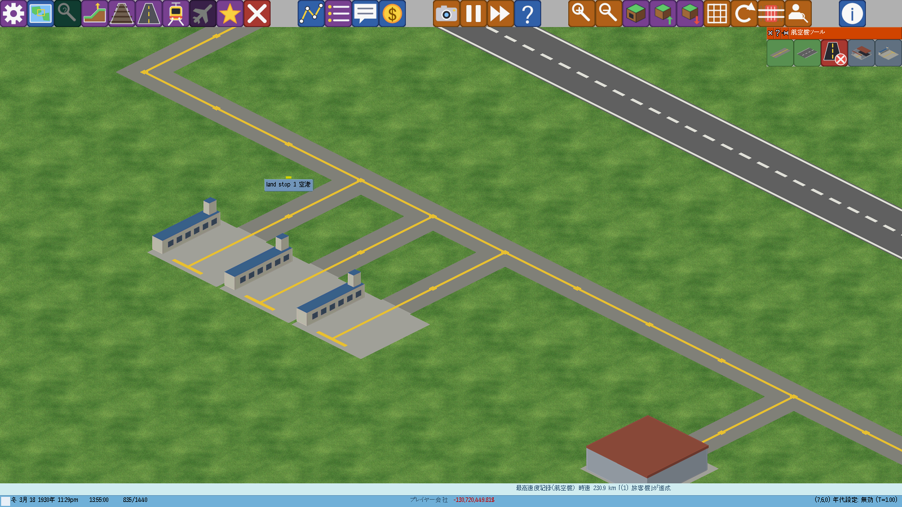
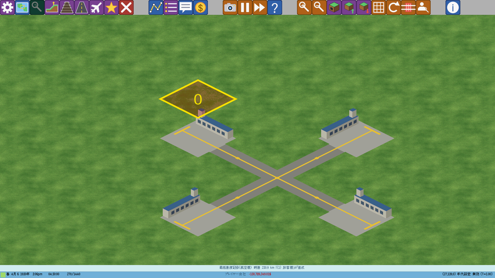
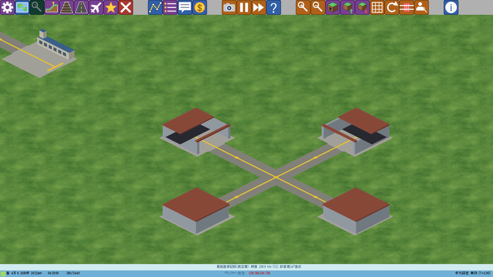
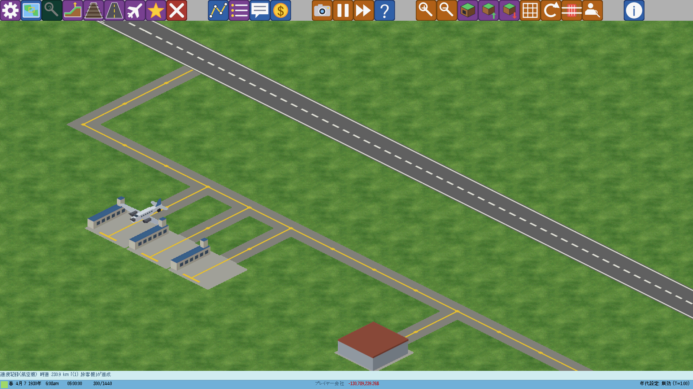
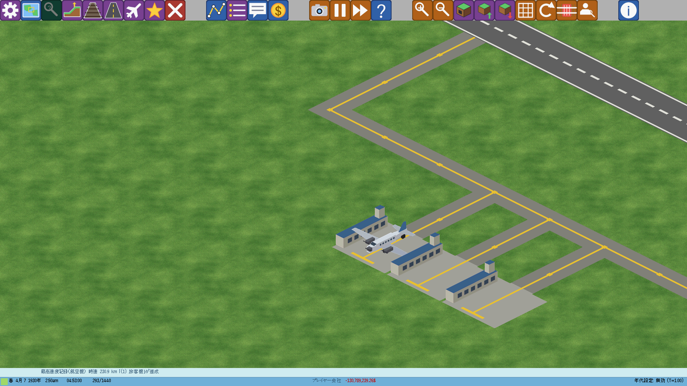
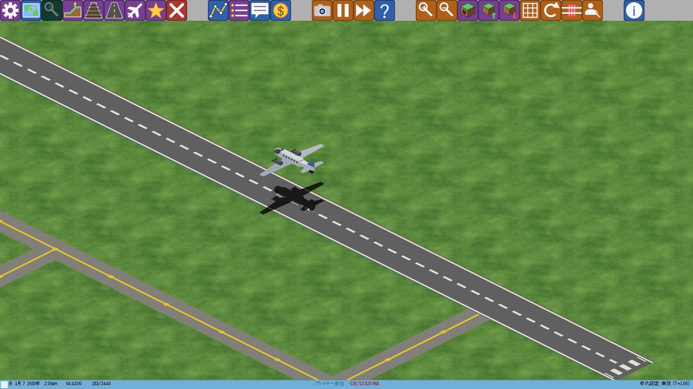
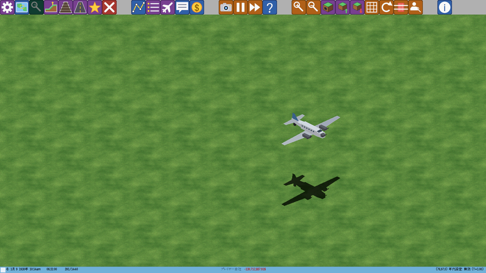
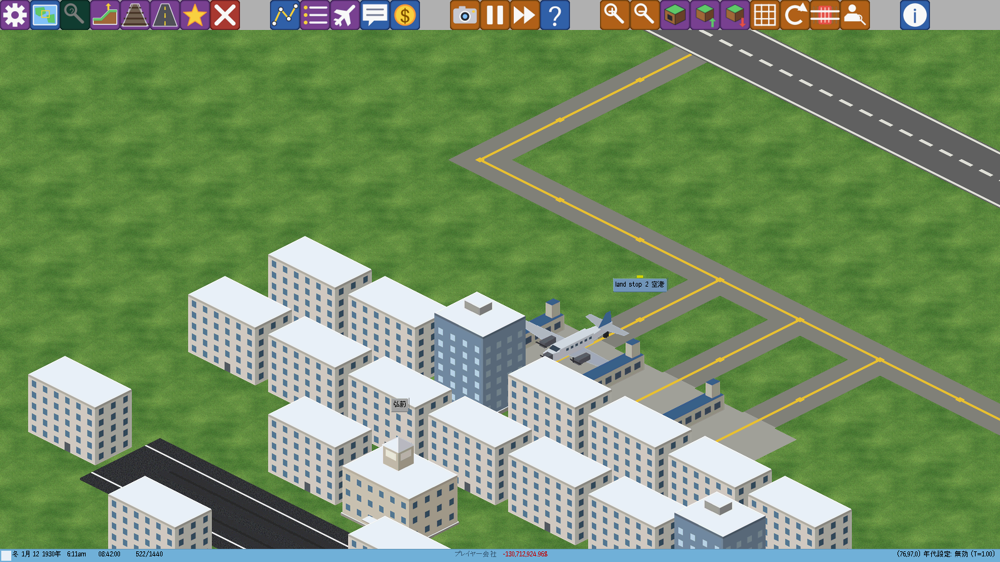
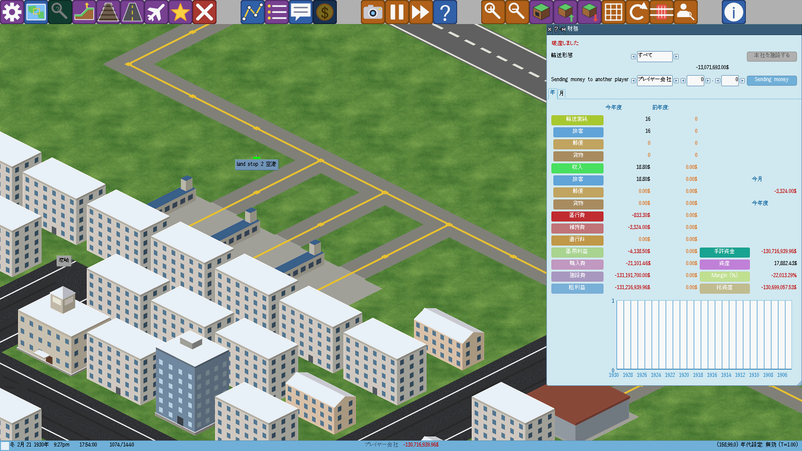

# 飛行機と空港の確かめ（2026-11-26、#155）

`tools/vehicle_check/air.nut`・`air_run.py` で、OTRP v64（`sim-WinGDI64-OTRPv64.exe`）の `flat_512_left_v64`（温帯。x < 256）に空港を 2 つ置き、旅客機 1 機を往復させた。決まりは [airport.md](../airport.md)。物の登場年・値は保存データの時代（1930 年）で使えることを、この確かめの中で見た。

## 置き方

- 空港 A は滑走路 (60,100)〜(78,100)、空港 B は (150,100)〜(168,100)。誘導路は 3 升南の y=103、駅は (x0+5〜7, 105)、格納庫は (x0+11, 105)。
- 街は各空港の南の (x0+6, 108) に公共のプレーヤーで置き、`change_size(3000)` で人口を足して、駅の前（y=106・107）に街の建物（`pak256_apartment`）を並べた。街が建てる建物は駅の近くに少なく、旅客がほとんど出なかったため。

## 結果

| 項目 | 結果 |
|---|---|
| 置けるか | 滑走路・誘導路・駅（向き 4 通り）・格納庫（向き 4 通り）がエラーなく置けた。誘導路をつないだ升は滑走路のまま |
| 運べるか | 旅客機が格納庫から出て、地上走行・離陸・飛行・着陸・駅への停車を A と B の間で繰り返した。旅客が乗って降りた（画面 9 の回の 1 年目の途中で 24 人） |
| お金 | 旅客の収入・運行費・維持費・建設費が財務に記録される。画面 9 の回の 1 年目の途中で、収入 28.22・運行費 838・維持費 3,324（クレジット）。建設費は dat と設定のとおり: 滑走路 1 升 1,750、誘導路 300、駅 2,000、格納庫 12,500 |

- **黒字ではない**。収入は小さく、運行費と維持費に届かない。乗った旅客が少ないためと見ているが、値の釣り合いは見ていない（roadmap の段階 4）。
- 財務の画面の建設費 約 -1.31 億と「破産しました」は、この確かめより前からのもの。何も置く前に読むと、手許資金が -130,571,999、今年度の建設費が -131,071,999 だった（フリープレイなので続けて遊べる）。上の建設費の単価は、置く前後の差で測った。
- 旅客機は、レビューの指摘で手本の 2 倍（`length` 13）から実物比例（`length` 11。高さは 4.5m）に描き直した。
- 飛行の高さは 6 段（192px）。画面で機体と影が約 200px 離れて見えた。高さの決まりは [airport.md](../airport.md) の「飛行の高さと影」。

## 画面

飛行機の段は路面電車の段（#153）の次に置いた。画面は実物比例に描き直した旅客機で撮った。画面 2〜9 は路面電車の段が入る前に撮ったので、上のツールバーに路面電車が無く、飛行機の位置が 1 と違う。

1. 飛行機のツールバー（左から誘導路・滑走路・撤去・格納庫・駅）

2. 駅の向き 4 通り（(30,140) の十字の先。名札を消した起動）

3. 格納庫の向き 4 通り（(38,140)）

4. 空港 A の全体（(68,102)、縮小。名札を消した起動）

5. 駅に止まった旅客機（空港 B の (155,105)）

6. 離陸した直後（空港 A の滑走路 (74,100)）

7. 飛行中（(146,98) の近く。下の黒い形が影）

8. 街の建物と駅（空港 B）

9. 財務の窓

## 画面を見て直した点

- 滑走路に脇からつながる所が滑走路の幅で張り出し、白い破線が脇へ曲がっていた → 枝を誘導路の幅と色にした。
- 駅の停止線が機首の止まる所とずれ、向きによってはターミナルに機首が重なった → 停止線を 0.90 に、ターミナルを脇の奥の辺にした。
