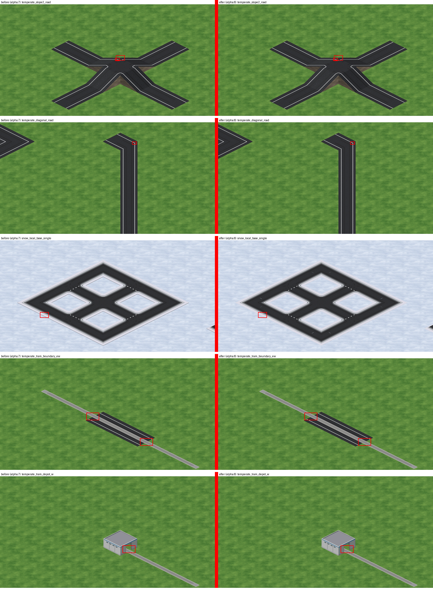
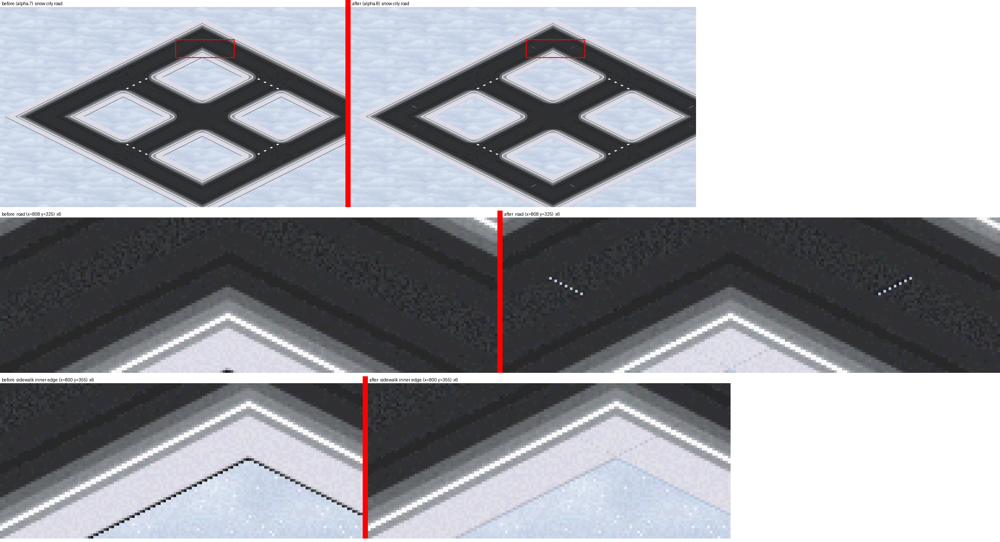
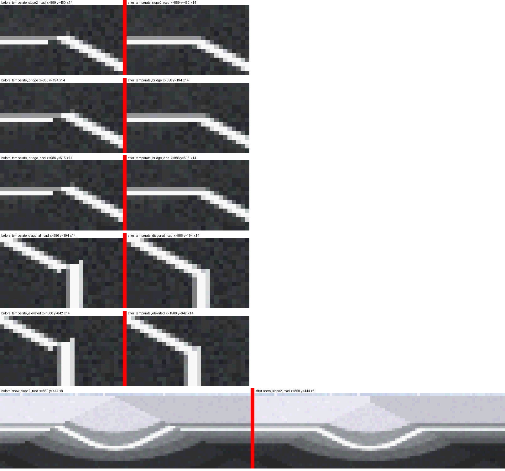
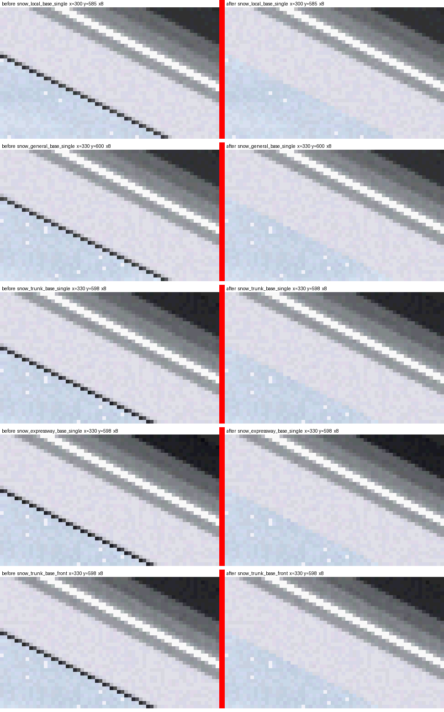
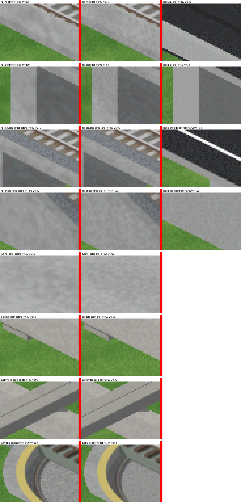
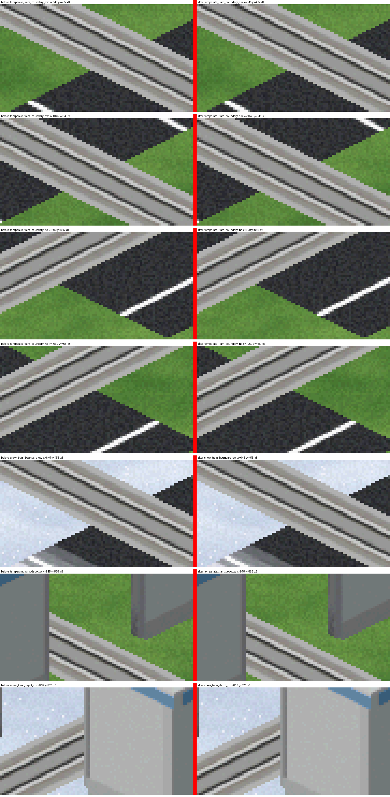
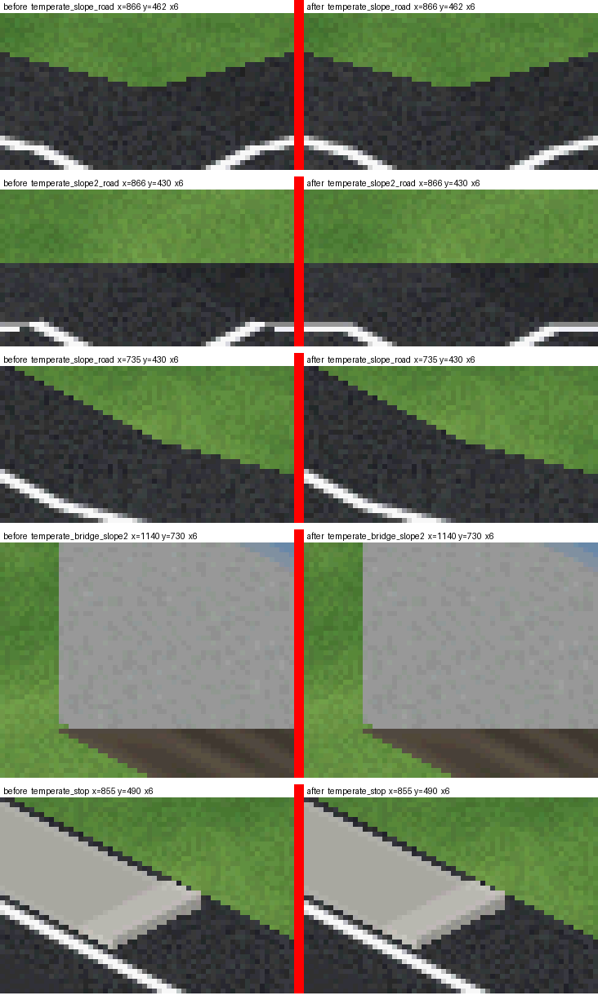

# AMI の直し（AMI 256 版 alpha.8）の確かめ（2026-11-26）

[#159](https://github.com/128-bit-net/pak256/issues/159)。AMI のコミット `f64a430` から 256 版 `ami-256-alpha.8` を組み、`ami-256-alpha.7`（`3658e5c`）と同じ見本で比べた。取り込んだ直しは次の 4 つ（AMI の issue の番号）。

- [#354](https://github.com/128na/simutrans-addon-dev/issues/354): 白線が向きを変える継ぎ目の欠け。
- [#355](https://github.com/128na/simutrans-addon-dev/issues/355): コンクリートの粒の大きさを pak の大きさに合わせる。
- [#360](https://github.com/128na/simutrans-addon-dev/issues/360): 雪の道の基盤の版（`base`）の下の端の暗い点線。
- [#365](https://github.com/128na/simutrans-addon-dev/issues/365): 路面軌道の境の暗い線。AMI #354 の直しで入った物で、alpha.7 には無い。

## 組みと検査

- `tools/build_ami256.py build --version alpha.8` は全部の段を通った。描画は 220 対象。道路のトンネル 3 つ・`ami_wall_road_back`・`ami_wall_rail_old_twin_catenary_back` の 5 対象は 1 回目に失敗し、道具の描き直しで通った。
- `check_way_edges.py`: 4869 セルを調べ、問題 0 件。
- zip の SHA-256 は `8b8e025cd89054ab6dcca40fe2b22c57afbef791c40a94fc90f28b78e6b36bed`。置き場 `vendor-ami-256-alpha.8` に上げた。
- `compare`（alpha.7 と）: pak の名前と数、物の数は同じ。
- pak をバイトで比べると、`ami_tram.pak`・`ami_canal.pak`・`ami_scenery.pak` は alpha.7 と同じ。`ami_road.pak`・`ami_rail.pak`・`ami_extra.pak`・`ami_monorail.pak` が違う。

## 撮り方

OTRP v64（`addon_check` の写し）、`flat_512_left_v64`、昼、`gui.set_zoom(3)`（等倍）。pak256 の側は同じで、AMI だけを alpha.7（前）と alpha.8（後）にした。温暖は原点 (60,60)、降雪は (316,60) からのずれ（`seam_scene.py` を除く）。画像の見出しの `x`・`y` は画面（1600x900）の画素。

| スクリプト | 見本 | 画面の名前とタイル（原点からのずれ） |
|---|---|---|
| [#134 の scene.py](2026-11-26_ami333-screens/scene.py) | 道・橋・高架・停留所など | `slope2_road` (3,70)、`diagonal_road` (14,0)、`bridge` (5,54)、`bridge_end` (2,52)、`elevated` (5,44)、`slope_road` (3,18)、`bridge_slope2` (5,116)、`stop` (5,100) |
| [scene.py](2026-11-26_ami159-screens/scene.py) | 道の基盤の版 8 種、路面軌道の境と車庫の前 | `<種類>_base_<版>` (3, 3+10i)、`tram_boundary_ew` (24,4)、`tram_boundary_ns` (24,20)、`tram_depot_w` (20,36)、`tram_depot_n` (30,38) |
| [seam_scene.py](2026-11-26_ami159-screens/seam_scene.py) | 雪の街の道路（保存データの道路名のまま） | 雪の格子の西の端 x=316。街の道路の道具 y=100、手敷きの `base_single` y=130 |
| [#134 の concrete_scene.py](2026-11-26_ami333-screens/concrete_scene.py) | コンクリートを使う物 | #134 の記録と同じ |

`scene.py`（#159）で手で敷く道は、保存データの道路名の書き換え（[game-check.md](../game-check.md)）の影響を受けない。[montage.py](2026-11-26_ami159-screens/montage.py) が下の画像を作る。左が前、右が後。

## 新しく出た崩れ（直していない）

### 雪の `ami_road_local_base_single` の路面に、地面が透ける点線

雪の気候で、5x5 の格子（角・分かれ目・十字）を `ami_road_local_base_single` で敷くと、四隅の角のタイルと隣の直線のタイルの境に、薄い青の点線が出る（1 つの格子で 8 か所。1 か所は斜めに長さ約 12 画素）。雪の地面が透けた色。alpha.7 には無い。

- 歩道の有無に関係なく出る。街の道路の道具が `base_single` を敷く保存データ（`flat_512_left_v64` の元の設定）では、街の道路にも出る。
- 街の道路が `ami_road_local`（pak256 の `config/simuconf.tab` の `city_road`）の画面には出ない。
- ほかの基盤の版（`general`・`trunk`・`expressway`）の同じ形には、地面の色の画素は見つからなかった。
- 原因の見込み（未確認）: AMI #360 の直しは、雪の絵の路面の板を手前の縁から内へ寄せ、その下を透明にした。隣のタイルがそこを覆わない所が透けていると見ている。

同じ画像の下の段は、歩道の内側の縁。暗い点線は消えたが、薄い青みの線が残る（AMI の側でも把握している）。

pak の中の画像では、`base` の 10 種の雪の画像で不透明な画素が減っている（[holes_pak.py](2026-11-26_ami159-screens/holes_pak.py)。狙いどおりに寄せた縁も数に入るので、透けて見える所の数ではない）。

## 直ったこと

### 白線の継ぎ目（AMI #354）

横の線の端の欠けと、縦の線の上の飛び出しが、見た 5 か所（2 段の台の十字、橋、橋の端、道路の斜め、高架の曲がり）で無くなった。下の段は降雪の 2 段の台。

### 雪の道の下の端の暗い点線（AMI #360）

`local`・`general`・`trunk`・`expressway` の `base_single` と `trunk_base_front` の手前の縁で、暗い線が消えた。

[#141 の pakimg.py](2026-11-26_snow-road-seam-screens/pakimg.py) の `count`（列のいちばん下の画素だけが暗い列が 30 以上ある画像の数）は、alpha.7 では `base` の 10 種すべてで 2〜18 枚、alpha.8 では 0 枚。`general_base_single` の坂の画像には、最大 2 列が残る。

### コンクリートの粒（AMI #355）

線路の壁・橋脚・高架の桁・橋の端・坑口の粒が、前より細かくなった。大きなまだら（しみ）は残り、道路のコンクリートより目立つ（AMI #355 の直しの PR は、しみと雨だれの大きさは変えていない）。モノレールの桁は、見た目の違いがほとんど分からない。転車台の床は少し細かくなった。左が alpha.7、中が alpha.8、右が道路のコンクリート。

## 前の版から変わらないこと

- **路面軌道（AMI #365）**: `ami_tram.pak` は alpha.7 とバイトで同じ。道路の上と土の上の軌道の境（東西・南北）と車庫の前に、レールを横切る暗い線は無い（温暖・降雪）。車庫の 4 つの向きの画面は前後で画素まで同じ。境の画面の違いは道路のタイルの側の粒。

- **AMI #340 の直し**: 台の上の十字の奥の角、坂の継ぎ目の奥の縁、2 段の橋の端は、前後で同じに見える。
- **停留所の奥の帯**（[stations.md](../stations.md)）: `stop` の画面は、明るさの差が 24 を超える画素が無い。道路の縁は動いていない。

## ほかに変わった所

- 道路のタイルの境の行と、雪の道路の路面の粒の並びが入れ替わった。#134 の見本の 46 画面で違う画素を塗って見ると、道路のタイルの境の行と、線路の橋・高架のコンクリートの面（粒の直し）に集まっていた。白線の継ぎ目のほかに、形の変化は見つけなかった。
- 降雪の高い橋（`snow_bridge_high`）の 1 タイルが、alpha.8 の 2 回の撮影のうち 1 回、雪の無い絵で写った。撮り直した回は alpha.7 と同じく雪が付いた。alpha.7 は 1 回だけ撮った。原因は分からない。

## 確かめていないこと

- 本家 125.0.1、右側通行、alpha.7 の保存データの読み込み。
- 雪の基盤の版の坂と複段の坂。`trunk`・`expressway` の `base_back`・`base_center` は、手前の縁を拡大して見ていない。
- 路面の点線は、5x5 の格子の形だけで見つけた。ほかの形で出るかは調べていない。
- コンクリートの粒は温暖だけ。基盤の版の板、門型の橋脚、遷車台は見ていない。
- 路面軌道の曲がりと T 字、路面電車を走らせること。
