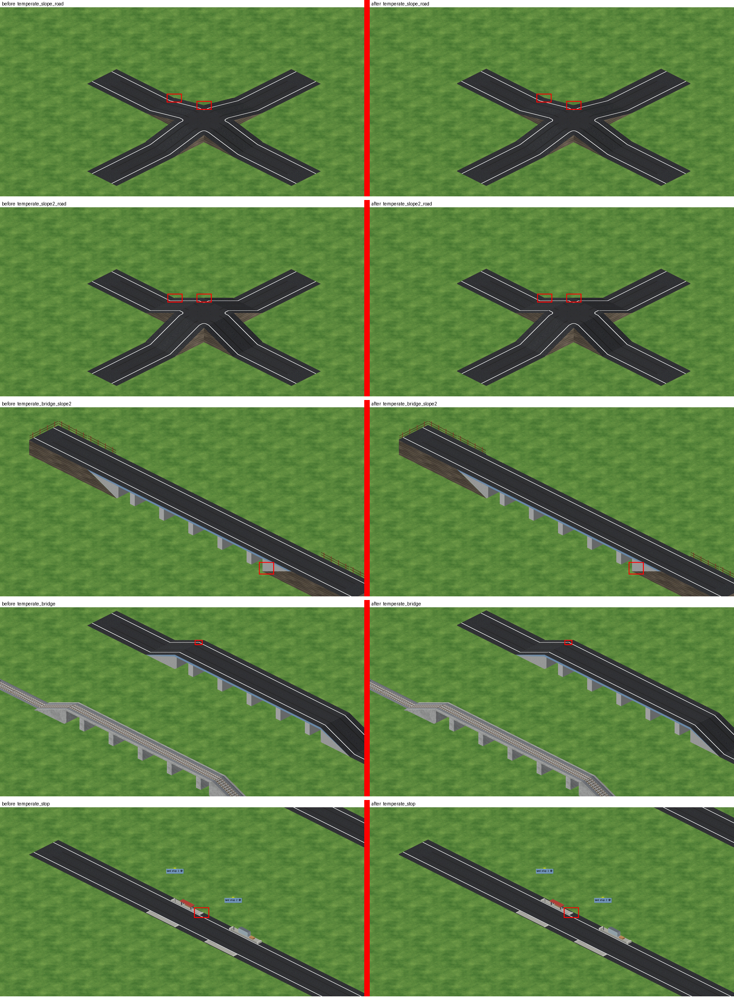
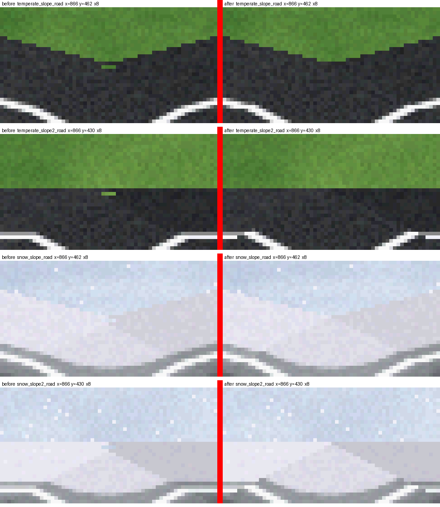
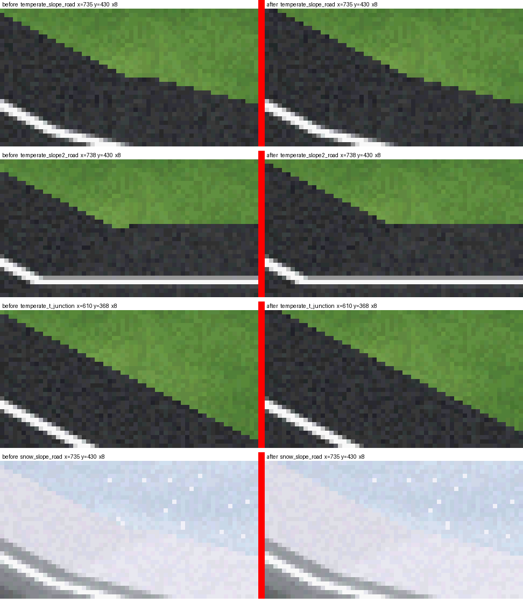
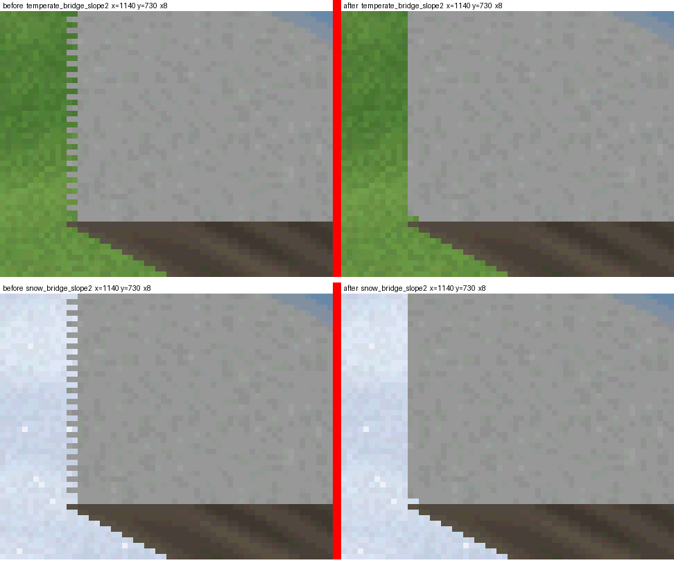
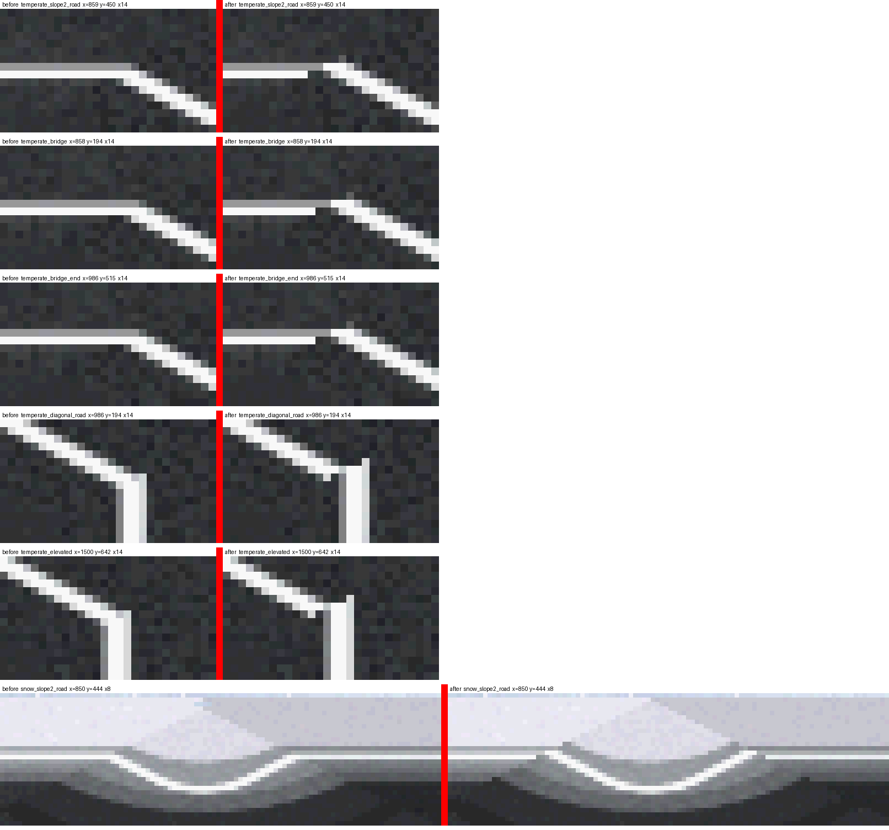
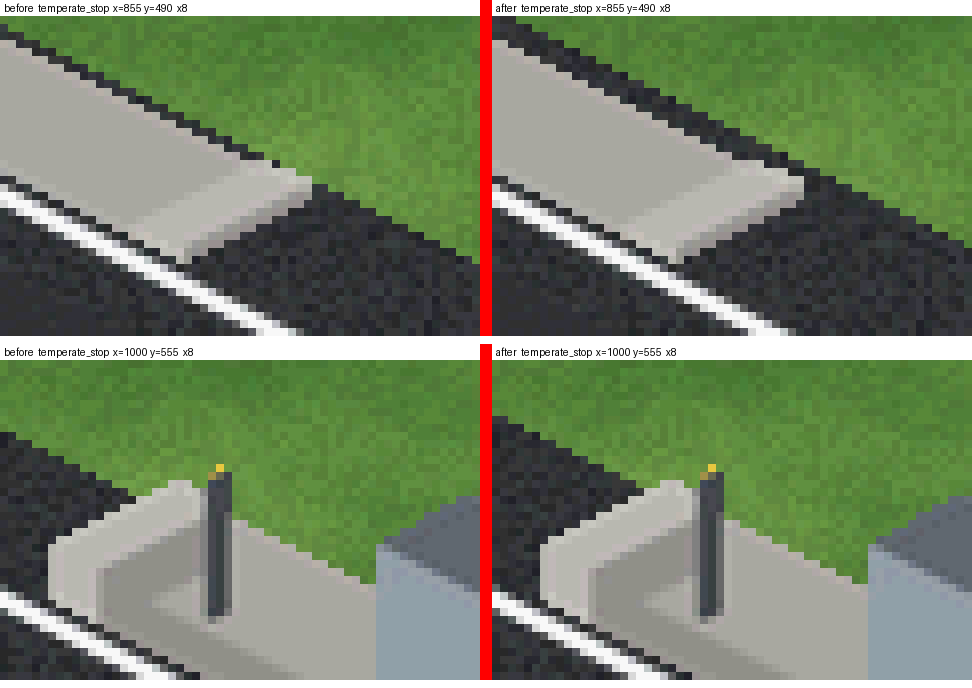
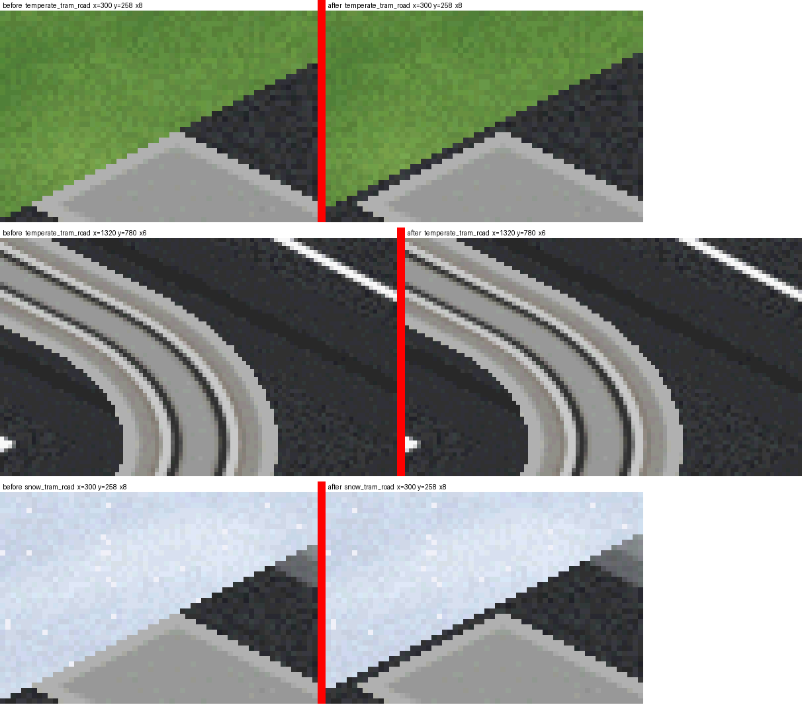
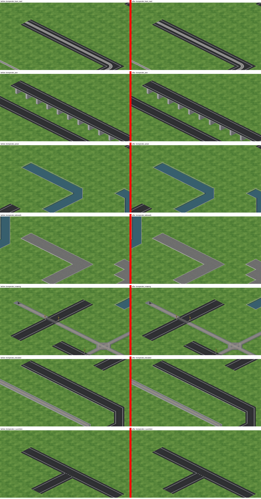
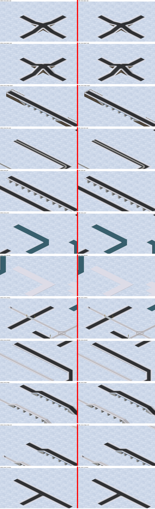
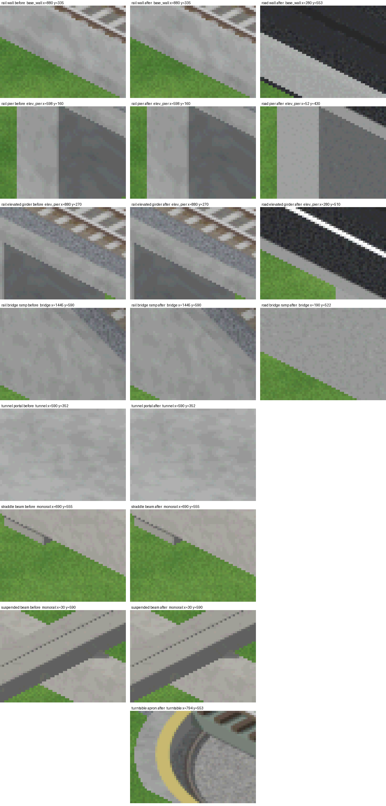

# AMI #340 の直し（AMI 256 版 alpha.7）の確かめ（2026-11-26）

[#134](https://github.com/128-bit-net/pak256/issues/134)。AMI の PR [#340](https://github.com/128na/simutrans-addon-dev/pull/340)（AMI #333）は、256 の持ち分マスクの 2 つを直した。

- 台の上の十字の奥の角の草の線と、橋の端の 2 段の坂のマスクの穴。
- 坂の継ぎ目の奥の縁の跳び。案 A として、道路の位置で描く物の奥の縁を地面の菱形の縁にそろえる（平らな道路などの奥の縁が 2 行上がる）。

AMI のコミット `3658e5c` から 256 版 `ami-256-alpha.7` を組んだ。

## 組みと検査

- `tools/build_ami256.py build --version alpha.7` は全部の段を通った。描画は 220 対象。道路のトンネル 3 つと `ami_wall_road_back` の 4 対象は 1 回目に失敗し、道具の描き直しで通った。
- `check_way_edges.py`: 4869 セルを調べ、問題 0 件。
- zip の SHA-256 は `c97fc3f508cb33a6a394e894d8f76c20dad16f4715095191b5963579040ae4d7`。置き場 `vendor-ami-256-alpha.7` に上げた。
- `compare`（alpha.6 と）: pak の名前と数は同じ。物は 7 つ増え、無くなった物は無い。
  - `ami_rail.pak`: `ami_rail_turntable`
  - `ami_road.pak`: `ami_mark_center_yellow`・`ami_mark_junction4_c`・`ami_mark_paving_blue`・`ami_mark_paving_green`・`ami_mark_paving_red`・`ami_mark_paving_red_striped`

## 撮り方

OTRP v64（`addon_check` の写し）、`flat_512_left_v64`、昼、`gui.set_zoom(3)`（等倍）。pak256 の側は同じで、AMI だけを alpha.6（前）と alpha.7（後）にした。

[scene.py](2026-11-26_ami333-screens/scene.py) で、温暖（原点 60,60）と降雪（原点 316,60。敷いた後に降雪に塗る）に同じ見本を敷き、[montage.py](2026-11-26_ami333-screens/montage.py) で左（前）・右（後）に並べた。画像の見出しの `x`・`y` は画面（1600x900）の画素。

| 画面の名前 | 見る所のタイル（原点からのずれ） |
|---|---|
| `slope_road` / `slope2_road` | (3,18) / (3,70)（1 段・2 段の台の上の十字と四方の坂） |
| `t_junction` / `tram_road` | (16,80) / (4,80) |
| `canal` / `sidewalk` / `crossing` | (4,28) / (16,28) / (5,36) |
| `elevated` / `pier` | (5,44) / (5,92) |
| `bridge` / `bridge_end` / `bridge_slope2` | (5,54) / (2,52) / (5,116)（2 段の坂から架けた橋） |
| `diagonal_road` | (14,0) |
| `stop` | (5,100)（pak256 のバスとトラックの停留所） |

## 直ったこと

- **台の上の十字の奥の角の草の線**: 1 段・2 段の台のどちらも消えた。降雪の画像は前も後も雪の色に紛れて見分けにくい。

- **坂の継ぎ目の奥の縁**: 平らから坂へ移る列の段差が無くなった（1 段・2 段）。平らな道路の奥の縁は 2 行上がり、坂とつながる。縁の草の抜けは見えない。

- **2 段の橋の端**: 前は端の縦の縁が櫛の歯のように欠けていた。後は縦の縁がそろった（温暖・降雪）。左下の角には 1px の切れ込みが残る。AMI の側ではマスクの検査だけで確かめていた所。

## 新しく出た崩れ（直していない）

### 白線の小さな欠け

白線が向きを変える所の継ぎ目で、alpha.6 では続いていた線に、後は 1 行の欠けや角の飛び出しが出る。

- 横の線が斜めに変わる所（2 段の台の十字、橋の面と端の坂の境）: 横の線の端が横 3px 欠ける。温暖・降雪とも。
- 斜めの線が縦の線に変わる所（道路の斜め・高架の曲がり）: 斜めの線の先が欠け、縦の線の上に 1px が飛び出す。

原因は調べていない。AMI #340 の本文にある「斜めのタイルの上下の持ち分が重なる行が 1 行から 3 行になる」により、後から描くタイルの路面が前のタイルの白線を覆っている、というのが推測。AMI の側では違う画素が路面の粒だけと確かめていたが、見本は斜めの道路だった。

### pak256 の停留所の奥の暗い帯が太くなる

奥側の停留所の台の後ろに見える路面が、道路の奥の縁が上がった分（2 行）だけ太くなる。停留所の絵（pak256 の `objects/station/road_stops/`）は前の縁に合わせて描いてある。気になるかは利用者の判断。

## ほかの見た所

橋脚の上の高架、運河、歩道、踏切、高架、橋、橋の端、T 字は、前後の全体（半分に縮めた図）を温暖と降雪で見た。上の 2 つのほかに、新しい崩れは気づかなかった。違う画素を赤く塗った図では、道の奥の縁とタイルの境の行にあった。

路面軌道は拡大して見た。軌条と舗装の形は前後で同じ。道路の端の軌道の敷石（道路の行き止まり）では、道路の奥の縁が上がった分、敷石の外に路面が 2 行出る。

運河は、奥の岸の笠石と水の間に細い草の帯が見える。alpha.6 でも同じで、この版の変化ではない。意図した形かは確かめていない。

## コンクリートの粒（`tiled_concrete_material`）

AMI の `tiled_concrete_material`（`tools/blender/sheetlib/core.py`）を使う物の粒を見た。使う物は次のとおり（AMI `3658e5c` を検索した）。

- 線路の基盤の版の板、高架と橋の床と桁、線路の壁、線路の橋脚（門型を含む）、線路のトンネルの坑口。
- モノレール（跨座式・懸垂式）の桁と柱。
- 転車台・遷車台のまわりの輪とピットの床。

この材質は、模様の細かさを部品の座標（世界の単位）で決め、倍率 `SCALE`（`core.py`）を掛けていない。同じ `core.py` の `noisy_material` は掛けている（AMI #298。128 と同じ画素の粒になる）。このコードからは、`tiled_concrete_material` の 256 の粒は、128 と同じ画素の大きさではなく、約 2 倍の画素の大きさになる。AMI の `addons/ami/blender/render.py` の注記では、線路の面の粒は 128 で約 4px。画素の大きさは測っていない。

[concrete_scene.py](2026-11-26_ami333-screens/concrete_scene.py) で温暖に敷き、[concrete_montage.py](2026-11-26_ami333-screens/concrete_montage.py) で同じ大きさの切り抜きを並べた。左が alpha.6、中が alpha.7、右が道路のコンクリート（`noisy_material`。alpha.7）。

- 線路の壁・橋脚・高架の桁・橋の端・坑口は、まだらの塊が大きい。並べた道路の壁・橋脚・高架の縁・橋の端は細かい点の粒。
- モノレールの桁はまだらが薄い。転車台のピットの床は元の値が細かく、粗くは見えない。
- 転車台を除く 7 か所の切り抜きは、alpha.6 と画素まで同じ。この版で変わった物ではない（転車台は alpha.6 に無い）。
- 粗すぎるかどうかは利用者の判断。直すなら AMI の側。
- 見ていないもの: 基盤の版の板（壁に隠れる）、門型の橋脚、遷車台、降雪。

## 確かめていないこと

- 道路は `ami_road_local`、線路は `ami_rail_ballast`、橋・高架はその 2 種、歩道は `ami_sidewalk`、運河は `ami_canal`、路面軌道は `ami_tram`、橋脚は `ami_pier_road` だけ。ほかの道の種類は `check_way_edges.py` の検査だけ。
- 増えた 7 つの物（色の舗装・黄色の中央線・転車台など）の見た目とツールバー。名前の訳も確かめていない。
- 右側通行、道路のトンネル、車庫、高架の歩道。線路のトンネルとモノレールは、上のコンクリートの粒だけを見た。
- alpha.6 の保存データを alpha.7 で読むこと。
- 雪の気候の道路の角の灰色の三角は [#136](https://github.com/128-bit-net/pak256/issues/136) の分で、見ていない。
