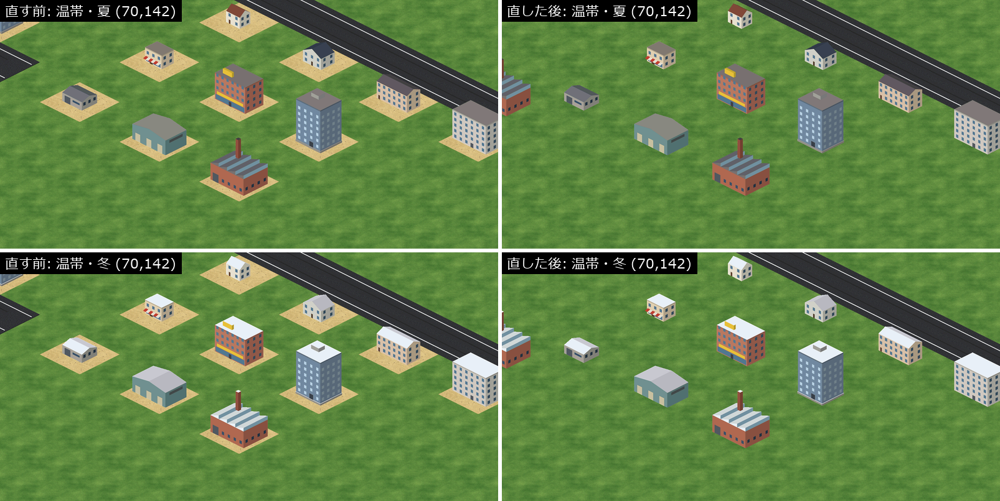
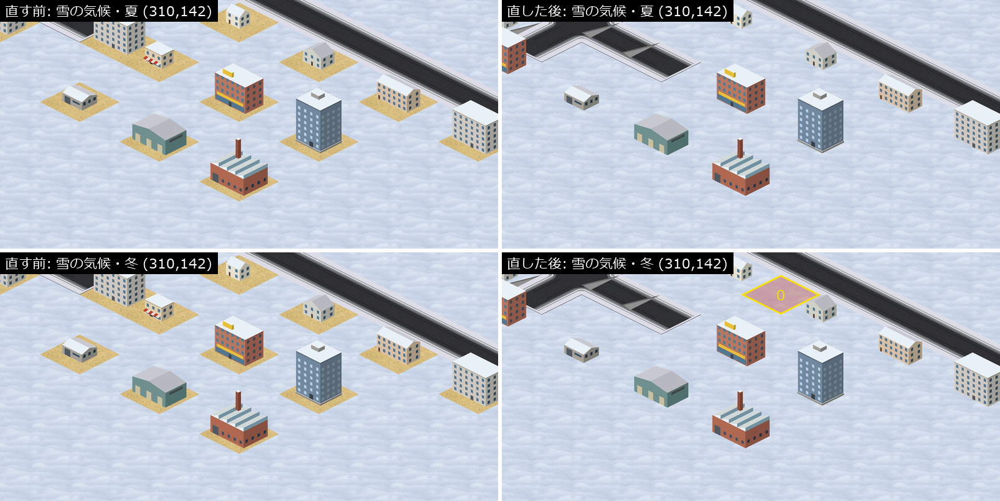
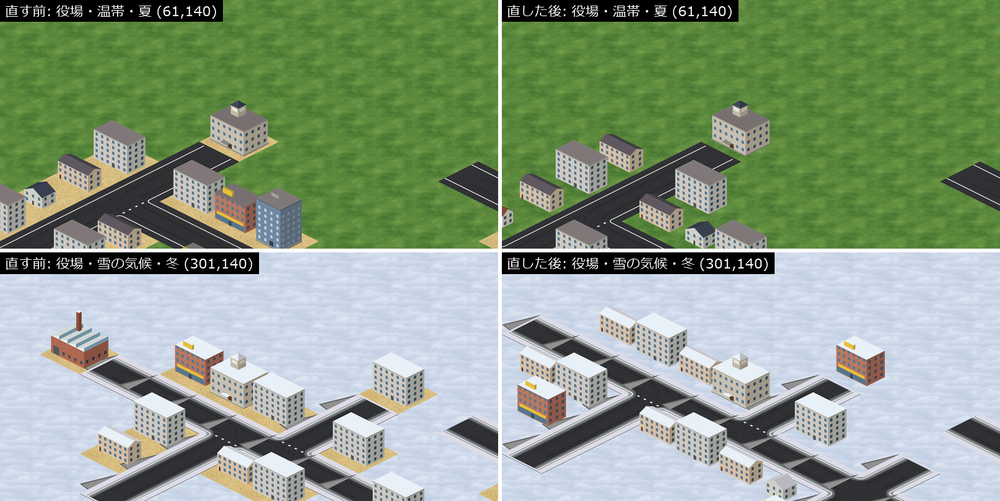
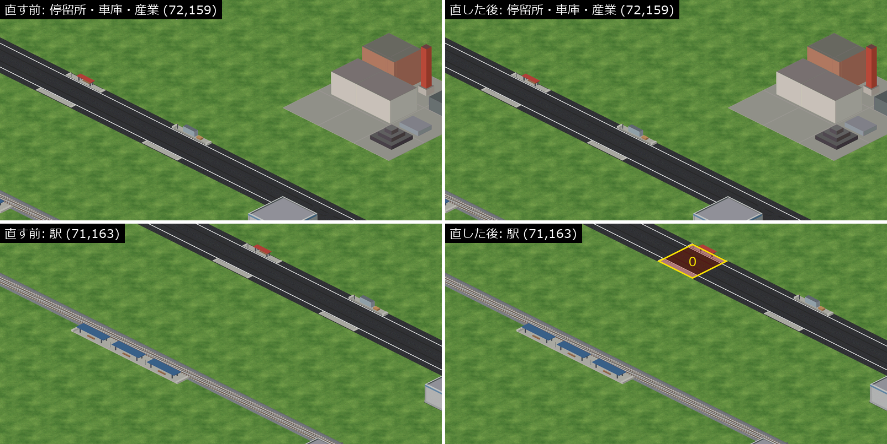

# 建物の下の地面が描かれない不具合の直し（2026-11-26）

[#126](https://github.com/128-bit-net/pak256/issues/126)。利用者が v0.4.0 の下書きを見て指摘した。言葉のまま:「建物の地面（ベースタイル）が未指定なので描画がおかしくなっている（画面をスクロールするとほかのタイルの絵が移りこむ仕様？）」。

## 原因

OTRP の本体は、建物の表に `needs_ground` が無いと、その升の地面を描かない。`gebaeude_t` が `remove_ground = tile->has_image() && !needs_ground()` を持ち、`calc_image` が基礎の升（`fundament_t`）の地面の絵を `IMG_EMPTY` にする（`obj/gebaeude.cc`）。pak256 の建物の絵は地面を持たないので、絵の透明な所に何も描かれず、前に描いた画面が残る。

## 該当した物

| 物 | `needs_ground` | 直す前の画面 | 扱い |
|---|---|---|---|
| 街の建物 11 種（役場・住宅 4・商業 3・工業 3） | 無かった | 下に前の画面が残る | `needs_ground: 1` を足した |
| 産業（炭鉱・発電所） | あった | 残らない | そのまま |
| pak256 の停留所 2 種と線路の駅 | 無い | 残らない（道の升の上に建つ） | そのまま |
| AMI の車庫（撮ったのは道路と線路）・操車場 | あった | 道路と線路の車庫は残らない | そのまま |

AMI の dat（手元の clone の `src*/`）の `obj=building` は車庫 5 種と操車場 1 種で、全部 `needs_ground=1`。操車場と、道路・線路以外の車庫は画面で見ていない。

## 直し

`objects/city/town_buildings/draw_buildings.py` が表に `needs_ground: 1` を書くようにして、11 の表を書き出し直した。絵（PNG）は変えていない。地面を絵に含めず本体に描かせるのは、気候と雪で地面が変わるため。検査は `tools/test_needs_ground.py`。

`needs_ground` は物の定義の値で、本体は読み込みのときに建物の定義から決め直すコードなので、前の版で作った保存データの建物にも効く見込み（コードを読んだ判断で、古い保存データでは確かめていない）。

## 撮り方

OTRP v64（`addon_check` の写し）、`flat_512_left_v64`、昼、拡大 3、名札は消した。[scene.py](2026-11-26_building-ground-screens/scene.py) で、同じ場面を温帯（x<256）と雪の気候（x>=256）に置き、**黄色い砂漠の区画を表示してから、目的の場所へ座標を移動して撮った**。地面が描かれない升には、前の画面の砂漠が残る。直す前は main（`73e6a6f`）の組み、直した後はこの変更の組み。[compare.py](2026-11-26_building-ground-screens/compare.py) で左右に並べた。

街は育つので、役場の画面と雪の気候の町は、直す前と後で建物の並びが同じではない（直した後の雪の気候では、道具で置く商店 1 軒が「No suitable ground!」で置けなかった）。町の画面の黄色い枠と「0」は、撮るときに画面の上にあったカーソル。

## 結果

直した後は、街の建物と役場の下に、温帯では草、雪の気候では雪の地面が描かれ、砂漠は残らない。温帯の冬の月は、地面は緑のまま建物の屋根が雪の絵になる。停留所・駅・車庫・産業は、直す前と後で変わらない。

## この直しと別に見えた物

雪の気候の道路の、角や分かれ目の近くに、灰色の細い三角が出る（上の雪の町と役場の画面）。直す前にもあり、AMI の道路の絵の側と見ている（原因は調べていない）。

## 確かめていないこと

- 本家 125.0.1、前の版の保存データ、街が自分で建てた商業・工業の建物の様子（街の育ちで建った物は画面に入ったが、種類ごとには見ていない）。
- 坂・水辺に建つ建物（平らな地面だけで撮った）。熱帯・砂漠などほかの気候の地面の上。
- 建設中の絵の升の地面。
- マウスで画面を引くスクロール（座標への移動で撮った）。
