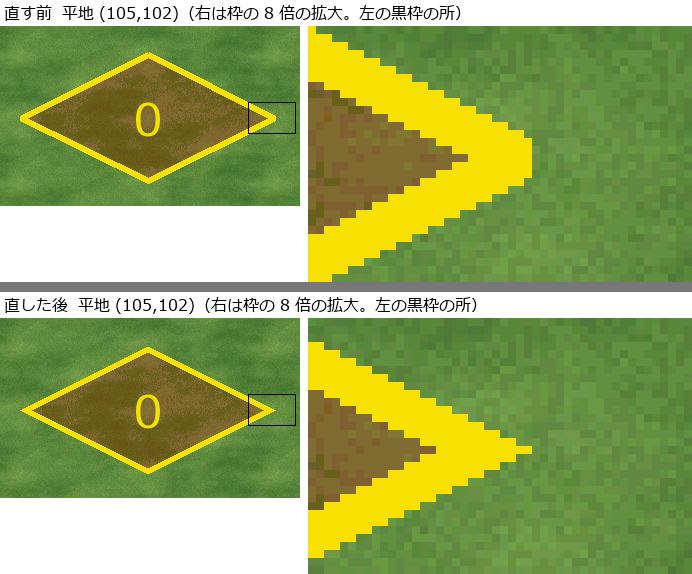
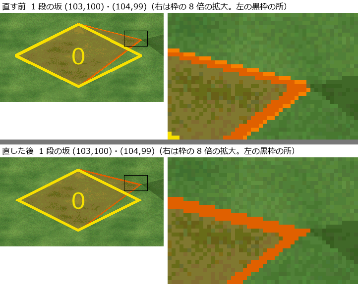
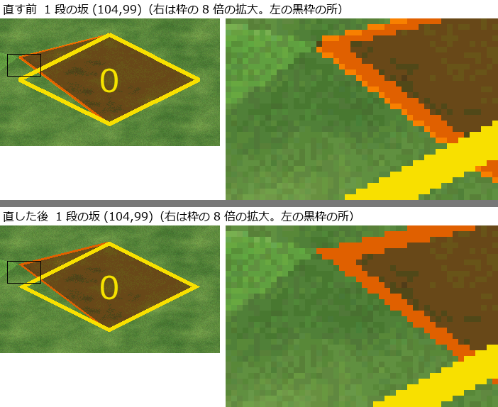
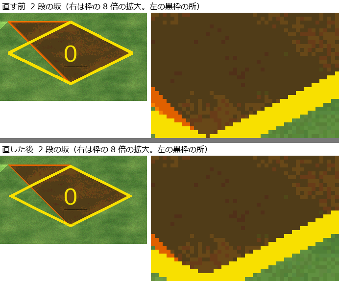
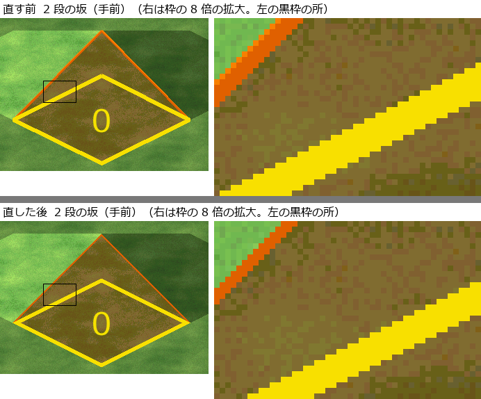

# 印・カーソルの枠を地面の縁にそろえた記録（2026-11-26）

[#112](https://github.com/128-bit-net/pak256/issues/112)（ユーザーのテストプレイの感想「枠の線が横 2px・縦 1px の階段になっていない所がある」）。OTRP v64（`sim-WinGDI64-OTRPv64.exe`）、保存データ `flat_512_left_v64`、`tools/game.py`（昼夜は止める。`gui.set_zoom(3)`、1600x900）。

## 原因

`Marker`・`Borders`（`draw_ground.py`）とカーソル（`draw_gui.py`）は、端の点を `ImageDraw.line` で結んでいた。点は列 1・128・254（カーソルは 0・128・255）で、横 127 に対して縦 63 のように 2:1 にならず、階段の刻みが崩れた。太い線は辺の両側にまたがり、地面の縁ともずれた。

## 直し

地面の画素（`column_span`）の端から内側へ、列ごとに決めた行数を塗る（`draw_ground.py` の `edge_pixels`。決まりは [ground.md](../ground.md) の「枠の線」）。行数は `Marker` 3・`Borders` 2・`GeneralTools` 6・`Builder` と `Marked` 8（元の線の太さと同じ数）。

issue の「平地と坂の辺がすべて横 2px・縦 1px」は、坂の両端の高さが違う辺では作れない（1 段 32px で、辺は水平・4:1・4:3・1:1 になる）。「地面の縁と画素単位で重なる。両端の高さが同じ辺は 2:1」と読んで直した。

## 確かめ

- `tools/test_frames.py`: 全部の絵（`Marker` 54・`Borders` 27・`GeneralTools` 16・`Builder`・`Marked`）の端が、地面の絵（`texture-lightmap.png`）の縁と一致する。直す前（`origin/main`）の PNG に差し替えて流すと、4 つの検査すべてが落ちる（失敗した絵の数は 99）。
- 画面の測定（平地の黄色のカーソル、256 列）: 地面の縁（2:1 の階段）からのずれは、直す前は列によって 317〜323 とばらつき、直した後は上下の辺とも全列で同じ値になった。
- 見た画面: 平地、1 段の坂、2 段の坂。地形は `command_x.grid_raise` で (104,100) を 1 段、(112,100) を 2 段など上げた。道具は問い合わせ（`gui.click`）で、地図は変わらない。

画像（左が画面の切り抜き、右が黒枠の所の 8 倍の拡大。上が直す前、下が直した後）:

- 平地: 
- 1 段の坂: 
- 1 段の坂（別の向き）: 
- 2 段の坂: 
- 2 段の坂（手前）: 

黄色の菱形は道具のカーソル（`GeneralTools`。坂でも平らなまま）、橙の線は地面の印（`Marker`）。

## 確かめていないこと

- `Builder`・`Marked` のゲーム内の見た目（出す操作をしていない。絵の検査だけ）。
- `Borders`（格子の表示を入れたときの線）のゲーム内の見た目。
- 等倍以外の拡大・縮小の段。
- `Marker` の奥の線は、カーソルの下の坂で見えた分だけ。81 通りの坂を 1 つずつは見ていない（絵の検査は全部）。
