# モノレールを入れたときの確かめ（2026-11-26、#156）

OTRP v64（`F:\Simutrans\addon_check` の写し）の `flat_512_left_v64` で、`tools/vehicle_check/monorail_run.py` を流した。pak は手元で組んだ pak256 と AMI の 256 版 `ami-256-alpha.7`。

```
python -X utf8 tools/vehicle_check/monorail_run.py --env <検証環境> --save flat_512_left_v64 --out <撮った絵の場所> --port 47900 --run 100
```

## 結果

- AMI の跨座式の軌道・高架（`_elev_center`）・トンネル・車庫と、pak256 の駅・車両を置けた。
- 地上・高架・トンネル・曲がり（直角の曲がり・南北の駅・斜め）の 4 本で、編成が走った。
- お金: 地上の線で旅客を運び、収入が立った。財務の窓で旅客の輸送実績と収入、運行費と維持費が出る（下の 7）。編成の値は、運んだ数 18・収入 59・利益 −4063（早送り約 1 年分。短い線と小さい街なので赤字）。ほかの 3 本は街が無く、旅客は運んでいない。保存データの会社は元から約 1.3 億の赤字で、財務の窓の「破産しました」はそのため。
- ツールバー: 道路の次にモノレールのボタンを足した。中身は軌道（跨座式 1・懸垂式 3）、高架（跨座式 3・懸垂式 3）、トンネル、電化 2、軌道の撤去、架線の撤去、車庫、駅（下の 6）。

## 画面

地上の駅に停まった 2 両の編成。ホームは車両の床の高さで、車体の裾が桁の側面を隠す。

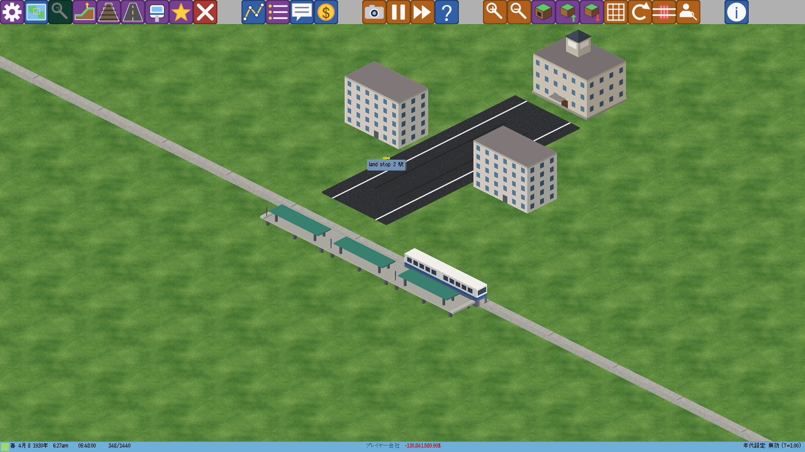

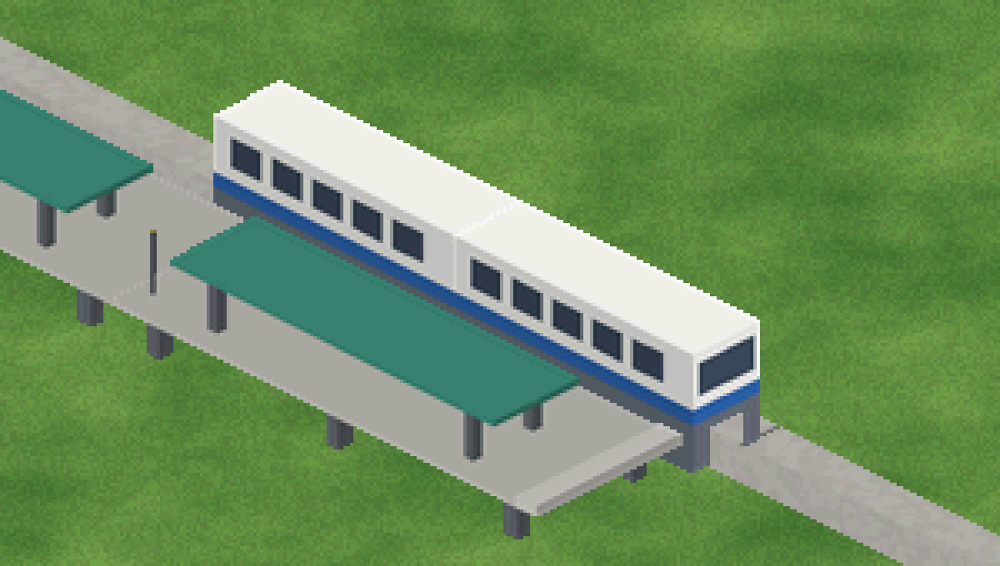

高架を走る 1 両と、高架の上の駅・車庫。

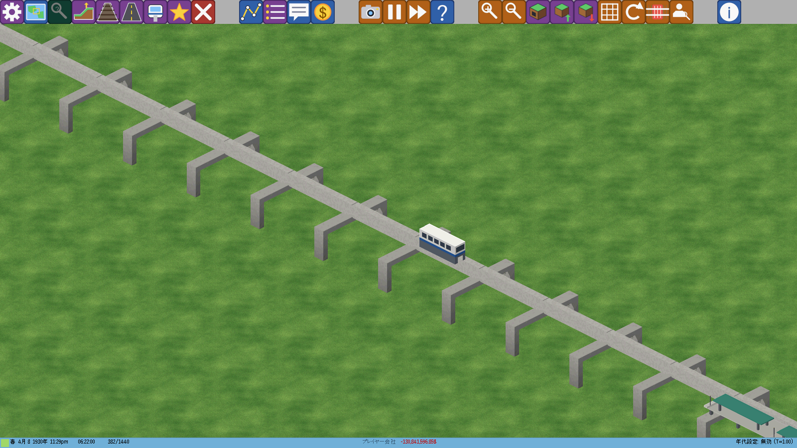

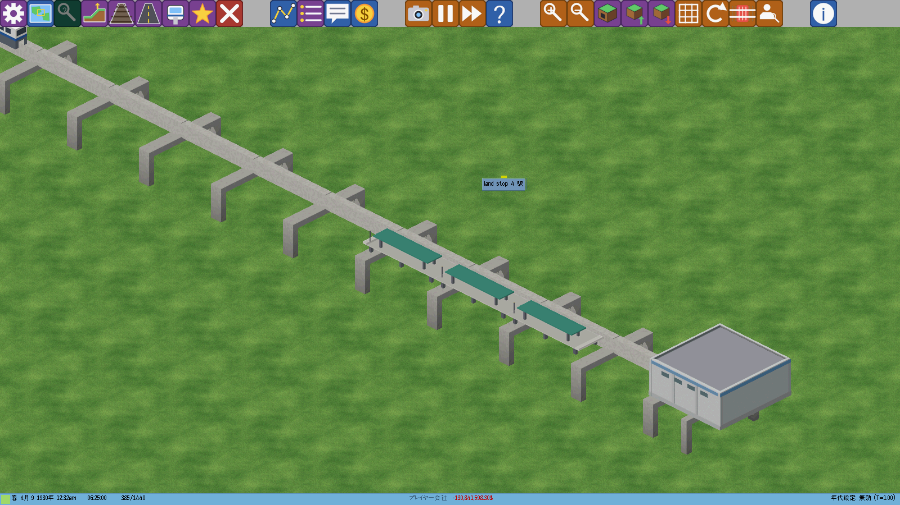

トンネルの東の口から出る 2 両。

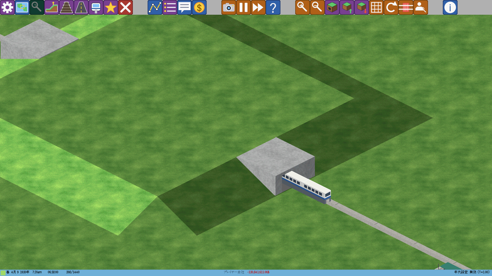

ツールバーと財務の窓。

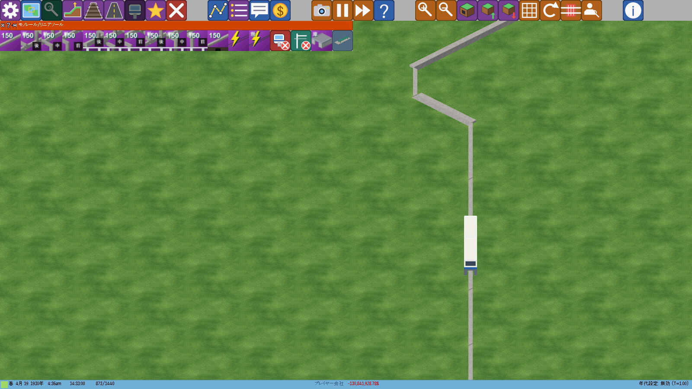

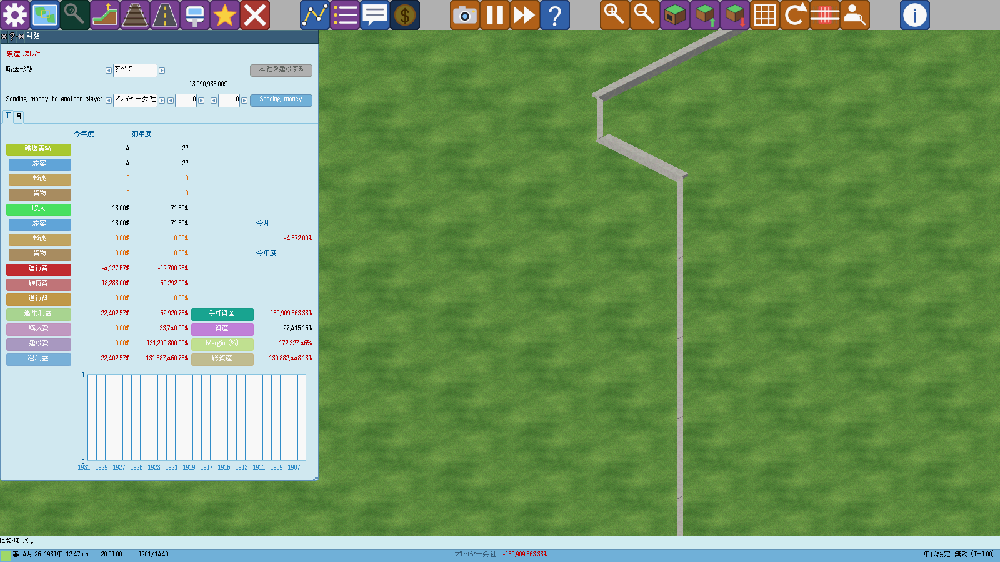

南北の駅、直角の曲がり、斜め。

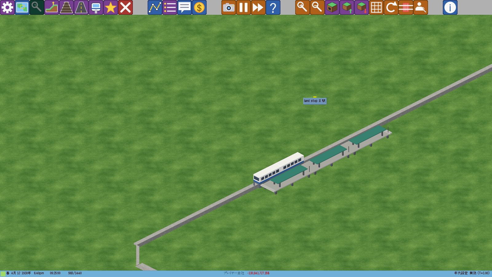

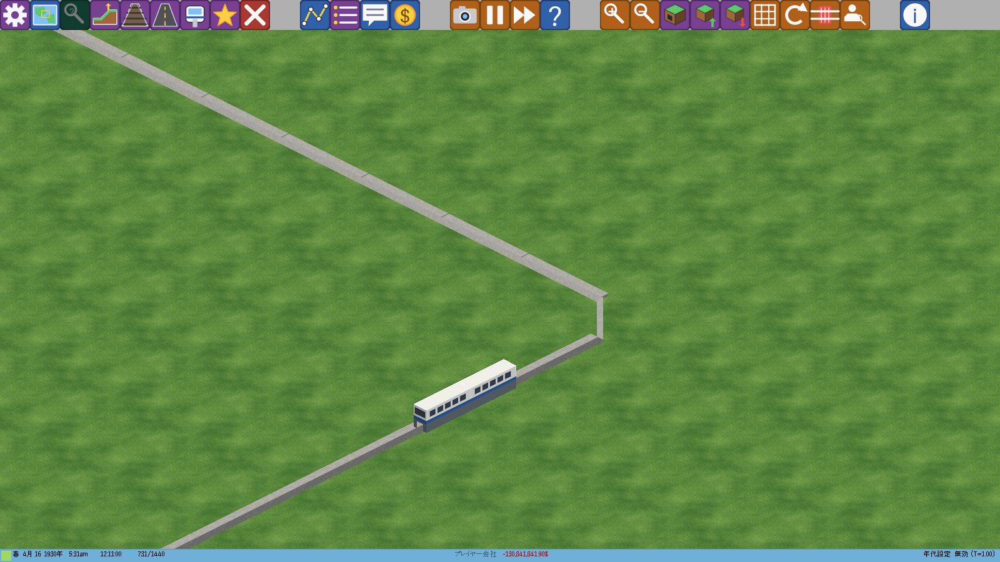

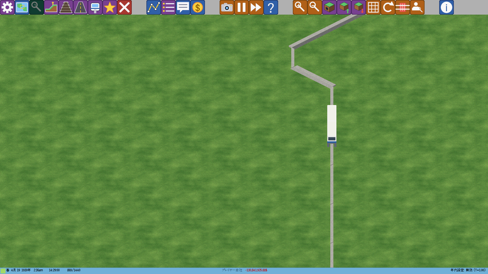

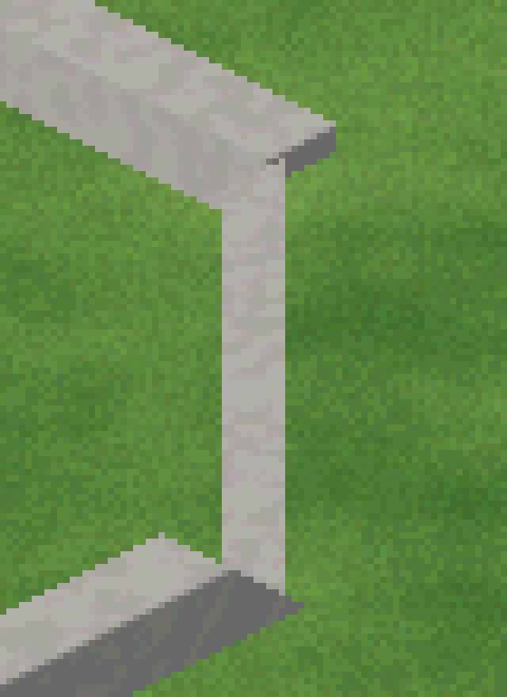

## 気づいたこと（直していない）

- 直角の曲がりの角は、AMI の斜めの絵の細い縦の桁でつながる。軸の向きの桁の端が、つなぎ目の外へ少し出る（上の拡大）。AMI の側の絵。
- 高架と地上の軌道をつなぐ形は作っていない（高架の線は、駅と車庫を高架の上に置いた）。
- 坂を走る車両、懸垂式の軌道の上の見え方、降雪の気候、右側通行、本家 125.0.1、保存と読み込みは確かめていない。
- モノレールの信号と橋は、pak256 にも AMI にも無い。
