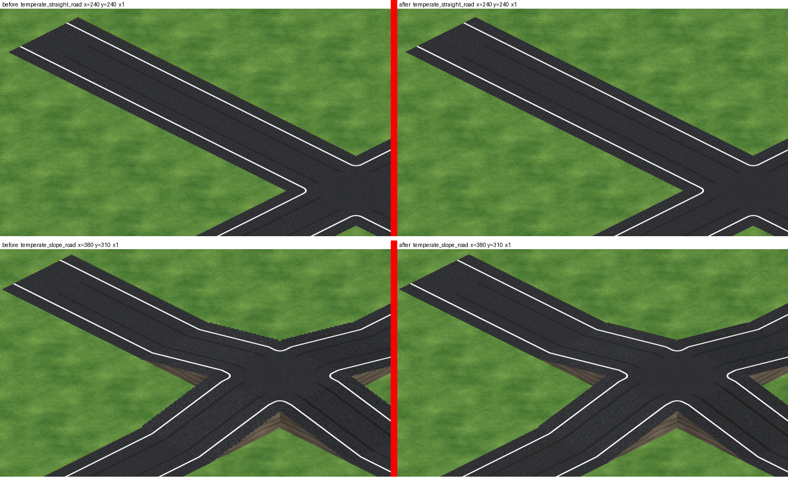
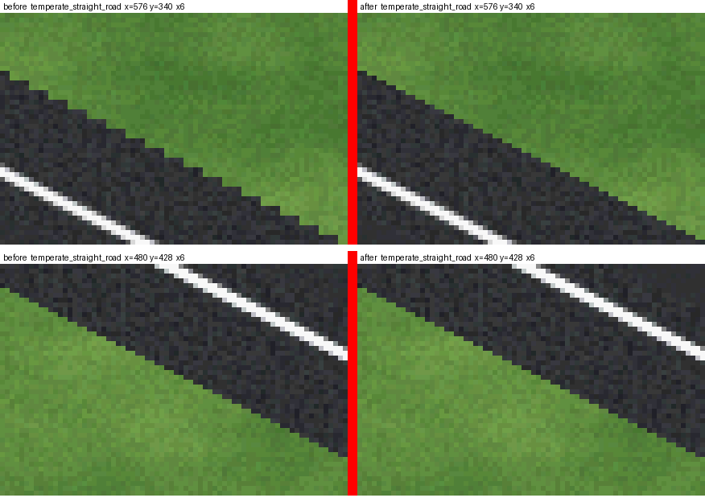
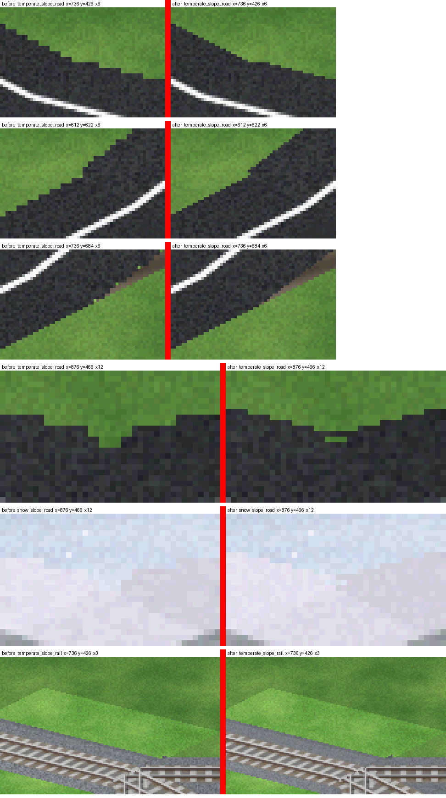
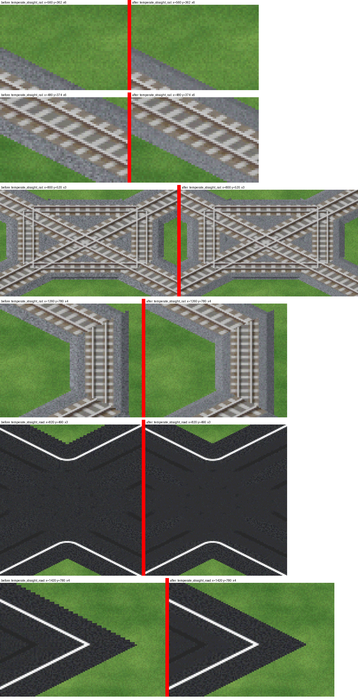
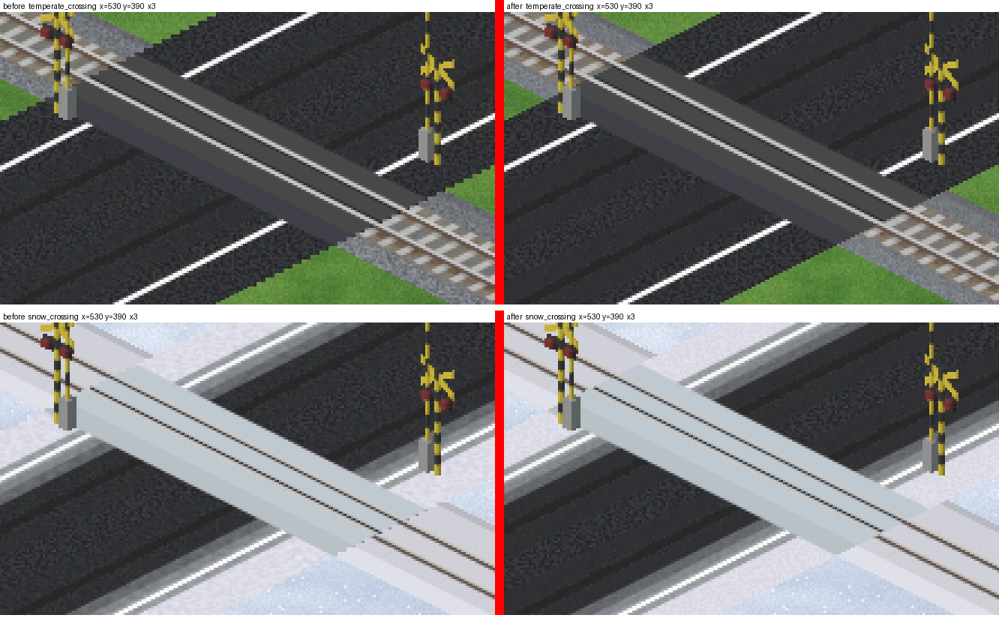
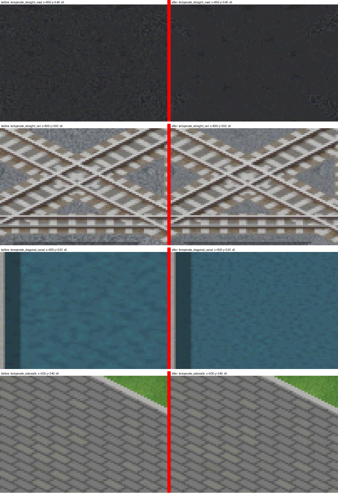
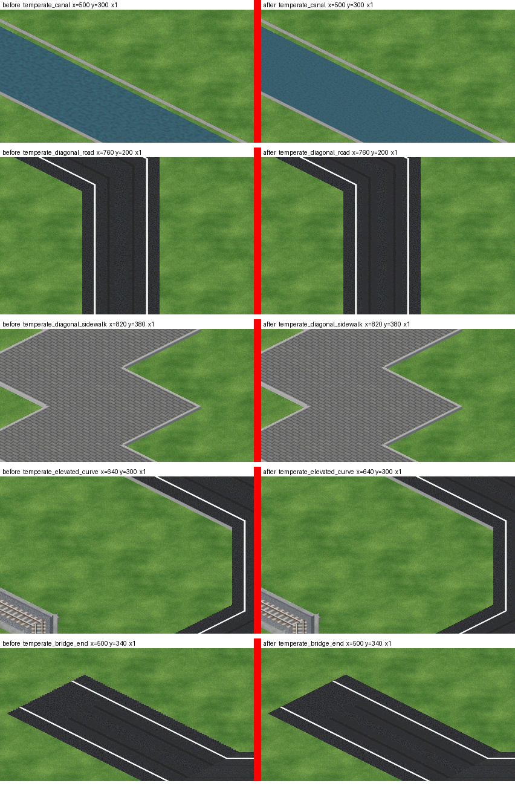
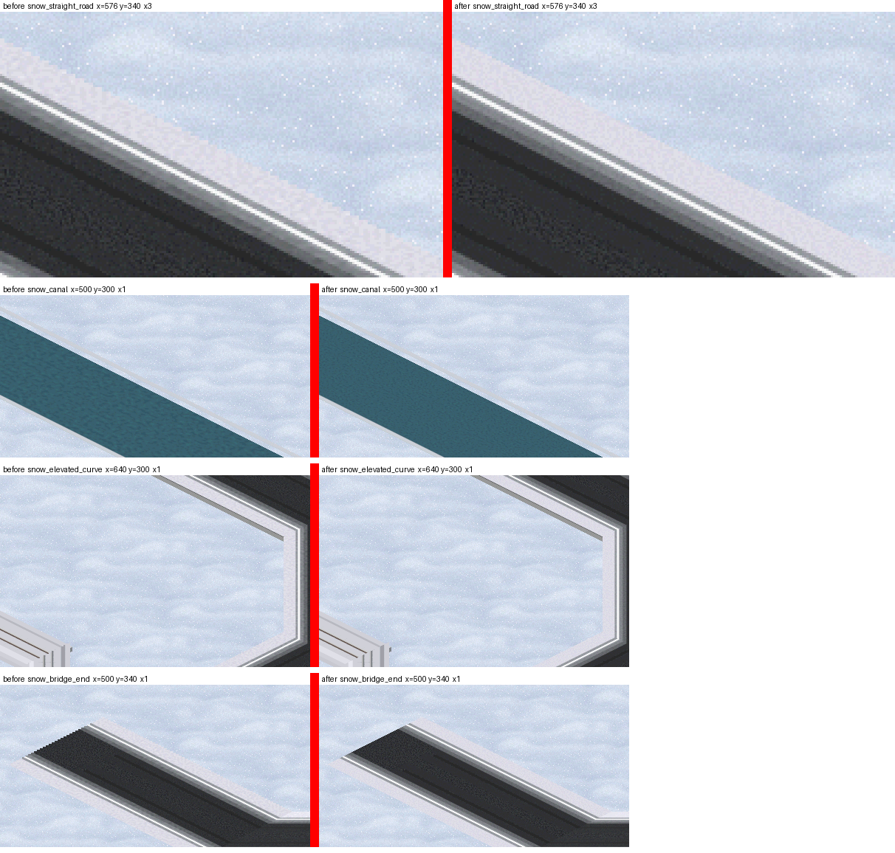

# 道の縁の段の直し（AMI 256 版 alpha.6）の確かめ（2026-11-26）

[#111](https://github.com/128-bit-net/pak256/issues/111)。道路の直線の奥の縁が横 4px・縦 2px の階段に見えていた。原因は、AMI の描画の道具が 256 の持ち分マスク（タイルの地面の範囲。道の絵をこの形で切る）を pak128 の大きさで作って 2 倍に拡大していたこと。AMI の側で直し（AMI #321・#322）、そのコミット `5d01ad8` から 256 版 `ami-256-alpha.6` を組んだ。

## 組みと検査

- `tools/build_ami256.py build --version alpha.6` は全部の段を通った（描画 213 対象。うち 5 対象は 1 回目に失敗し、道具の描き直しで通った: 道路のトンネル 3 つと `ami_wall_road_back`・`ami_wall_rail_old_twin_catenary_back`）。
- `check_way_edges.py`: 4784 セルを調べ、問題 0 件。直す前の形（AMI `0b69844` の 20 対象・1025 セル）では 1804 件で落ちた（[issue のコメント](https://github.com/128-bit-net/pak256/issues/111#issuecomment-7181458093)）。
- `compare`（alpha.5 と）: pak の名前と数は同じ。物の違いは `ami_road.pak` の `ami_road_bus_stop`・`ami_road_truck_stop` が無くなったことだけ（AMI #305。[stations.md](../stations.md)）。

## 撮り方

OTRP v64（`addon_check` の写し）、`flat_512_left_v64`、昼、`gui.set_zoom(3)`（等倍）。pak256 の側は同じで、AMI だけを alpha.5（前）と alpha.6（後）にした。[scene.py](2026-11-26_road-edge-screens/scene.py) で、温暖（原点 60,60）と降雪（原点 316,60。敷いた後に降雪に塗る）に同じ見本を敷き、[compare.py](2026-11-26_road-edge-screens/compare.py) で切り抜いて左（前）・右（後）に並べた。画像の見出しの `x`・`y` は画面（1600x900）の画素。

| 画面の名前 | 見る所のタイル（原点からのずれ） |
|---|---|
| `straight_road` / `straight_rail` / `diagonal_road` / `diagonal_rail` | (4,0) / (4,8) / (14,0) / (14,8) |
| `slope_road` / `slope_rail` | (3,18) / (12,18) |
| `canal` / `sidewalk` / `diagonal_canal` / `diagonal_sidewalk` | (4,28) / (16,28) / (9,28) / (21,28) |
| `crossing` | (5,36) |
| `elevated` / `elevated_curve` | (5,44) / (9,45) |
| `bridge` / `bridge_end` | (5,54) / (2,52) |

## 結果

- **直線道路の奥の縁**: 前は横 4px・縦 2px の段、後は横 2px・縦 1px の段。手前の縁は前から 2px の段に見える（手前のタイルの地面が上から描かれるため、という読み）。
- **道路どうしの継ぎ目（平ら）**: タイルの境をまたぐ範囲（下の 2 枚目の 3 段目。`straight_road` の原点からのずれ (4,0) より西の直線で、画面の幅 160px はタイル 1 枚の辺より長い）で、縁の段は途切れずに続き、境に草の線は出ていない。

- **坂の継ぎ目**（上から: 平らと坂の境の奥の縁、手前左の坂の継ぎ目、手前の坂の側面、台の上の十字の奥の角）: 段は 2px になり、前に坂の側面に出ていた草の点は無くなった。
  - **残った崩れ 1**: 1 段の台の上の十字の奥の角に、道路の中へ離れた草が横 4px・縦 1px 出る（4 段目の右。前は同じ所が下へ尖った草の切れ込みだった）。5 段目は降雪の同じ所で、雪の上では見分けにくい。
  - 手前左の継ぎ目には、縁に 1 画素の出っ張りが残る（2 段目の右）。
  - 6 段目は線路の坂の継ぎ目。小さな点が前後とも同じ所にあり、この版の変化ではない。
  - 直さない理由: どちらも AMI の絵（持ち分マスク・坂の絵）の側で、pak256 では直せない。原因は調べていない。AMI に起票するかは、利用者の見た目の確認の後に決める。

- **線路・十字路・曲がり**（上から: 線路の直線の奥の縁・手前の縁、線路の十字、線路の曲がり、道路の十字、道路の曲がり）: 道路の曲がりと十字の奥の縁は 4px の段から 2px の段になった。線路のバラストの縁は形そのものの縁で、前から 2px の段で、前後で変わらない（階段が出るのはマスクで切れるタイルの境だけで、隣のタイルに隠れる）。切り抜いた範囲に新しい崩れは見えない。

- **踏切**: 道路の縁の段は直った。降雪の踏板の右の端にあった点々は無くなった。

- **模様の粒**（AMI #311。上から路面・バラスト・運河の水・歩道。左が alpha.5）: 運河の水の模様は前より細かくなり、まとまった波が目立たなくなった。路面の粒もわずかに弱く細かい。バラストと歩道は違いが分からない。細かすぎるかどうかは利用者の判断にする。

- **運河・斜めの道路・斜めの歩道・高架の曲がり・橋の端**: 橋の端の奥の縁の段は直った。斜めの縁（画面で縦・横の向き）と歩道・運河の岸の形は前と変わらず見え、切り抜いた範囲に前と違う崩れは見えなかった。線路の高架の曲がりの端に離れた小片があるが、前も同じ（この版の変化ではない）。

## 確かめていないこと

- 道路は `ami_road_local`、線路は `ami_rail_ballast`、橋・高架はその 2 種、歩道は `ami_sidewalk`、運河は `ami_canal` だけを撮った。ほかの道の種類は `check_way_edges.py` の検査だけ（橋・高架・トンネルの絵は検査の対象外）。
- 2 段の坂、右側通行、トンネルの口、車庫、路面軌道、モノレール。
- 道路のツールバー（AMI の停留所が消えたこと）は撮っていない。
- 直す前の版の保存データを alpha.6 で読むこと。
