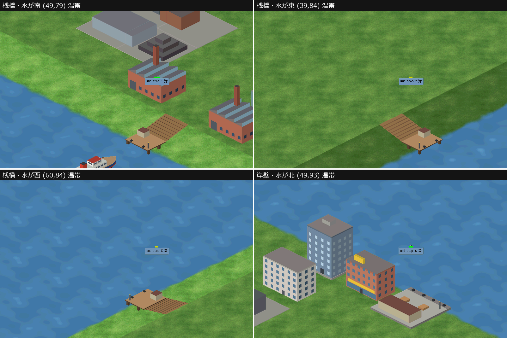
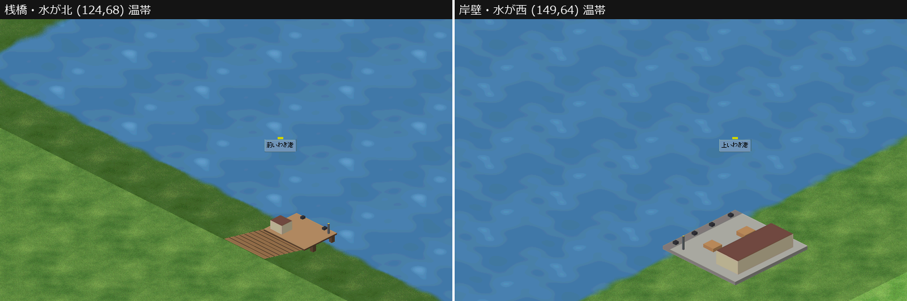
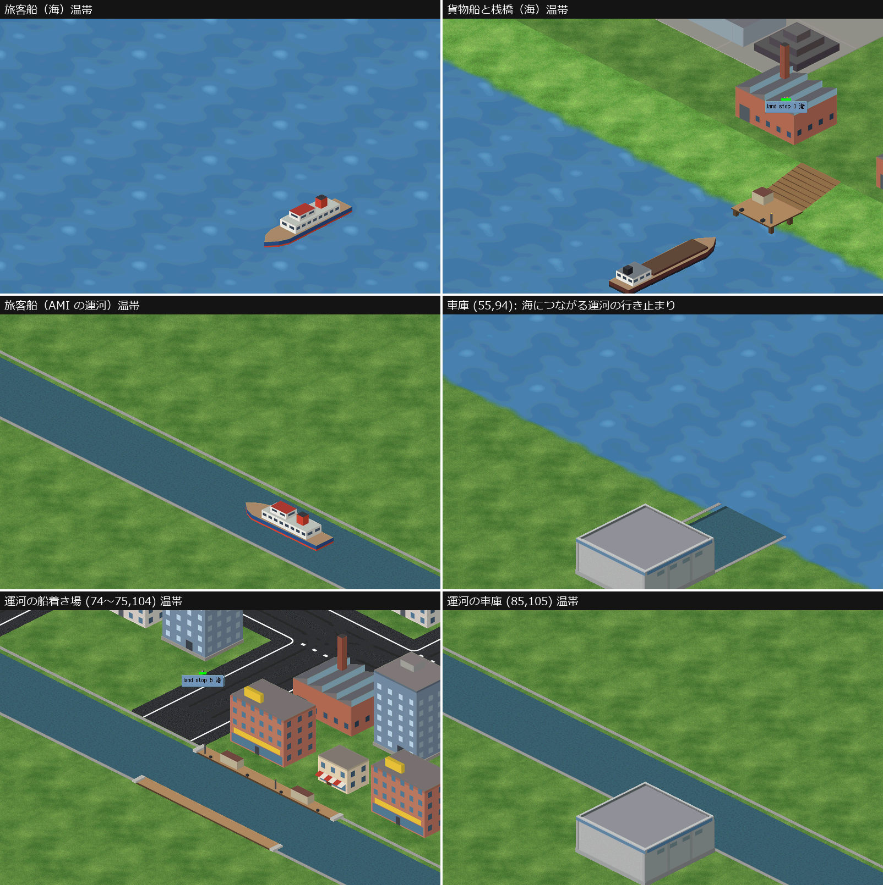
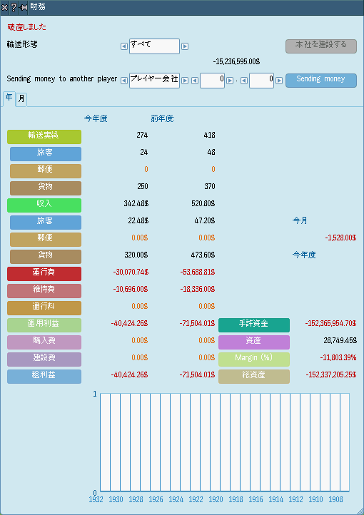
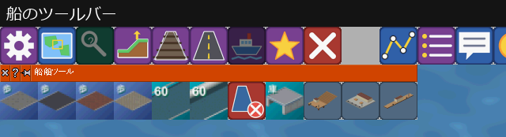

# 2026-11-26 船と港を入れた確かめ（#154）

環境: OTRP v64（`sim-WinGDI64-OTRPv64.exe`）、保存データ `flat_512_left_v64`（温帯の所）、`tools/game.py`（MCP のポート 47920）、AMI の 256 版は `ami-256-alpha.7`。流したスクリプトは `tools/vehicle_check/ship.nut`（開いたままのゲームに `--send-file`）。

## AMI の 256 版にある物

`ami_canal.pak` に運河 `ami_canal`・`ami_canal_scenic` と船の車庫 `ami_canal_depot`、`ami_extra.pak` に運河との踏切と、`waytype=water` の歩道 `ami_sidewalk*`（`ami_pier_*` は路面軌道の橋脚で港ではない）。港・船・川の物は無い。どちらの pak も配布の zip に入る。

## 置けた物

- 海: 地面を 1 段掘り、水位を -1 にして作った。南の岸は掘り足して水面と同じ高さの平らな土地にした。
- 桟橋は水が南・東・西の坂（(49,79)・(39,84)・(60,84)）と、別の池の北の坂 (124,68) に建った。岸壁は水が北 (49,93)・西 (149,64) の平らな岸に建った（別の池の 2 つは `ship_ports.nut` で作る）。**岸壁の水が南・東の向きは確かめていない**（その形の岸をスクリプトで作れなかった）。
- 運河の船着き場は AMI の `ami_canal` の上に 2 升ずつ。船は両脇の板の間を通った。
- 車庫（`ami_canal_depot`）は、陸の運河の行き止まりと、海につながる短い運河の行き止まりに建った。水の升に直に置くと、**岸に接した升には建ち、四方が水の升には建たなかった**（`command_x.build_depot` を 11 升で。辺 (45,80)・(55,91)・(40,84)・(59,84)、角 (40,80)・(59,80)・(40,91)・(59,91) は建ち、(50,81)・(41,86)・(50,86) は「Depots must be built on flat dead-end way tiles!」。海は x 40〜59、y 80〜91）。岸に直に置いた車庫から船を出すところは確かめていない（画面の車庫と船は短い運河の形）。
- ダイヤの行き先は港の升でなく手前の水面の升（(49,80)・(49,92)）。港の升を指すと `change_schedule` が「less than two entries remained」で断った。
- 旅客は、停留所の届く範囲に街の建物が無いと乗らなかった。住宅を脇に置いて確かめた。

## 運べた・お金が回った

`ship.nut` を流して実時間 250 秒（速さ 64）進めた後の財務の窓。前年度に旅客 48・貨物（石炭）370 を運び、収入は旅客 47.20、貨物 473.60。運行費と維持費はそれを上回り赤字（値の釣り合いは後で見直す）。「破産しました」と資金の大きな赤字は、保存データの会社の資金が最初から -1.3 億なため。

財務は会社の合計で、運河の旅客船の分は切り分けていない。運河の旅客船が旅客を乗せたことは、同じ回の 2 つの船着き場の `halt_x.get_departed()`（今月・前月・前々月）が 0・0・1 だったことで見た（少ない）。

## ツールバー

船のツールバーを道路の右に足した。`ways(3,0)` は水の道を全部並べるので、AMI の歩道 4 種（`waytype=water`）が運河より前に出る。

## 確かめていないこと

- 川（pak に川の物が無く、`simuconf.tab` に `river_type` も無いので、地図に川ができない）。
- 岸壁の水が南・東の向き、本家 125.0.1、雪の気候、右側通行の地図。
- 船の曲がり・斜めの進路・すれ違いの見え方（直線と、画面に出た向きだけ見た）。
- ツールバーから実際にクリックして置く操作（置くのはスクリプトで行った）。
