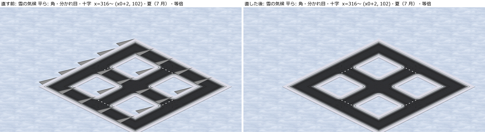

# 雪の街の道路の灰色の三角（2026-11-26）

[#136](https://github.com/128-bit-net/pak256/issues/136)。雪の気候の歩道つきの道路に、灰色の細い三角が出た。

## 原因

`Sidewalk` の番号の並びが本体と違っていた。本体（OTRP の `boden/boden.cc` の `boden_t::calc_image_internal`）は、道の乗る坂の番号（0・3・6・…・24）を起点に、+0 を通常、+1 を雪、+2 を雪線のすぐ下の坂の絵に引く。pak256 は坂の絵を 0〜14 に詰めて置いていたので、雪の平らなタイルが 1 番（隅が 1 つ上がった坂）を引き、上がった隅が三角に見えた。並びの決まりは [gui.md](../gui.md) の「坂の番号」。

## 直したこと

`objects/gui/draw_gui.py` の `build_sidewalk` で、番号 + 0 に夏の絵、+1 に同じ形の雪の仮の絵（薄い青灰）を置き、+2 は空きにした。夏の絵の画素は変えていない。`TunnelTexture` は本体が +0 だけを引く（`tunnelboden.cc`）ので、絵と番号は変えていない。検査は `tools/test_gui.py` の `test_sidewalk_numbers`。

## ゲームでの確かめ

OTRP v64（`sim-WinGDI64-OTRPv64.exe`）、保存データ `flat_512_left_v64`、AMI の 256 版は `ami-256-alpha.6`。道路は街の道路の道具（`tool_build_cityroad`）で敷いた（歩道つき）。夏（7 月）、等倍。温帯は x=60〜、雪の気候は x=316〜 の同じ並び（平らな格子は y=100〜104、1 段の台地は (x0+2, 130)）。スクリプトは [scene.py](2026-11-26_sidewalk-snow-screens/scene.py)（直す前と後の build で 1 回ずつ流した）と、並べて画素を数える [compare.py](2026-11-26_sidewalk-snow-screens/compare.py)。

| 場所 | 直す前と後 |
|---|---|
| 雪・平ら（角・分かれ目・十字） |  |
| 雪・台地と坂 |  |
| 温帯・平ら |  |
| 温帯・台地と坂 |  |

- 雪の気候: 直す前は、平らな所・台地の上・4 向きの坂に灰色の三角が出た。直した後は、撮った 6 場面に三角は見えない。
- 温帯: 6 場面とも、直す前と後で画素の違いは 0（上の道具の帯と下の状態の行を除いた範囲）。
- 雪の道路のタイルの境目に薄い点線がある。直す前の画像にも同じ位置にあるので、この変更の外（原因は調べていない）。

## 確かめていないこと

- 雪線のすぐ下の坂（番号 + 2 を引く所）と、冬に雪線が下がる温帯の高い土地は撮っていない。直す前はここも別の坂の絵を引く並びだった。直した後は空きなので、本体の読みでは夏の絵になる。
- 複段の坂（番号 15〜24）はゲームで撮っていない（並びは検査で見る）。
- 本体は OTRP だけを読んだ。本家 125.0.1 の並びは読んでいない（pak128 の `sidewalk.dat` が同じ 3 つ刻みなのは確かめた）。
- トンネルの中（`TunnelTexture`）は撮っていない。

## 道具のメモ

- 歩道は、公共のプレーヤーか街が建てた道路にだけ付く。`run_squirrel` の道具はスクリプトの中の `player_x(…)` でなく呼び出しの `player_nr` のプレーヤーで動き、`mcp_client.py` の既定は 0（`tools/game.py` は渡さない）。歩道を付けるには `--player-nr 1` で流す（`scene.py` の `sq_public`）。
- `command_x(tool_build_cityroad).work` は 4 つめに `""` を渡す。
