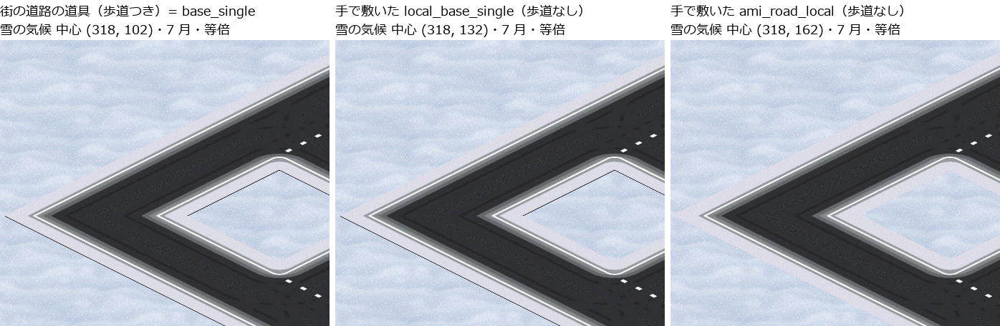
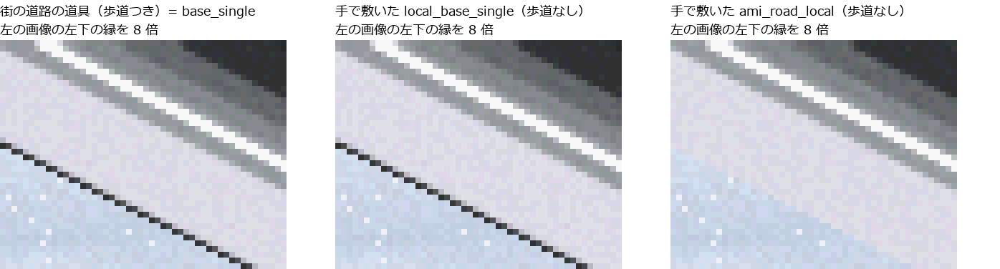
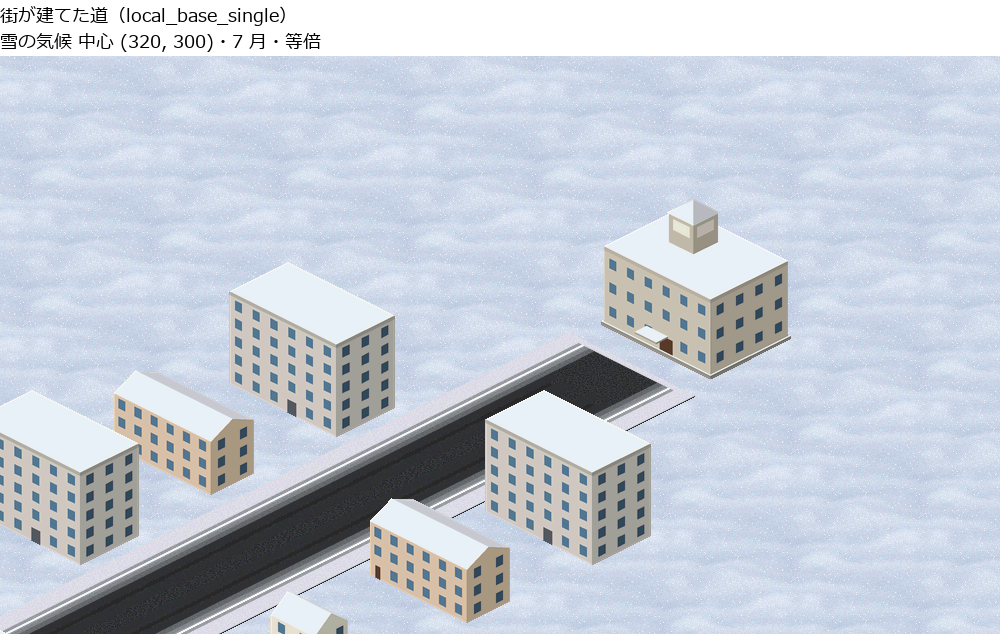
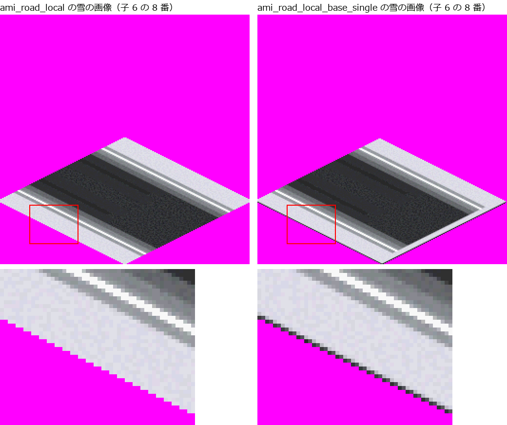
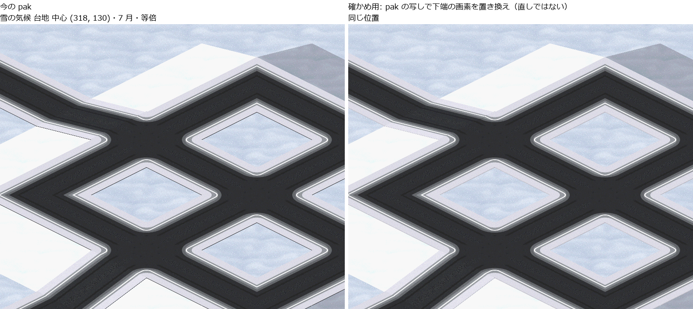

# 雪の道路のタイルの境目の薄い点線の調べ（2026-11-26）

[#141](https://github.com/128-bit-net/pak256/issues/141)。原因は **AMI の 256 版の道の絵**で、pak256 の絵・dat は変えていない。

## 結論

- 雪の画像の下の端の 1〜2 行に、路面のような暗い色が出ている。ゲームでは、タイルの下の縁に沿う 1px の暗い線になる（縮小して見ると薄い点線に見える）。
- ゲームで線を確かめたのは `ami_road_local_base_single`（出る）と `ami_road_local`（出ない）。
- pak の画像を数えると、同じ形の画像は `ami_road_<local・general・trunk・expressway>_base_*` にあり、通常の版と高架（`_elev_*`）には無い。`local_base_single` 以外はゲームで撮っていない。
- 保存データ `flat_512_left_v64` では、街の道路の道具も街が建てた道も `ami_road_local_base_single` になるので、この保存データの雪の街の道路に出る（新しい地図では確かめていない）。
- `Sidewalk`（pak256 の歩道の下の地面）と地面の絵は原因ではない。

## ゲームでの切り分け

OTRP v64（`sim-WinGDI64-OTRPv64.exe`）、保存データ `flat_512_left_v64`、AMI は `ami-256-alpha.7`（AMI のコミット `3658e5c`）。スクリプトは [scene.py](2026-11-26_snow-road-seam-screens/scene.py)。

- 歩道の有無に関係なく、way が `ami_road_local_base_single` のときに線が出る。手で敷いた `ami_road_local` には出ない。
- `Sidewalk` の雪の絵をマゼンタにした pak でも、線は同じ所に同じように出た（補足。このときの画像とスクリプトは残していない）。
- 温帯（街の道路の道具・夏）の画面では線は見えない（[#136 の温帯の画像](2026-11-26_sidewalk-snow-screens/temperate_flat.png)）。道の縁が暗い路面なので、夏の絵に同じ行があるかは画面からは分からない。

街が建てた道（`tool_add_city`。数えた way はすべて `ami_road_local_base_single`・歩道つき）:

## pak の中の画像

[pakimg.py](2026-11-26_snow-road-seam-screens/pakimg.py) で `ami_road.pak` の画像を読んだ。同じ番号の直線の雪の画像は、輪郭は同じで、`base_single` だけ下の端が暗い（下の図の赤い枠を拡大）。

「列のいちばん下の画素が暗く（RGB の和 300 未満）、すぐ上が明るい（和 500 超）」列が 30 以上ある画像の数（`pakimg.py count`）:

| way | 平らな雪の画像（36 枚中） | 坂の雪の画像（8 枚中） |
|---|---|---|
| `ami_road_local_base_single` | 18 | 6 |
| `ami_road_general_base_single` | 15 | 6 |
| `ami_road_trunk_base_single`・`_front` | 15 | 5 |
| `ami_road_expressway_base_single`・`_front` | 15 | 5 |
| `ami_road_trunk_base_back`・`_center`、`ami_road_expressway_base_back`・`_center` | 2 | 0 |
| 4 種の通常の版、`_elev_*` | 0 | 0 |

`local`・`general` の `base_front`・`base_back`・`base_center` は、この pak の way の一覧に無かった。

参考値: 128 版も、手元の AMI の `dist/ami_road.pak`（2026-11-22 の組み。元のコミットは確かめていない）を読むと、`local`・`general`・`expressway` の `base_single` に同じ形の画像があった（平らな 16 枚中 3・3・9 枚）。

## 確かめのための置き換え

pak の写しで、下の端の暗い画素をすぐ上の色に置き換えて撮った（`pakimg.py patch` と、[#136 の scene.py](2026-11-26_sidewalk-snow-screens/scene.py)）。**直しではなく、原因の場所を確かめるためのもの。**

- 暗い線は消えた。薄い灰色の点は残る。下から 2 行目も路面の色と混ざっていて、置き換えがその色を写すため。
- 温帯の平らと台地の画面は、置き換えの前後で大きく違う画素（明るさの差 40 超）が 0（`pakimg.py diff`）。

画像の組み立ては [figures.py](2026-11-26_snow-road-seam-screens/figures.py)。

## 原因の見込み（AMI の側）

確かめたのは「`base_*` の雪の画像の下の端に暗い画素がある」まで。描き方のどこで付くかは確かめていない。

- 見込み: 路肩の雪の板が下の端の 1〜2 行を覆いきらず、下の路面か基盤の色が残る。
- 見る所の候補: `base_*` の版の組み立て（AMI の `addons/ami/blender/render.py` の「地上の基盤の版」。壁の外を削る・カーブの形を変える）と、雪の板（`tools/blender/sheetlib/road_parts.py` の `SNOW_LAYERS`）。

## 別の点線（白い点線）

分かれ目のタイルの境目に、道を横切る白い点線がある。温帯の画面（[#136 の温帯の画像](2026-11-26_sidewalk-snow-screens/temperate_flat.png)）にも、上の 3 枚の `ami_road_local` にも同じように出るので、雪とは関係のない AMI の路面の絵と見ている。

#141 の「薄い点線」は、雪の気候だけに出る暗い線の方と判断した（issue が「雪の気候の道路」と書いていて、白い点線は温帯にも出るため）。起票のもとの画像で指していたのが白い点線なら、この調べの対象と違う。

## 確かめていないこと

- 暗い線が消えた確かめは、`base_single` の平らな所と 1 段の坂だけ。複段の坂、`general`・`trunk`・`expressway`、`front`・`back`・`center` はゲームで撮っていない（pak の画像を数えただけ）。
- [#136 の記録](2026-11-26_sidewalk-snow.md)の台地の画像で、坂の歩道を横切る薄い点の列も見えた。同じ下の端の画素が次のタイルに覆われきらないものと見ているが、単独では確かめていない。
- 新しく作った地図で、街の道がどちらの way になるか（`config/simuconf.tab` の `city_road` は `ami_road_local`。確かめた保存データでは `base_single` だった。保存データの設定によるのか、本体の置き換えなのかは調べていない）。
- 本家 125.0.1。
