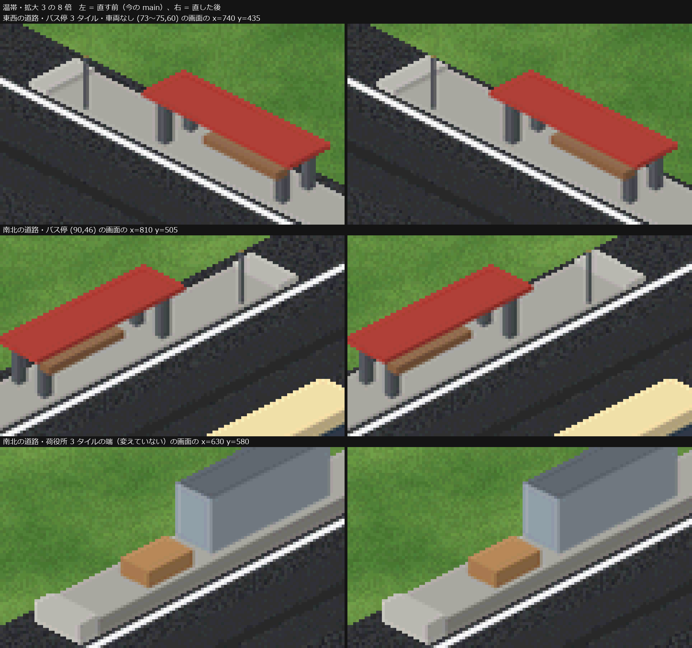
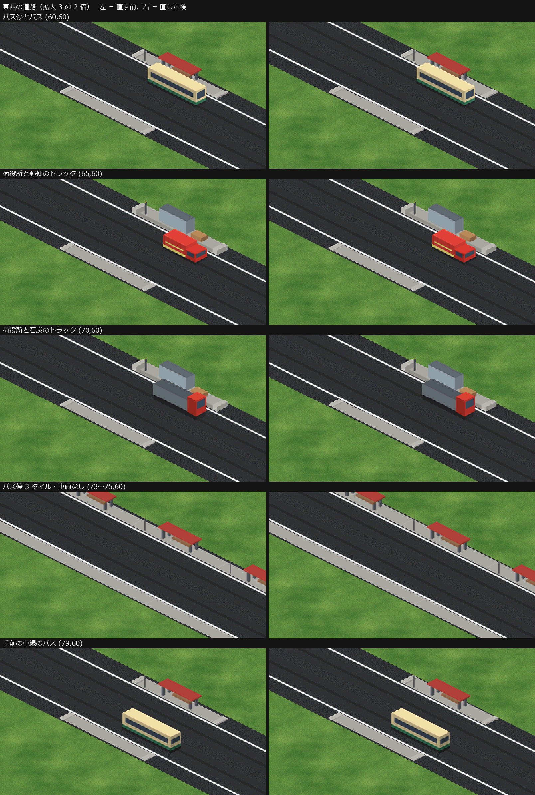
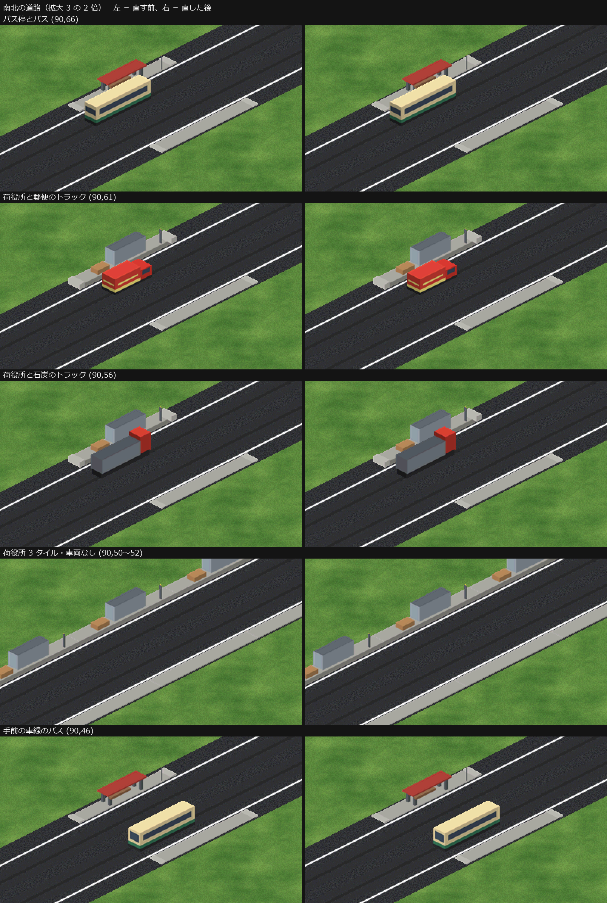

# 停留所の奥の暗い帯を細くする記録（2026-11-26）

[#139](https://github.com/128-bit-net/pak256/issues/139)。AMI の 256 版を alpha.7 に上げると（[記録](2026-11-26_ami333.md)）、道路の奥の縁が 2 行上がり、停留所の奥に残る路面の暗い帯が太くなった。OTRP v64（`addon_check` の写し）、`flat_512_left_v64`、温帯（x<256）、昼、拡大 3、停留所の名前の札は消す。

## 直し

`objects/station/road_stops/draw_stops.py`。バス停の奥の歩道（高さ 0.15m）の奥の辺を、c = 0.015 からタイルの端の c = 0 にした（`BUS_FAR`）。画面の道路の奥の縁はその先にあるので、暗い行は 1〜2 行残る（alpha.6 のときと同じくらいの太さ）。タイルの外へは出していない。内側の端（c = 0.14）、待合・ベンチ・標識の位置、手前の帯は変えない。

荷役所は、高さ 1m の積み降ろし場が奥の縁を覆い、直す前から暗い行が 0 なので、変えていない（絵も前と同じ）。

## 奥の暗い帯の行数

草の下端から、帯の灰色が始まるまでの暗い画素の行数を列ごとに数えた（傾き 2:1 の辺なので、列で 1 行ずれる）。alpha.7 の数は [count.py](2026-11-26_stop-back-screens/count.py) の出力（行数: 列数）。

| 版 | バス停 3 タイル（`ew_empty`） | 荷役所 3 タイル（`ns_empty`） |
|---|---|---|
| alpha.7・直す前 | 2: 1、3: 78、4: 78 | 0: 132 |
| alpha.7・直した後 | 0: 2、1: 78、2: 77 | 0: 132 |

alpha.6（停留所は直す前の絵）は、同じ撮り方でなく、[ami333 の画像 5](2026-11-26_ami333-screens/5_stop_back_edge.png) の左（8 倍の図の上の段）から数えて 0〜2 行（同じ図の右の alpha.7 は 2〜4 行）。

白線は、[lines.py](2026-11-26_stop-overlap-screens/lines.py) で車両なしの画面を数えて、直す前後とも東西 399/400・南北 400/400 の列で 2 本がそのまま（残りの 1 列には、2 本とは別の 1px の明るい画素がある）。

## 画面

撮り方は #115 と同じ [run.py](2026-11-26_stop-overlap-screens/run.py) と [compare.py](2026-11-26_stop-overlap-screens/compare.py)（直す前の pak と直した後の pak で 2 回流す）。8 倍の図は [zoom.py](2026-11-26_stop-back-screens/zoom.py)。

8 倍（左 = 直す前、右 = 直した後）:

東西の道路:

南北の道路:

見た点:

- バス停は、東西・南北とも、奥の暗い帯が細くなった。直す前後で色の変わった画素に、直す前が草の画素は無い（8 場面の画面を比べた。コンクリートが草に出ていない）。
- 単独・3 タイル続きの継ぎ目・端の縁は、切れ目や段が無い。
- 荷役所は前後で変わらない。
- 車両を停めた絵（バス・郵便・石炭のトラック）、手前の車線のバスの重なり方も前後で変わらない。

## 確かめていないこと

- 雪の気候、坂、地下の停留所、拡大 3 以外。
- `ami_road_local` 以外の道路の種類。
- 道具の絵（後ろの絵から作るので、バス停の帯が少し広くなる）のゲーム内の見た目。
- 残る 1〜2 行も無くす形（帯をタイルの外の c = −0.012 ほどまで伸ばす）は、描いていない。
