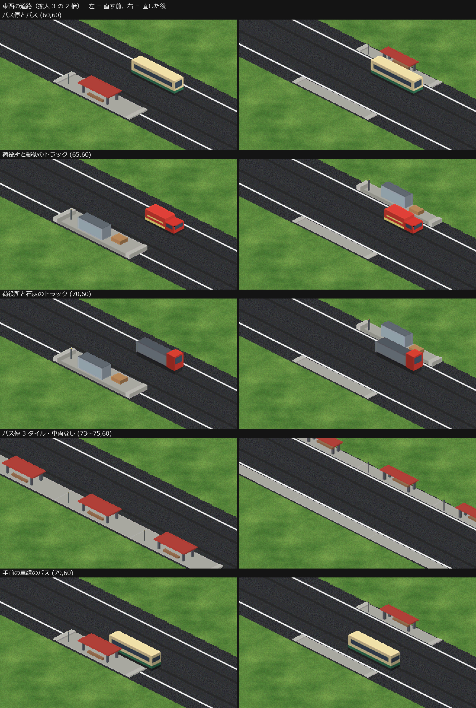
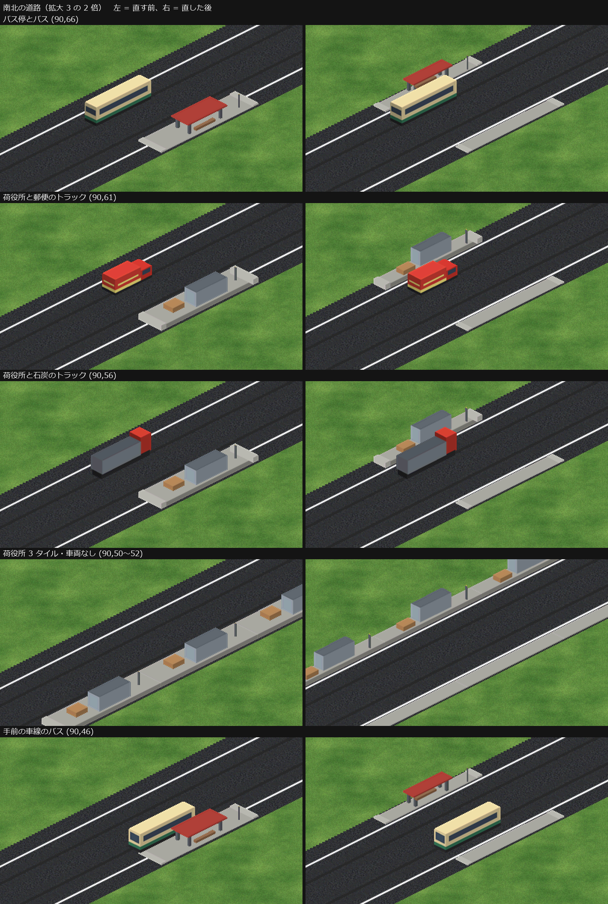

# 停留所の歩道と待合を白線の外へ移した記録（2026-11-26）

[#115](https://github.com/128-bit-net/pak256/issues/115)。縮尺の見比べ（[記録](2026-11-26_scale-check.md)）で、pak256 のバス停・荷役所の歩道と待合が AMI の生活道路の白線の上に重なっていた。OTRP v64（`sim-WinGDI64-OTRPv64.exe`）、保存データ `flat_512_left_v64`、温帯（x<256）、`tools/game.py`（昼夜は止める。`gui.set_zoom(3)`、停留所の名前の札は消す）。

## 原因

停留所の絵は、道路の幅を約 9m（c = 0.33〜0.67）と見て c = 0.74〜0.98 に置いていた。実際の `ami_road_local` は舗装がタイルの端までで、白線は c = 0.156〜0.172 と 0.828〜0.844（画面の 1 列の画素で測った。東西・南北とも同じ）。帯の内側の端（0.74）が手前の白線より中央寄りだった。

## 直し

`objects/station/road_stops/draw_stops.py`。待合・小屋などの設備は奥の側（c = 0.015〜0.14。後ろの絵）、手前の側（c = 0.86〜0.985。前の絵）は低い歩道の帯だけにした。手前に屋根や小屋を置くと、足元が路肩でも画面で白線に掛かるため。置き方の決まりは [stations.md](../stations.md) の「道路の停留所」。道具の絵は、奥の側の絵だけから作る。

## 確かめ

- `tools/test_stations.py` の `test_road_stops_off_the_lane_lines`: 停留所の 2 層 × 8 向きの絵の画素を地面の座標に戻し、c = 0.156〜0.844 に画素が無いことを検査する。直す前の PNG では落ちる。
- ゲーム: `python -X utf8 docs/records/2026-11-26_stop-overlap-screens/run.py <検証環境> <ポート> <撮る先>` で、東西の道路（y=60）と南北の道路（x=90）に、バス停・荷役所 2 つを置いてバス・郵便・石炭のトラックを積載の待ち 100% で停め、車両を停めない 3 タイル続きの停留所も置いた。手前の車線は、反対の端の車庫から西行き・南行きのバスを 1 台ずつ出してバス停に停めた（8 編成とも速度 0）。直す前の PNG と直した後の PNG をそれぞれ組んで同じ配置を撮り、`compare.py` で同じ位置を切り抜いて 2 倍にした。
  - 東西の道路: 
  - 南北の道路: 
- 見た点:
  - 直した後は、バス停・荷役所とも、東西・南北のどちらでも、歩道・待合・小屋が白線に掛からず、白線は端から端まで見える。
  - 3 タイル続きでは、帯は切れ目なくつながる。
  - 奥の車線に停まった車両（左側通行の東行き・北行き）の陰で、待合・小屋の下側が隠れる。屋根の上の部分は見える。
  - 手前の車線に停まった車両（西行き・南行き）は、手前の歩道の帯と重ならない。直す前は、手前の待合の屋根がこの車両に掛かっていた。
- 白線の確かめ: 車両のいない 3 タイル続きの画面で、`lines.py` が列ごとに白線を数えた（停留所の付近の 400 列。2px の白が 2 本、間隔がそのままの列）。直す前は東西 58・南北 147、直した後は東西 399・南北 400。東西の残り 1 列は、2 本とは別の 1px の明るい画素がある列で、2 本の白線はある。

## 確かめていないこと

- 手前の車線のトラック（手前の車線で撮ったのはバスだけ）。
- `ami_road_local` 以外の道路の種類の白線の位置。
- 雪の気候、坂、地下の停留所、拡大 3 以外。
- ツールバーの道具の絵のゲーム内の見た目（絵の検査だけ）。
