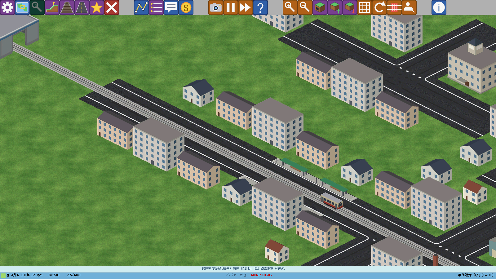
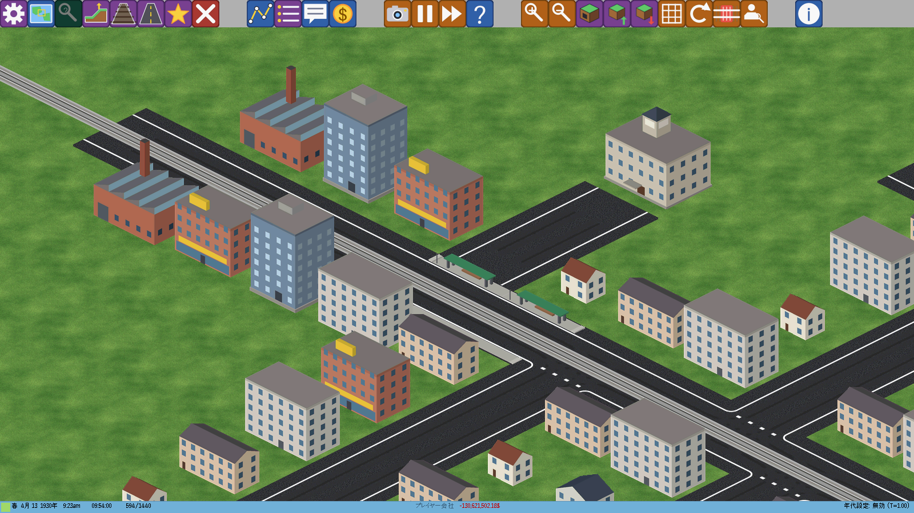
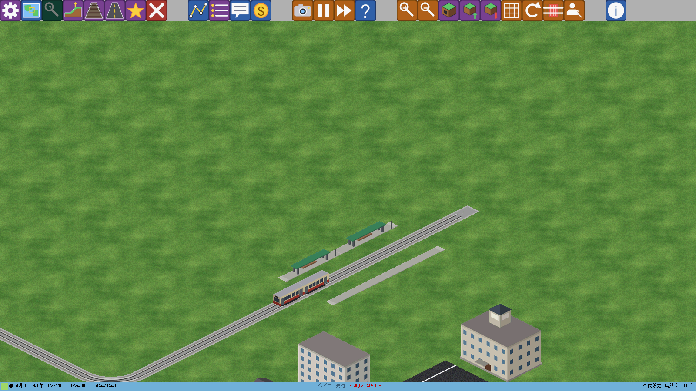
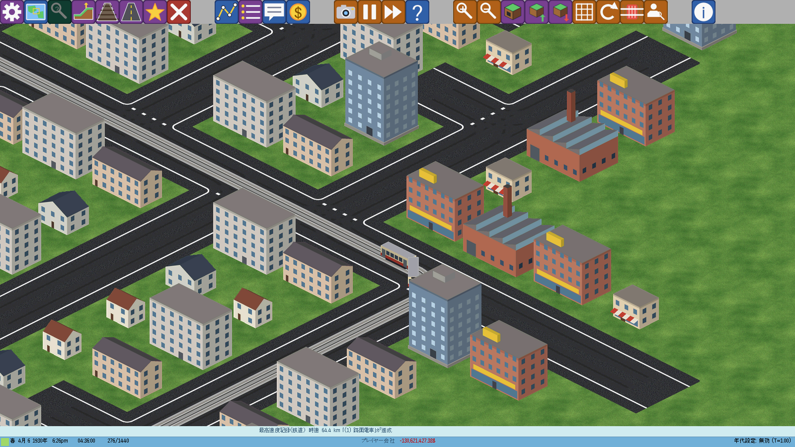
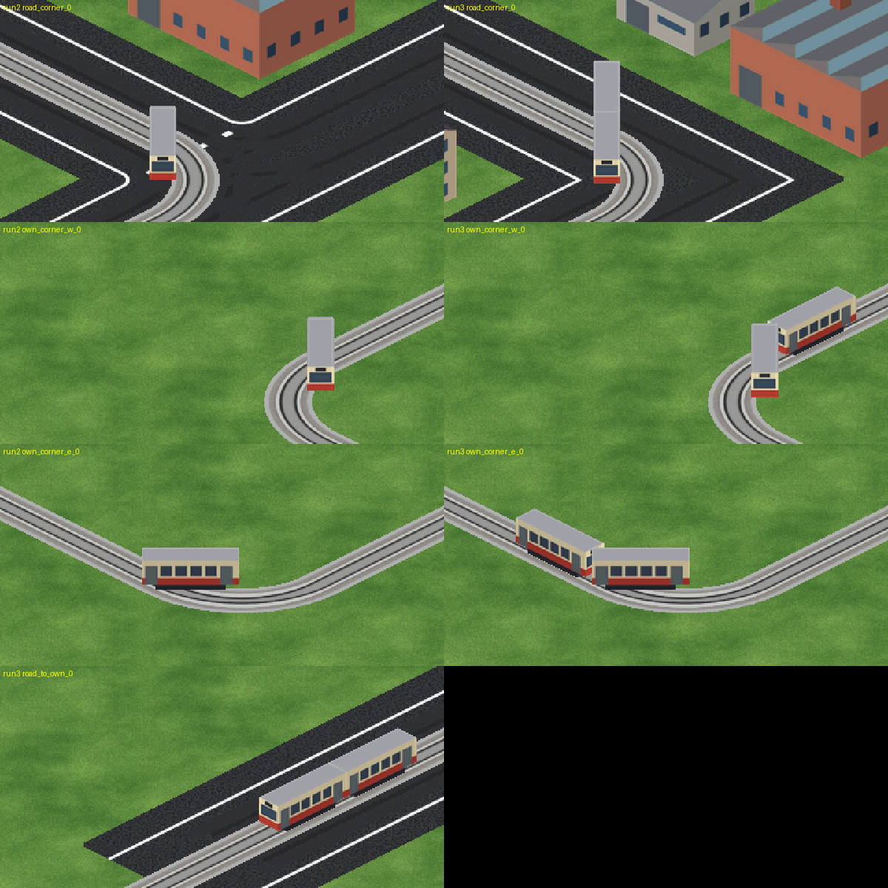
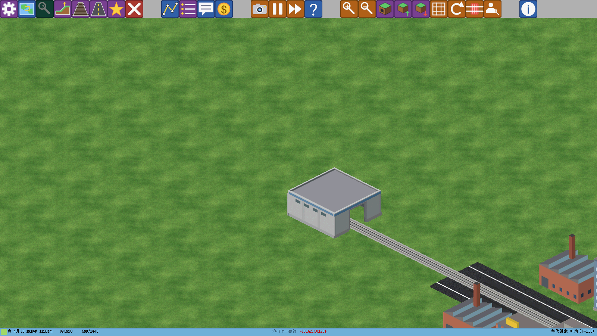
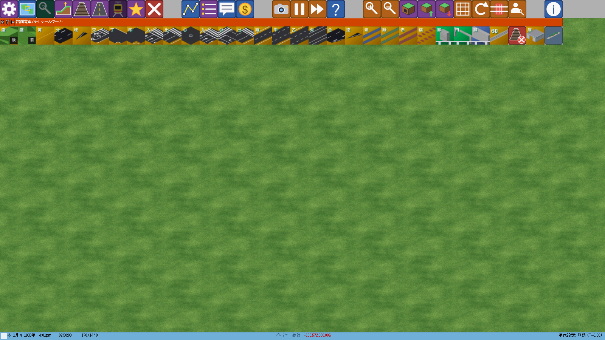
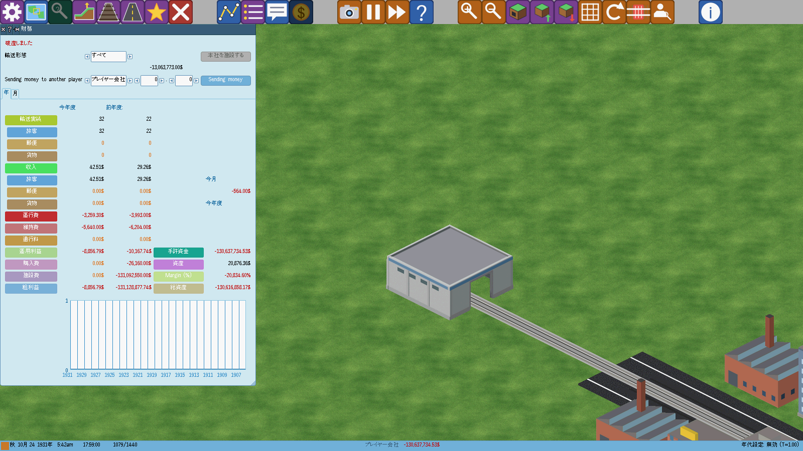

# 路面電車を入れた確かめ（#153）

2026-11-26。pak256 の路面電車（`pak256_tram`）と停留所（`pak256_tram_stop`）を、AMI の 256 版 alpha.7 の軌道 `ami_tram` と車庫 `ami_tram_depot` で走らせた。本体は OTRP v64、保存データは `flat_512_left_v64`（左側通行）。画面の夜は止めてある（`tools/game.py`）。決まりは [vehicles.md](../vehicles.md) の「路面電車」と [stations.md](../stations.md)。

## AMI の 256 版にある物

`ami_tram.pak`（配布の zip に入る 7 つの 1 つ）にあるのは、軌道の way `ami_tram`（`tram_track`・60 km/h）と車庫 `ami_tram_depot` の 2 つ。停留所・車両・架線（`tram_track` の way-object）・橋・トンネル・高架は無い。ほかに `waytype=tram_track` の way として、路面表示 `ami_mark_*`（`ami_road.pak`）・盛土（`ami_scenery.pak`）・橋脚（`ami_pier_*`、`ami_extra.pak`）がある。

## コース

`tools/vehicle_check/tram_run.py`（`tram.nut`・`tram_cities.nut`）。西の端の車庫から、道路（`ami_road_local`）の上に敷いた軌道で東へ 16 タイル、角を曲がって南へ 8 タイル、そこから土の上の専用の軌道で南へ 6 タイル・東へ 20 タイル・北へ 6 タイル。停留所は 2 タイルずつ、道路の区間と専用の区間の北向きの辺。街は 2 つを停留所の脇に置いて人口を足した（輸送で自然に育つ形ではない）。

道路の上のタイルは道路と軌道の 2 つの way を持ち（`has_two_ways() == true`）、専用の区間は軌道だけ。

## 結果

- 置ける: 軌道（道路の上と土の上）、停留所（道路の上と専用の軌道の両方）、AMI の車庫。停留所は、街の道がつながって交差になった升には置けなかった（`No through station here!`）。停留所を置いた後で街の道がつながると、待合が側道の口に重なって見える。
- 走る: 車両は軌道の中央を走る（左側通行のずれは付かない）。道路の上では道路の中央。`get_speed()` の最大は 50 km/h で表の値のとおり（本体の「最高速度記録(鉄道)」の通知には 64 前後の数字が出た。換算の違いは調べていない）。
- 運べる・お金が回る（2 両連結、1930〜1931 年）: 財務の窓で、旅客 32 人（今年度）・22 人（前年度）、収入 42.51$ と 29.26$、運行費 -3,259$、維持費 -5,640$。短い線に街が 2 つなので、収入は費用より小さい。1 両の回では旅客 44 人・収入 58.45$。街の育ち方で、旅客が 0 のまま終わる回もあった（街が停留所から離れた回）。
- 撤去: ツールバーの軌道の撤去と同じ道具（`tool_remove_way` の引数 `2`）で、道路の上の軌道を消すと道路は残り軌道だけが消えた。専用の軌道も消えた。引数 `2` は線路も撤去する道具（本体は路面軌道を線路の一種として扱う）。
- 会社の残高が大きくマイナスで「破産しました」と出るのは、保存データの会社の残高が置く前から約 -1.3 億だったため（`get_current_cash()` で確かめた）。

## 曲がりでのはみ出し

`length=7`（車体 11.6m、画面で約 79px）。AMI の路面軌道の 90° の曲がりは 1 タイルの中の丸い曲がりで、本体は角のタイルでは進む向きの斜めの絵を直線で動かすので、車体は曲線の内側へ軌道の幅の半分ほど寄る。外へは飛び出さず、道路の上では舗装の中に収まった。2 両連結では、角で 2 両の向きが違い、継ぎ目が折れ曲がらず少し重なる・開く。`length=12` 以上の車両（[#71 の記録](2026-11-25_rail-leftovers.md)）より小さく、そのまま受け入れる。坂と分岐は見ていない。

## 画面

ツールバーの画面（7）のほかは、路面電車のツールバーを足す前の pak で撮った（上の帯に路面電車の入口が無い）。車両・停留所の絵と表は同じ。

道路の区間の停留所と車両（座標 (64,60)・(65,60)、温帯）:

車両のいない道路の停留所:

専用の軌道の停留所（(96,69)〜(96,70)）:

道路の上の 90° の曲がり（(76,60)）:

曲がりの拡大（左が 1 両、右が 2 両連結。上から道路の角・専用の西の角・専用の東の角・道路から専用への境）:

車庫（(57,60)）、路面電車のツールバー（AMI の `tram_track` の way がすべて並ぶ。右の 3 つが軌道の撤去・車庫・停留所）、財務の窓:

## 確かめていないこと

- 本家 125.0.1 での動き（OTRP v64 だけ）。
- 右側通行、雪の気候・冬の絵、坂、分岐（分岐の絵と、分かれる向きの動き）、信号と複数編成。
- 道路の車両と路面電車が同じ道路を走るときの重なり。
- 停留所をツールバーから置くときのカーソル（`cursor` を書いていない）。ツールバーは開いて撮っただけで、そこからは置いていない。
