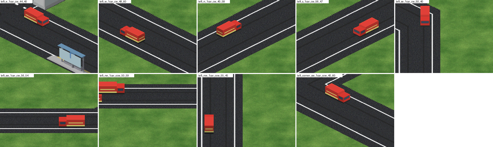
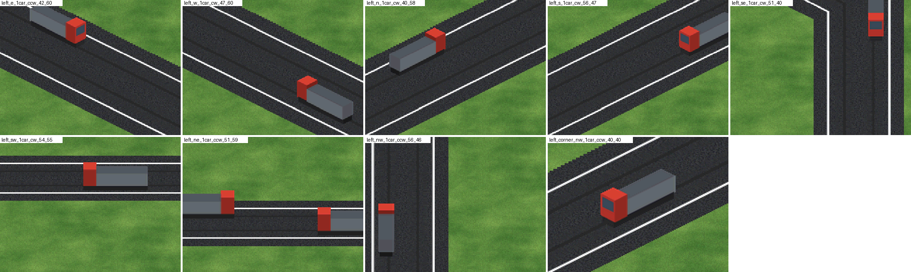
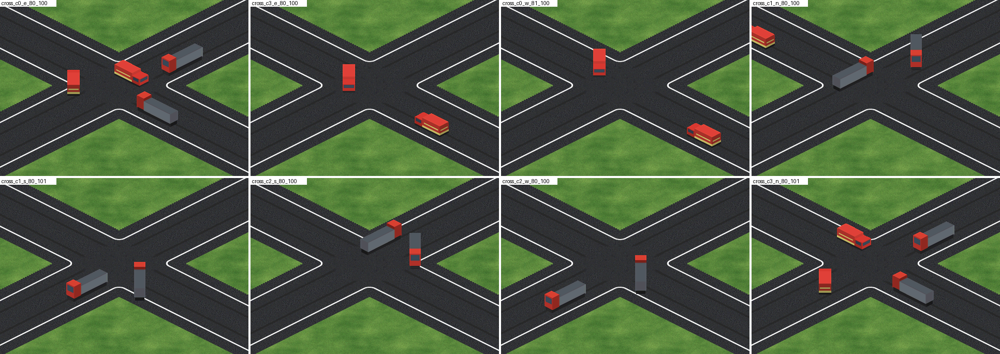
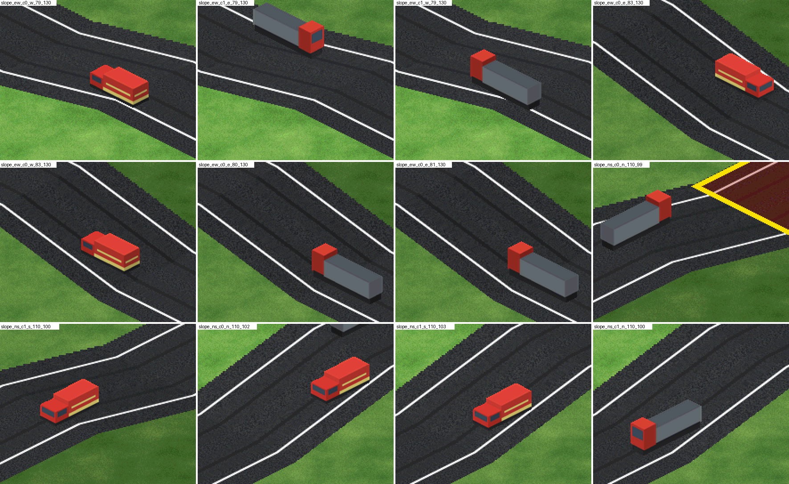
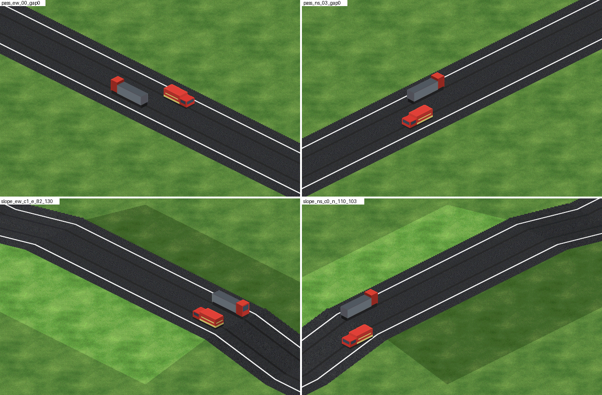
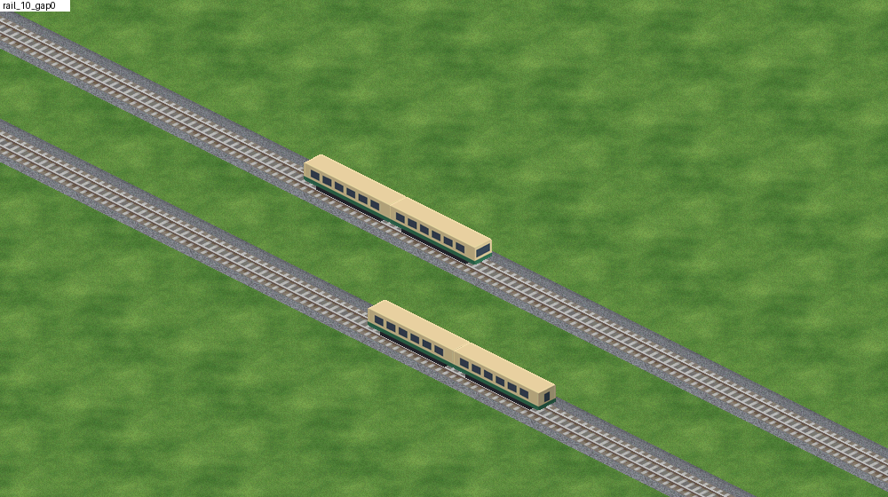
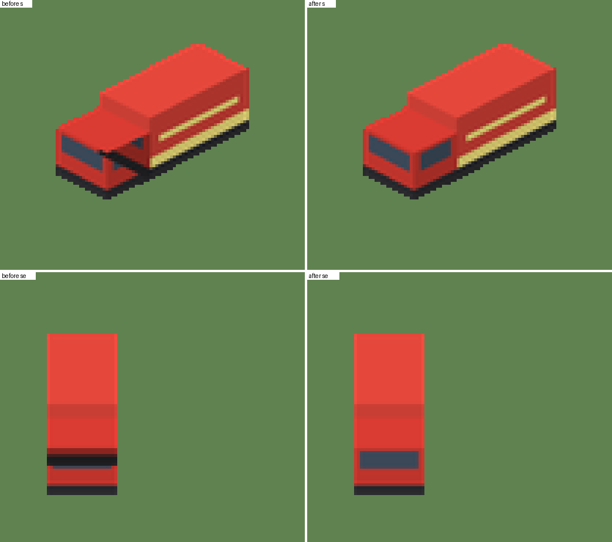

# 太くしたトラックの曲がり・十字路・坂と、編成のすれ違い（2026-11-26）

[#116](https://github.com/128-bit-net/pak256/issues/116)。[#104](https://github.com/128-bit-net/pak256/issues/104) で車両を手本の 2 倍に描き直した後、郵便・石炭のトラックの曲がりと、編成どうしのすれ違いはゲームで確かめていなかった。

## 結果

- **郵便のトラックの絵が崩れていたので直した。** 運転台が手前に来る向き（シートのセルの `s` と `se`）で、運転台の後ろの面と車輪の暗い帯が、運転台の上に塗り重なっていた（`G_mail_fix.png`）。#104 より前の絵にも同じ崩れがあった。原因は `draw_vehicles.py` の `draw_panel` が、面の向きを部分の箱でなく車体全体の中心から決めていたこと。部分の箱の中心から決めるように直し、検査（`tools/test_vehicles.py` の `test_nothing_painted_over_the_skirt`）を足した。バスは箱が 1 つなので絵は変わらず、石炭のトラックは別の描き方なので元から崩れていない。
- 直した後は、下の画面で、はみ出し（舗装の外）・車両どうしの重なり・向きの絵の誤りは見当たらなかった。

| 画像 | 中身と見たこと |
|---|---|
| `A_mail_loop.png`・`B_coal_loop.png` | 道路の輪（`tools/vehicle_check/run.py`）の 8 方向と角。車体は舗装の中。向きによって白線の上に車体が掛かるが、舗装の外には出ない（#104 のバスと同じ）。角は、郵便が `corner_sw`、石炭が `corner_nw` だけ撮れた |
| `C_cross.png` | 十字路の直進と右左折（右左折は画面で縦向きの絵）。運転台は進む向き |
| `D_slope.png` | 高さ 1 の台を越える道路（東西・南北）の坂。車体は水平のまま走る。浮き・沈みは目立たない。車体の下の角が白線に掛かる向きがある（舗装の中）。`slope_ns_c0_n_110_99` の黄色い枠は、本体のカーソルの写り込み |
| `E_road_passing.png` | 向かい合う郵便と石炭が並ぶ画面（東西・南北の平らな道路と、坂の道路）。車線が分かれ、重ならない。郵便は白線に掛かって見える向きがある（舗装の中） |
| `F_rail_passing.png` | 1 タイル隣り合う 2 本の線路で、2 編成（気動車 + 付随車）が同じ位置で並んだ瞬間。重ならない |
| `G_mail_fix.png` | 郵便のトラックの素材のセル `s`・`se`（直す前と後。5 倍） |

## 手順

1. `python -X utf8 tools/build.py` で組む。makeobj のログに `Warning`・`ERROR` は無い。
2. 曲がり: `tools/vehicle_check/run.py --vehicle pak256_mail_truck`（と `pak256_coal_truck`）。保存データ `flat_512_left_v64`（左側通行）、OTRP v64、昼夜は止めてある。
3. 十字路・坂・すれ違い: `2026-11-26_truck-curves-passing-screens/run.py <検証環境> <ポート> <出力フォルダ>`。道路と線路は AMI の `ami_road_local`・`ami_rail_ballast`。
4. 撮った全画面（拡大 3）から切り抜いて、上の画像にまとめた。

## 確かめていないこと

- 石炭を積んだ絵（`freightimage`）の曲がり・坂。ゲームでは空の荷台で走らせた（積んだ絵は素材のシートで 8 方向を見た）。
- 右側通行の地図、雪・冬、夜の見え方。拡大 3 以外。
- 郵便の `corner_nw` と石炭の `corner_sw` の角。
- 線路の曲がりと坂は撮り直していない（#104 の[記録](2026-11-26_scale-check.md)）。
