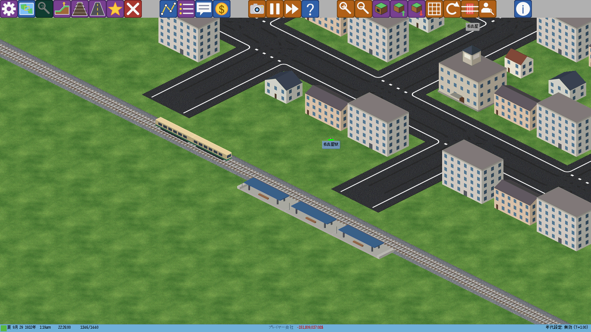
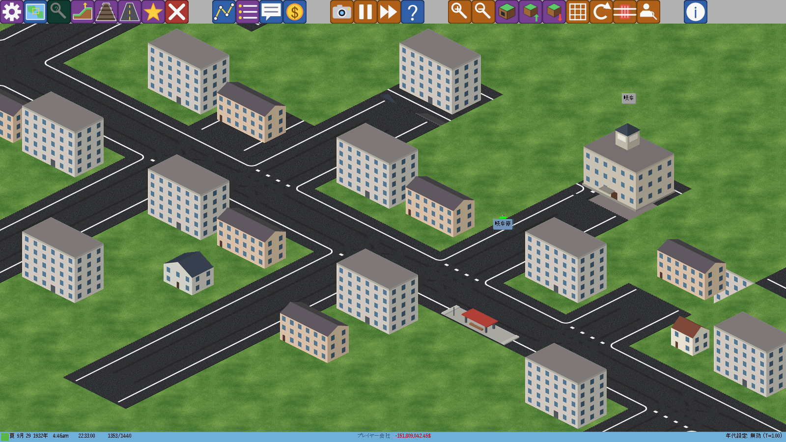
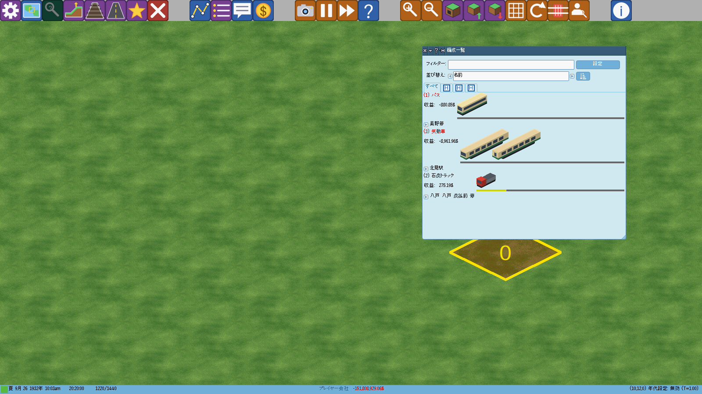

# v0.3.1 の起動・運送・保存データの互換の確かめ（2026-11-26）

[#99](https://github.com/128-bit-net/pak256/issues/99)。main の先頭（`a8fad1b`）の CI（run 45662606160）が作った配布の zip（`pak256-dev-a8fad1b.zip`。artifact `pak256-zip`）と、v0.3.0 の Release の zip（`pak256-v0.3.0.zip`）を展開し、中の `*.pak`・`ami_license.txt` と `config/`・`text/` だけで起動した（借り物なし。`Game(build=…, root=…)`。手順は [alpha03-check の 1](2026-11-25_alpha03-check.md)）。検証環境は `addon_check`（OTRP v64）、保存データは `flat_512_left_v64`、昼夜は止めてある。タグ `v0.3.1` は同じコミットに打ち、CI が作った下書きの Release の zip（`pak256-v0.3.1.zip`）を取って比べた: pak 23 個の SHA-256 と、`CREDITS.md`・`LICENSE.md`・`ami_license.txt`・`text/ja.tab` が、dev の zip と全部同じ。

## v0.3.0 → v0.3.1 の保存データの違い

pak の物の名前（保存データはこの名前で引く）は、v0.3.0 と v0.3.1 で次のとおり。

| 物 | v0.3.0 | v0.3.1 | 保存データ |
|---|---|---|---|
| 道路の停留所・荷役所 | `pak256_bus_stop`・`pak256_truck_stop` | 同じ名前（絵は作り直し。#94） | 読める |
| 線路の駅 | `pak256_train_station` | 同じ名前（絵は作り直し。#73） | 読める |
| 道路の車庫・線路の車庫 | `ami_road_depot`・`ami_rail_depot` | 同じ名前（AMI の 256 版 alpha.5） | 名前は同じ。読み込み後の升は未確認（下。編成は残った） |
| 線路の信号 | 無い | `pak256_rail_signal`（新規） | 影響なし |
| AMI の閉塞信号 `ami_rail_signal` | 無い（v0.3.0 の AMI の pak に入っていない） | 無い | 影響なし |

途中で `ami_road_bus_stop`・`ami_road_truck_stop`（AMI の停留所。#72 で入れ、#94 で外した）に置き換わったが、リリースされた版には入っていない。確かめた範囲（station・signal・AMI の道路と線路の pak の車庫と停留所）では、v0.3.0 から見て名前の消える物は無い。

## 手順

1. [run1.py](2026-11-26_v031-check-screens/run1.py): v0.3.0 の pak で、[α0.3 の setup.nut](2026-11-25_alpha03-screens/setup.nut)（道路・街・炭鉱と発電所・バス停・荷役所・道路の車庫・バスと石炭のトラック・線路・駅・線路の車庫・気動車）を置き、約 1.2 年（1930 年 3 月〜1931 年 6 月）走らせて `world.save_game("compat030")` で保存した。
2. [run2.py](2026-11-26_v031-check-screens/run2.py): その保存データを、v0.3.1 の zip の pak で読み込み、建物の名前と編成を読み、約 1.2 年（1931 年 6 月〜1932 年 8 月）走らせた（`rev` は月ごとの値なので、読み込み前の月の値が残りうる最初の読みを除き、後の 5 回で見ても収入は出ている）。
3. [run3.py](2026-11-26_v031-check-screens/run3.py): v0.3.1 の zip の pak だけで、同じ setup.nut を新しい状態で流し、運送を走らせた（車庫の存在も読んだ）。

## 結果

- **v0.3.0 の保存データが v0.3.1 で読めた**: バス停（59,60・101,60）・荷役所（119,60・139,60）・線路の駅 6 タイル（46〜48・92〜94,110）が、同じ名前の物として残った。停留所の一覧も残った（駅 2 つ・バス停・荷役所）。編成 3 つ（バス・石炭のトラック・気動車）は残り、読み込んだ後も走って収入が出た（6 回の読みのうち、収入が 0 でなかったのはバス 5 回・石炭のトラック 2 回・気動車 2 回。`rev` は月ごとの値で、数字は run2 の標準出力）。本体は最後まで止まらなかった。絵は #94・#73 のとおり v0.3.1 の物で描かれる（`load_rail.png`・`load_road.png`。v0.3.0 の同じ場所の画像との比べはしていない）。
- **v0.3.1 の zip だけで起動し、運送が動いた**: 12 回の読み（約 2 年）で、収入が 0 でなかったのはバス 6 回・石炭のトラック 7 回・気動車 7 回（約 2.4 年）。道路の車庫の升に車庫があった（`depot ok`）。編成一覧は `convoys.png`。

画像の名前は、run3.py が付けた `run3_convoys.png` から `convoys.png` に付け替えた。

## 確かめていないこと

- 道路の車庫・線路の車庫の升が、読み込んだ後も車庫として残っているか（run2 の建物の名前では車庫の升が `none` と出た。車庫は建物の種類（`mo_building`）では見つからないため。run3 は `mo_depot_road` で見て `depot ok`。保存データの側では未確認で、編成は残った）。
- 保存データの途中の運行・ダイヤ・停留所の枠の細かい内容、路線の組み直しが要るか。
- 本家 125.0.1、右側通行・雪・夜・年代設定が有効な状態。収入の額・黒字の条件。
- v0.2.0 の保存データ（車庫を AMI の物に置き換えたため、v0.3.0 で引き継げないと書いてある）。
- 起動のログの `ERROR`・`Warning`（run2 は `debug.log` の末尾だけを出す作りで、読んでいない）。ツールバーから置く操作（スクリプトで置いた）。
