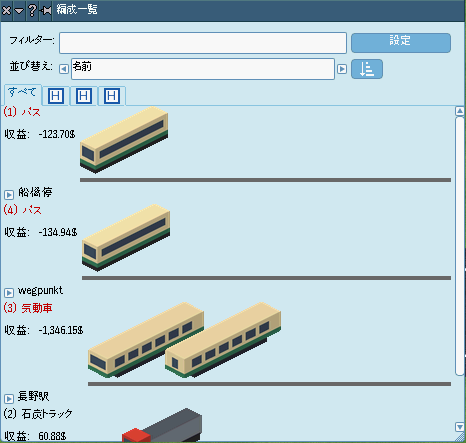
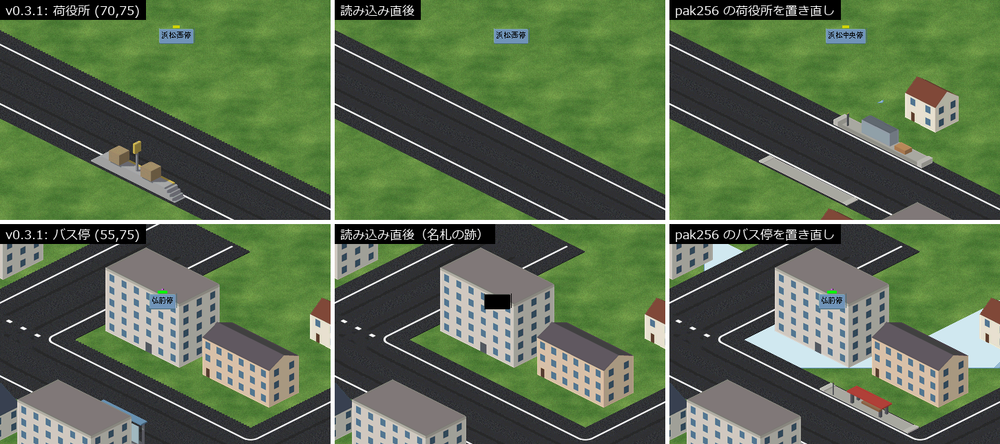
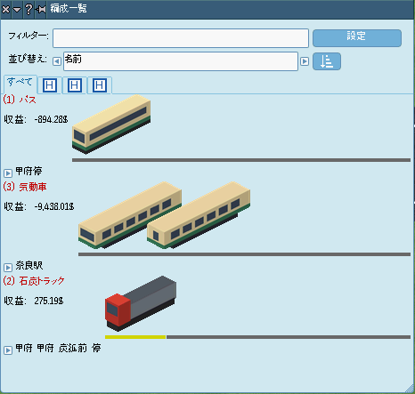
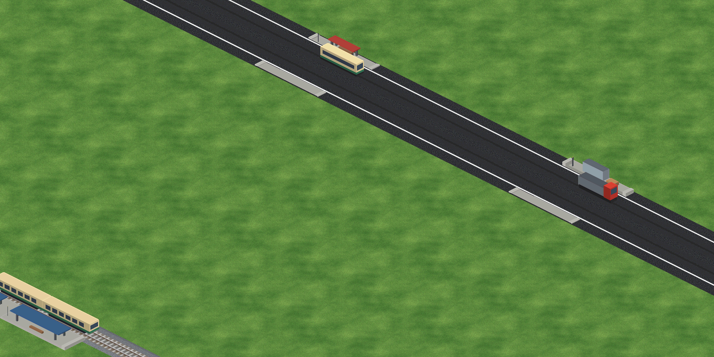
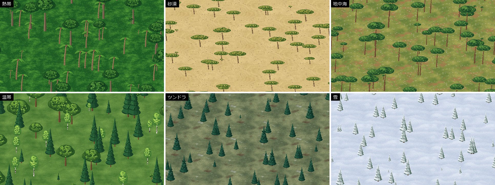
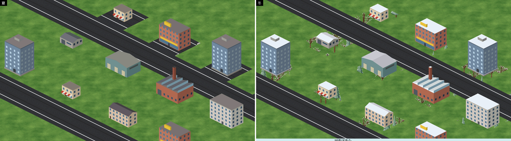

# v0.4.0 の起動・運送・保存データの互換の確かめ（2026-11-26）

[#105](https://github.com/128-bit-net/pak256/issues/105)。main の先頭（`0e99d9b`）の CI（run 45761739071）が作った配布の zip（`pak256-dev-0e99d9b.zip`）と、v0.3.1 の Release の zip（`pak256-v0.3.1.zip`）を展開し、中の `*.pak`・`ami_license.txt` と `config/`・`text/` だけで起動した（借り物なし。`Game(build=…, root=…)`）。検証環境は `addon_check`（OTRP v64）、保存データは `flat_512_left_v64`、昼夜は止めてある。確かめた後にタグ `v0.4.0` を同じコミットに打った。CI の下書きの Release の zip（`pak256-v0.4.0.zip`）は、確かめた zip と 36 ファイル（pak 23 個を含む）の SHA-256 が全部同じ。

スクリプトはリポジトリの直下から流し、展開した zip は `work/a04/v031/` と `work/a04/ci/` に置く（[prep_zips.py](2026-11-26_v040-check-screens/prep_zips.py)）。手順は [game-check.md](../game-check.md) の「保存データの互換の確かめ」。流した順は次のとおり（引数は各スクリプトの先頭の「使い方」。ポートは 47820〜47830）。

1. [prep_zips.py](2026-11-26_v040-check-screens/prep_zips.py)（展開と名前の比べ）
2. [run1.py](2026-11-26_v040-check-screens/run1.py)（保存データを作る。`work/a04/w1/save/compat031.sve` に残る）
3. [mkenv.py](2026-11-26_v040-check-screens/mkenv.py)（その保存データを置いた環境を `work/a04/env2/` に作る）
4. [run2.py](2026-11-26_v040-check-screens/run2.py)、[run2_log.py](2026-11-26_v040-check-screens/run2_log.py)（`ci` と `v031` の 2 回）
5. [run3.py](2026-11-26_v040-check-screens/run3.py)、[run4.py](2026-11-26_v040-check-screens/run4.py)（`v031` と `ci`）
6. [shots.py](2026-11-26_v040-check-screens/shots.py)、[montage.py](2026-11-26_v040-check-screens/montage.py)（画面）
7. タグの後に [cmpzip.py](2026-11-26_v040-check-screens/cmpzip.py)（下書きの zip との比べ）

## v0.3.1 → v0.4.0 の物の名前の違い

[prep_zips.py](2026-11-26_v040-check-screens/prep_zips.py) で、2 つの zip の pak の物を `makeobj list` で比べた（v0.3.1 は 208 個、v0.4.0 は 217 個）。

| 違い | 物 |
|---|---|
| 無くなった | `ami_road_bus_stop`・`ami_road_truck_stop`（`ami_road.pak`） |
| 増えた | 建物 `pak256_shop`・`pak256_store`・`pak256_office`・`pak256_workshop`・`pak256_warehouse`・`pak256_factory`、木 `pak256_acacia`・`pak256_kapok`・`pak256_palm`・`pak256_pine`・`pak256_spruce` |
| pak のファイル名 | `scenery.temperate_trees.pak` → `scenery.trees.pak`（木の名前は同じ） |

v0.3.1 の zip の `ami_road.pak` には AMI の停留所が入っていた。v0.3.1 の Release の説明と [v0.3.1 の記録](2026-11-26_v031-check.md) の、公開した版に AMI の停留所は入っていないという記述は誤り（pak256 の停留所に戻した後も、AMI の pak の中の停留所は残っていた。[stations.md](../stations.md)）。

## v0.3.1 の保存データを v0.4.0 で読む

### 保存データ

[run1.py](2026-11-26_v040-check-screens/run1.py): v0.3.1 の pak で、[α0.3 の setup.nut](2026-11-25_alpha03-screens/setup.nut)（道路・街・炭鉱と発電所・pak256 のバス停と荷役所・道路の車庫・バスと石炭のトラック・線路・駅・線路の車庫・気動車）を置いた。続けて [extra.nut](2026-11-26_v040-check-screens/extra.nut) で、AMI のバス停 2 つ（55,75・85,75）と荷役所 1 つ（70,75）を置き、AMI のバス停の間を往復するバスを 1 台出した。温帯の木 3 種（62・64・66,66）も植えた。約 1.2 年走らせて `world.save_game("compat031")` で保存した。

### 結果（[run2.py](2026-11-26_v040-check-screens/run2.py)）

- **本体は止まらなかった。** 読み込んでから 12 回の読み（約 2.4 年）と、置き直した後の 6 回の読み（約 1.5 年）まで動いた。
- **AMI の停留所 3 つは消えた。** その升には道路だけが残り、停留所の一覧から 3 つ（弘前停・浜松西停・浜松停）が無くなった。
- **消えた停留所を指していた路線の編成は残る。** バスは 2 つの地点の間を走り続けるが、収入は 0。編成一覧では、行き先が停留所でなく経由地（本体の表示は `wegpunkt`）になった。

- **同じ升に pak256 の停留所を置き直すと、ダイヤを直さずに収入が戻った。** バス停 2 つと荷役所 1 つが置けて、停留所の一覧に 3 つ増え、そのバスに収入が出た。停留所の名前は新しく付くので、変わることがある（浜松西停 → 浜松中央停）。
- **地図の上に名札の跡が残った。** 荷役所の升は古い名前の名札、バス停の 1 つは中身の無い黒い四角。置き直すと、撮った 2 か所では新しい名札になった。
- **ほかの物は残った**: pak256 のバス停・荷役所・線路の駅 6 タイル、道路の車庫（`mo_depot_road`）と線路の車庫（`mo_depot_rail`）の升、木 3 本、4 つの編成。バス・石炭のトラック・気動車は読み込んだ後も収入が出た。
- **起動のログ**（[run2_log.py](2026-11-26_v040-check-screens/run2_log.py)。`-log -debug 3` を足して読み込み、同じ保存データを v0.3.1 の pak で読んだログと比べた）: v0.4.0 だけに出た警告は、停留所が消えたことの 3 種 × 3 件。`description ami_road_bus_stop/ami_road_truck_stop … not found (will be removed)`・`will no longer add ground without building`・`could not restore stop`。ほかの `Warning`・`ERROR` は両方に出た（`symbol.BigLogo.pak` の読み込みの失敗を含む。本体はこの名前のファイルを先に探すが、pak256 の zip には無い、という読み）。

右下の画像の水色の四角は、閉じた窓の描き残しと見ている（確かめていない）。

追記（2026-11-26、#126）: 水色の四角は、街の建物に `needs_ground` が無く、本体が下の地面を描かないために前の画面（閉じた窓）が残ったものと見ている。下の「Release の説明に使う画面」の街の絵で、建物の下に別の季節の木が見えるのも同じ原因と見ている（[#126 の記録](2026-11-26_building-ground.md)）。

## v0.4.0 の zip だけで起動して運ぶ

- [run3.py](2026-11-26_v040-check-screens/run3.py): α0.3 の setup.nut を新しい状態で流した。置く操作は、setup.nut が停留所の場所をずらして探す分を除き、全部成功した。道路と線路の車庫の升に車庫があった。12 回の読み（約 2.4 年）で、今月の収入が 0 でない読みはバス 6 回・石炭のトラック 7 回・気動車 0 回だった。
- 気動車の 0 回を確かめるため、[run4.py](2026-11-26_v040-check-screens/run4.py) で同じ場面を v0.3.1 と v0.4.0 で 1 回ずつ走らせ、直近 12 か月の運んだ数を読んだ。**気動車は v0.4.0 でも旅客を運んで収入が出た**（運んだ数の合計は v0.3.1 が 24、v0.4.0 が 18。どちらも少ない）。石炭のトラックは両方とも 280。バスは 98 と 37。
- もう 1 回ずつ走らせて、月ごとの走行距離（`get_traveled_distance`）も読んだ。バスの走行距離は両方とも月に 260 前後で、v0.4.0 のバスが詰まっていることはない。旅客の数は、この回も v0.4.0 の方が少なかった（バスは v0.3.1 が 41・v0.4.0 が 26、気動車は 22 と 6）。石炭のトラックは、直近 12 か月の窓が 1 か月ずれた分を除き同じ並びだった。
- **旅客が 2 回とも少なかった理由は調べていない。** 街の育ちの偶然か、街の商業・工業の建物が増えたこと（#103）の影響かは分けていない。

## Release の説明に使う画面

[shots.py](2026-11-26_v040-check-screens/shots.py) と [montage.py](2026-11-26_v040-check-screens/montage.py)。v0.4.0 の zip の中身だけで撮った。街の建物は道具で置いた（街の育ちは待っていない）。気候の区画は塗って、森の道具で木を植えた。名札は消してある。

## 確かめていないこと

- 新しい地図の作成画面で、街・木・炭鉱が出ること。本家 Simutrans 125.0.1。
- 読み込んだ後の停留所の枠の細かい内容、待っていた旅客・貨物の扱い。AMI の停留所と pak256 の停留所が同じ停留所（枠）にまとまっていた場合。
- 消えた停留所を指す路線（`line`）を作っていた場合（確かめたのは、編成ごとのダイヤ）。
- 右側通行、夜、年代設定が有効な状態、収支が黒字になる条件。郵便のトラック。
- ツールバーから置く・買う操作（スクリプトで置いた）。
- v0.2.0・v0.3.0 の保存データ。
