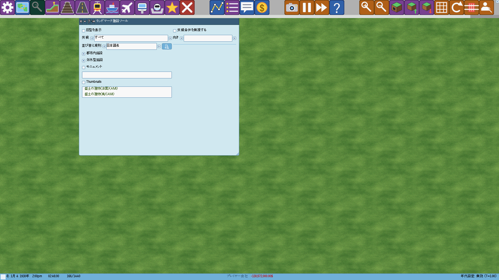
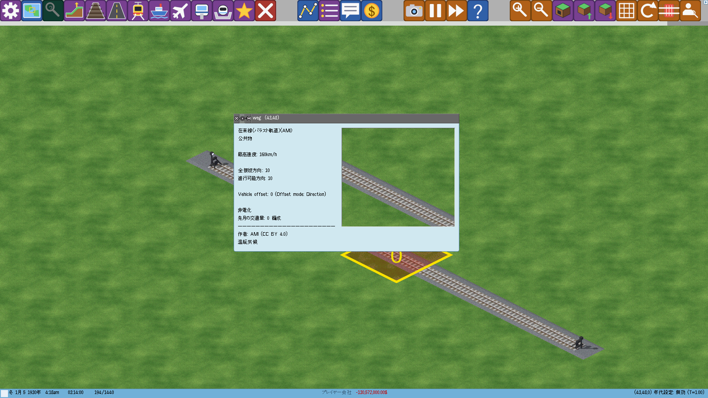

# AMI の物の名前の訳を pak に入れた（#196、2026-11-27）

AMI（`60820de`、ami-256-alpha.9）の日本語の訳を `vendor/ami/text/` に写し、AMI の pak を入れた物の `text/` に入れた。取り込み方は [layout.md](../layout.md) の「AMI の物の名前の訳」。

## 確かめたこと

配布の zip を展開した `pak256/` を `--pak` にして、OTRP v64（`-lang ja`、`flat_512_left_v64`）で起動した。

名所の窓で、盛土の建物が日本語名で出る。前は内部の名前（`ami_embankment_building`）だった。

線路の情報窓で、在来線が日本語名で出る。生活道路の情報窓でも同じだった。

## 入れていない物

- 英語の訳。AMI に無い。AMI の側に足してもらう（2026-11-27、ユーザーの決定）。`en_ami.tab` が足されたら、`build_ami256.py text` が `en.ami.tab` として写す。
- 道路標識 8 件（`ami_sign_stop`・`ami_sign_one_way`・`ami_sign_speed_40`・`ami_sign_speed_60`・`ami_sign_speed_80`・`ami_sign_min_50`・`ami_sign_crosswalk`・`ami_sign_crosswalk_one_way`）の訳。AMI の訳に無く、内部の名前のまま出る見込み（9 つの pak の名前と訳の名前の突き合わせ。画面では見ていない）。ほかの物の名前は全部、訳にある。

## 確かめていないこと

- ツールバーの説明（マウスを乗せる操作がスクリプトに無い。情報窓と同じ訳の仕組みを通る見込みで、画面では見ていない）。
- 本家 125.0.1 のゲーム。
