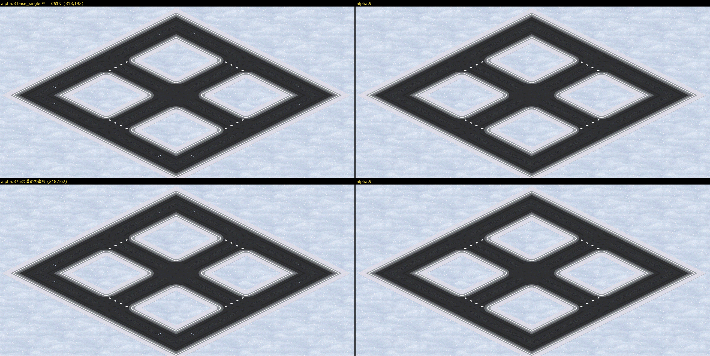
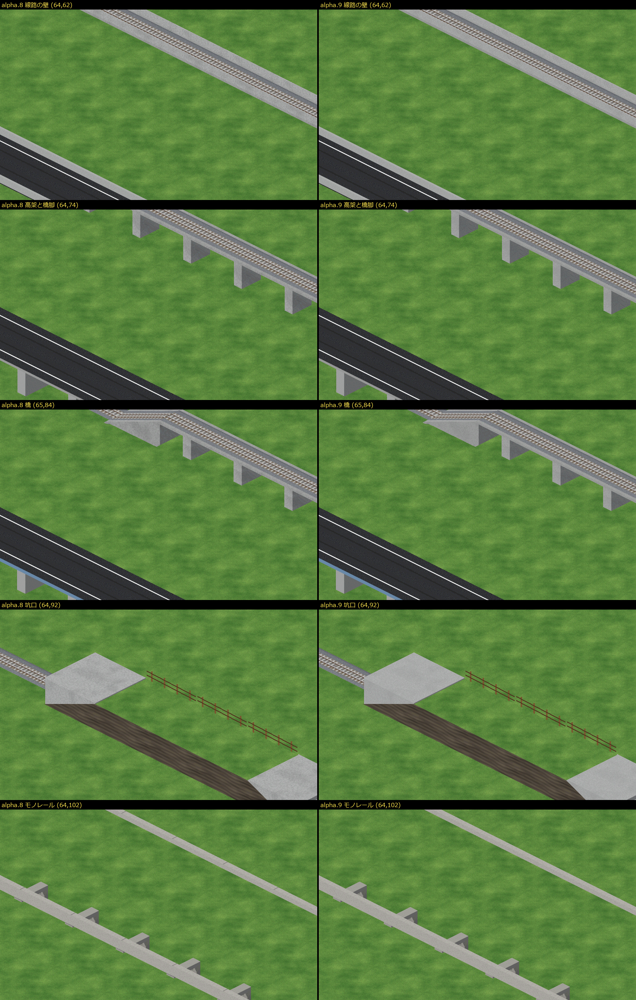
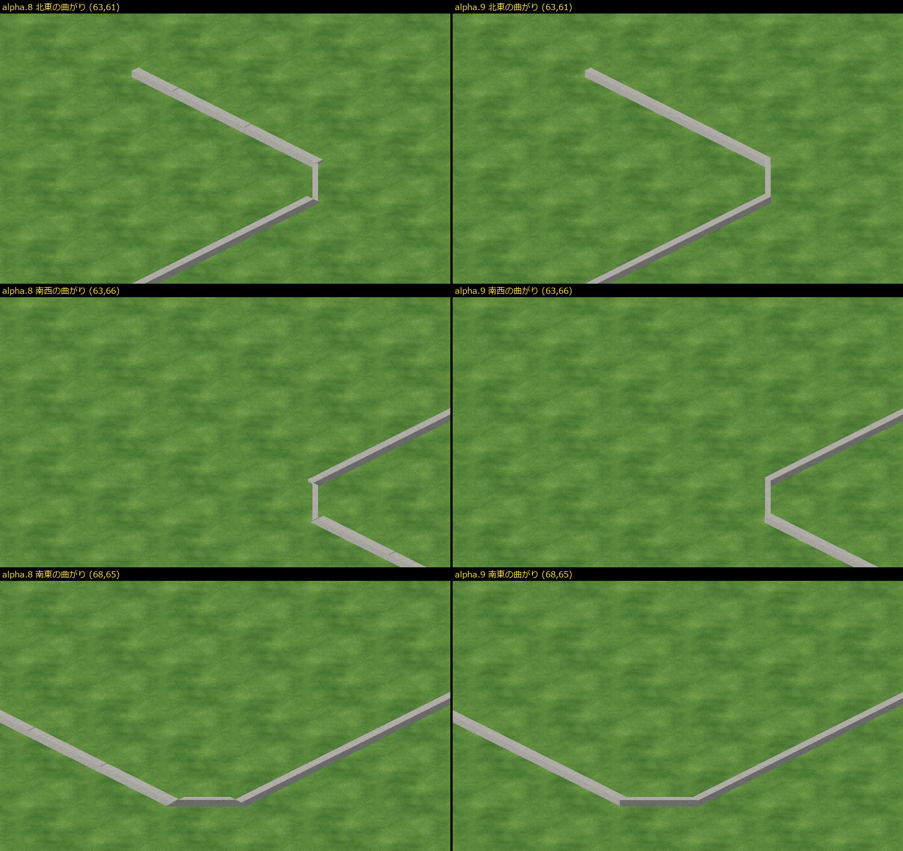
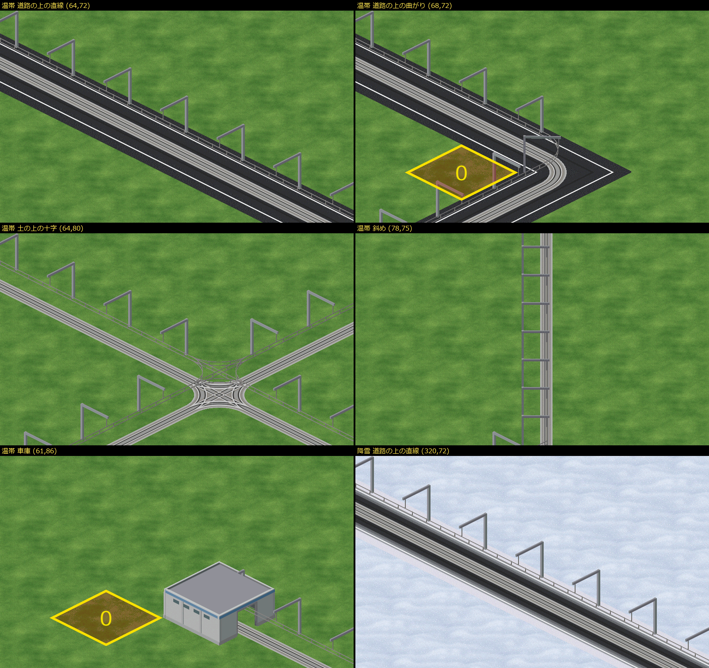
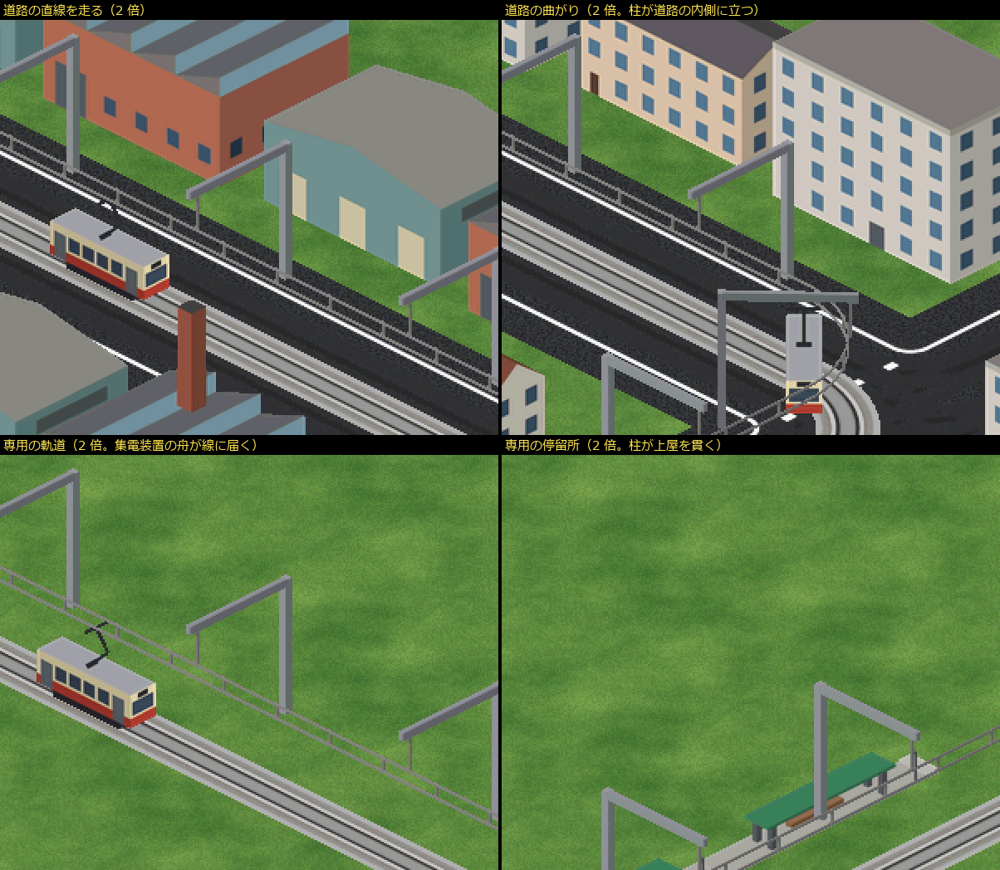
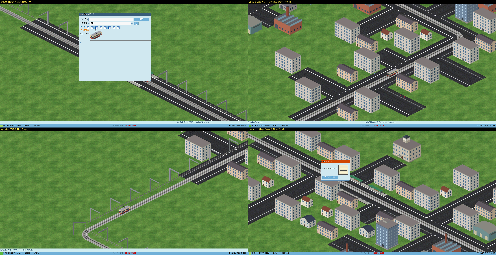
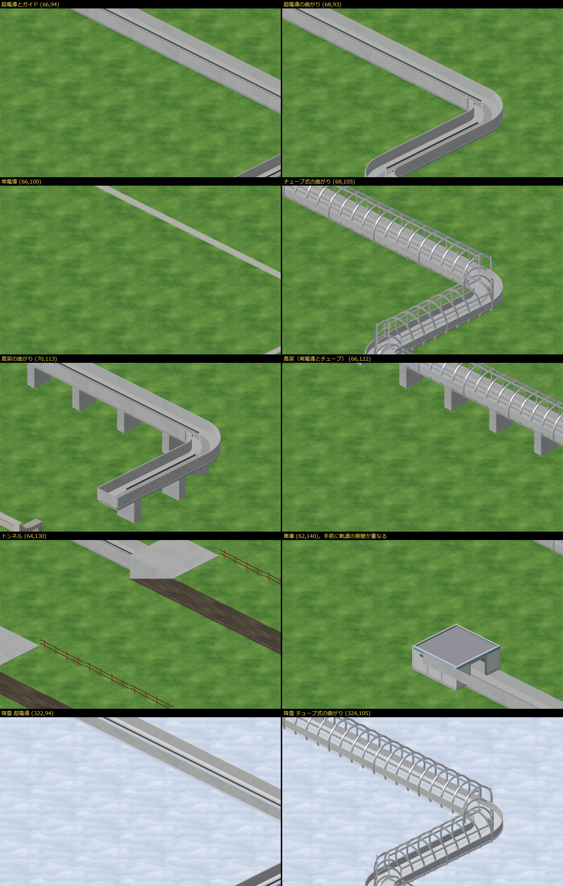
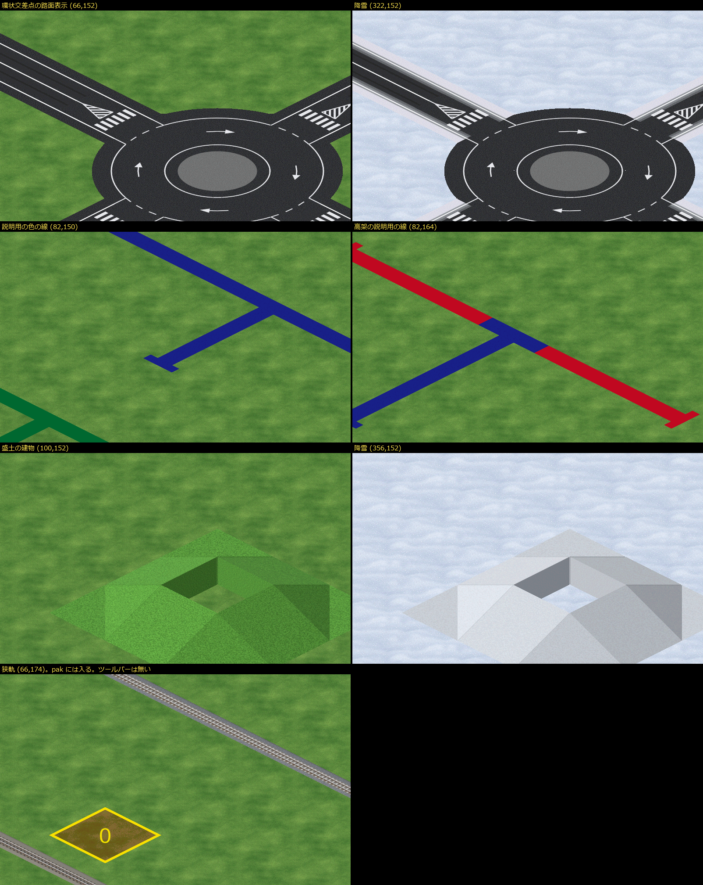
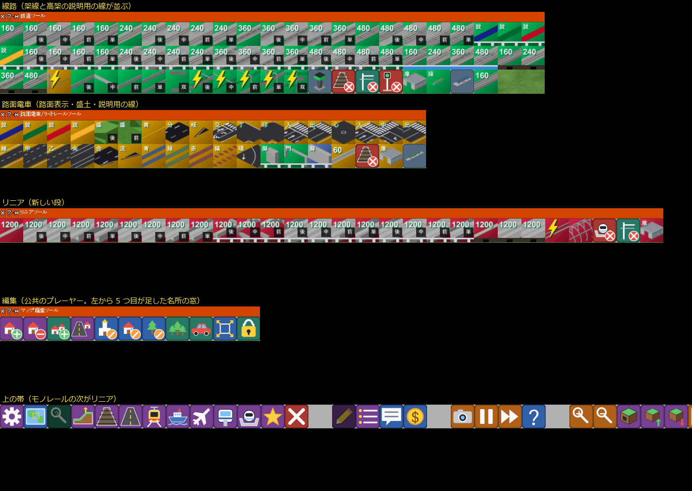
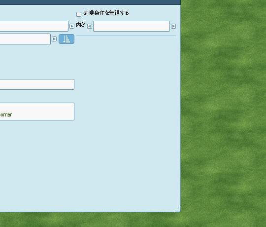

# AMI 256 版 alpha.9 の取り込みと路面電車の電化（2026-11-27）

[#189](https://github.com/128-bit-net/pak256/issues/189)。AMI のコミット `60820de` から 256 版 `ami-256-alpha.9` を組み、`ami-256-alpha.8`（`f64a430`）と比べた。取り込んだ物は次のとおり（番号は AMI の issue）。

- [#376](https://github.com/128na/simutrans-addon-dev/issues/376): 路面軌道の架線 `ami_tram_catenary`。
- [#378](https://github.com/128na/simutrans-addon-dev/issues/378): 雪の `ami_road_local_base_single` のカーブの透ける点線。
- [#379](https://github.com/128na/simutrans-addon-dev/issues/379): 256 のコンクリートのしみと、線路のコンクリートの粒。
- [#371](https://github.com/128na/simutrans-addon-dev/issues/371)・[#372](https://github.com/128na/simutrans-addon-dev/issues/372): リニアの道と景観の補助。
- [#370](https://github.com/128na/simutrans-addon-dev/issues/370)・[#375](https://github.com/128na/simutrans-addon-dev/issues/375): 狭軌と、跨座式モノレールの直角の曲がりの桁。issue の一覧には無いが、組んだ時点の AMI の main に入っていた。

## 組みと検査

- `tools/build_ami256.py build --version alpha.9` は全部の段を通った。描画は 258 対象。次の 8 対象は 1 回目に失敗し、道具の描き直しで通った: `ami_maglev_beam_tunnel`・`ami_maglev_guideway_tunnel`・`ami_narrow_ballast_tunnel`・道路のトンネル 3 つ・`ami_wall_road_back`・`ami_wall_rail_old_twin_catenary_back`。
- 検査は全部通った。ログの `check_snow_edge.py --self-test` の `ERROR` の行は、自己検査がわざと壊した絵への出力。`check_way_edges.py` は 5580 セルで問題 0 件。
- 組む道具を直した: pak を 7 つから 9 つ（`ami_maglev`・`ami_narrow`）にし、AMI の `check.sh` の 256 の検査に合わせて `check_snow_edge.py`・`check_curve_join.py` を足した。
- zip の SHA-256 は `0193c65b783ae6f8dd94eb40dd6f3918c47e7ce70bd63bd2a2ac8d07ed8f192b`（64.5 MB）。置き場 `vendor-ami-256-alpha.9` に上げた。
- `compare`（alpha.8 と）: pak が 2 つ増えた（`ami_maglev.pak` 52.3 MB、`ami_narrow.pak` 3.6 MB）。無くなった物は無い。`ami_road`・`ami_scenery`・`ami_tram` の物が増えた。`ami_canal.pak` はバイトで同じ。`ami_scenery.pak` は 7.9 MB から 14.7 MB。
- `demo/demo.sve` が使う 52 個の名前は全部ある。路面電車は入っていない。

## 撮り方

OTRP v64（`addon_check` の写し）、`flat_512_left_v64`、昼、`gui.set_zoom(3)`（等倍）。前後は pak256 の側を同じにして、AMI だけを alpha.8 と alpha.9 にした。スクリプトは [この記録のフォルダ](2026-11-27_ami189-screens/new_scene.py) の `new_scene.py`・`toolbar.py`・`nocat.py`・`compat_save.py`・`compat_load.py`・`montage.py`。コンクリートは [#134 の concrete_scene.py](2026-11-26_ami333-screens/concrete_scene.py)、雪の曲がりは [#159 の seam_scene.py](2026-11-26_ami159-screens/seam_scene.py)。路面電車は `tools/vehicle_check/tram_run.py`。

## 直ったこと

雪の `ami_road_local_base_single` の 5x5 の格子で、角と隣の境の点線 8 か所が消えた。

線路の壁・高架と橋脚・橋・坑口のコンクリートは、大きなしみが薄くなり、粒が細かくなった。

跨座式モノレールの直角の曲がりで、桁の端の出っ張りが消えた。

## 架線と路面電車

- 架線は、道路の上と土の上の直線・曲がり・十字・斜め・車庫に張れた。
- 路面電車（`engine_type: electric`）は架線を張ったコースを往復した。屋根の集電装置の舟は線の高さに届く。
- 架線が無いと車庫から出ない。道路の区間と車庫だけに張ると、架線の切れる手前の停留所で止まり「運行できる経路がありません」と出る。
- **v0.5.0 の保存データ**（架線の無い軌道を路面電車が走る場面）: 読めて、「足りない物」の窓は出ない。路面電車はその場で止まる。軌道に架線を張ると、車庫に戻さなくても走り出した。起動のログの `ERROR` は、作業フォルダの `symbol.BigLogo.pak` の 1 件（[v0.5.0 の記録](2026-11-27_v050-check.md)と同じ）。

## リニア・景観の補助・狭軌

置く操作はスクリプトで行い、失敗は無かった。

## ツールバー

置き場所は [config.md](../config.md) の `menuconf.tab`。リニアの段を足し、編集の段に名所の窓（`dialog_tool[21]`。盛土の建物を選ぶ）を足した。狭軌はツールバーに出さない。

## 気づいた崩れと残り（直していない）

- リニアの車庫の手前に、軌道の側壁が建物に重なって描かれる（[リニア](2026-11-27_ami189-screens/5_maglev.png) の「車庫」）。
- 路面軌道の架線の曲がりの柱が、道路の内側の路面に立つ（[走る路面電車](2026-11-27_ami189-screens/2_tram_run.png) の右上）。
- 架線の柱が、pak256 の路面電車の停留所の上屋を貫く（同じ画像の右下）。
- AMI の物は、名所の窓などで内部の名前（`ami_embankment_building`）のまま出る。AMI の訳は pak256 の zip に入っていない。

## 確かめていないこと

- 本家 125.0.1、右側通行。
- 車庫の窓で、架線の無い車庫の電車が買えるか。
- 名所の窓から選んで盛土の建物を建てる操作（置いたのはスクリプトの `tool_build_house`）。ツールバーのボタンから道や架線を置く操作。
- リニアと狭軌を車両で走らせること（pak256 にも AMI にも車両が無い）。
- 架線の坂・近い斜めの分け合うタイル・分岐の追加画像。降雪のリニアと架線は一部の画面だけ。
- 停留所の奥の帯の行数（[stations.md](../stations.md)。alpha.9 では数え直していない）。
