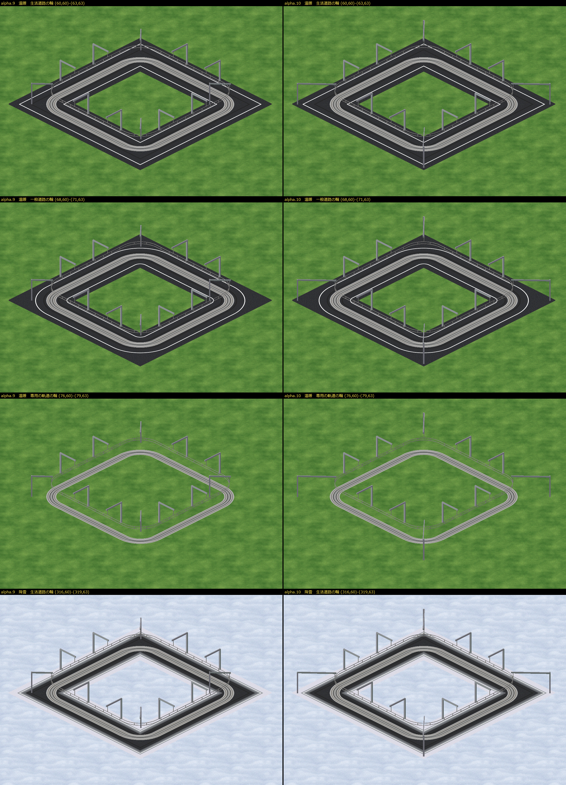
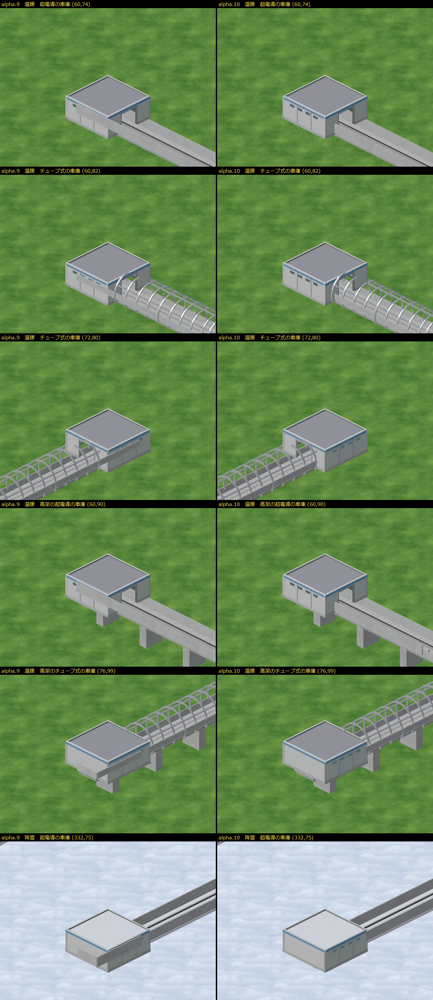
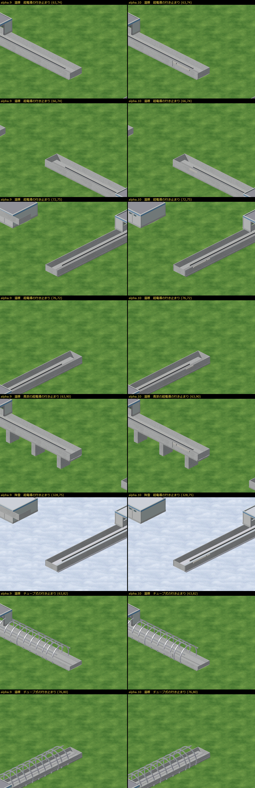
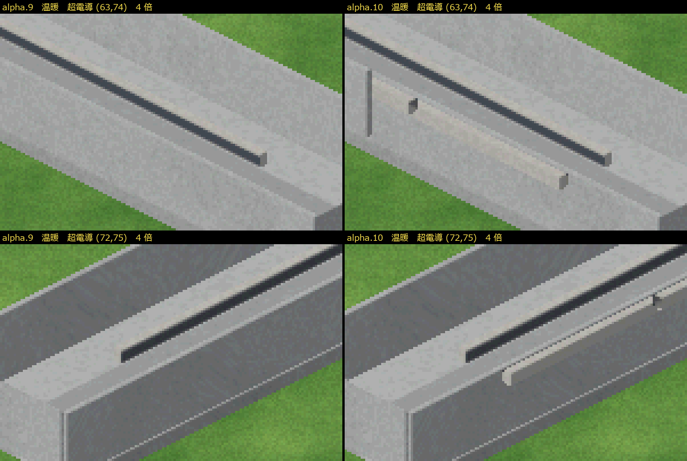
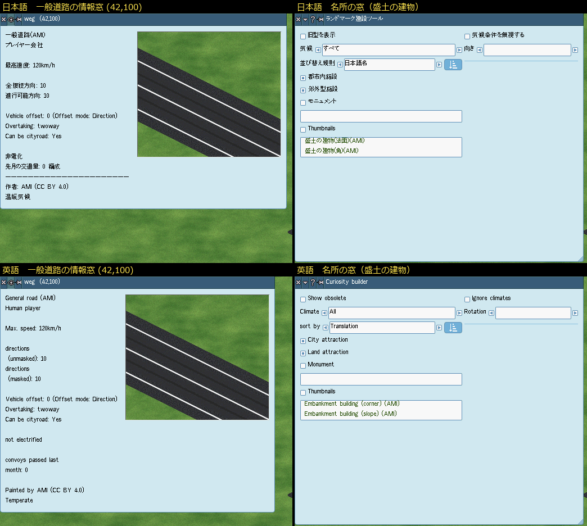

# AMI 256 版 alpha.10 の取り込み（2026-11-27）

[#219](https://github.com/128-bit-net/pak256/issues/219)。AMI のコミット `ca46424` から 256 版 `ami-256-alpha.10` を組み、`ami-256-alpha.9`（`60820de`）と比べた。取り込んだ物は次のとおり（番号は AMI の issue）。

- [#393](https://github.com/128na/simutrans-addon-dev/issues/393): 路面軌道の架線の曲がりの柱を、弧の外側のタイルの角へ（専用の軌道の曲がりも同じ）。
- [#394](https://github.com/128na/simutrans-addon-dev/issues/394): リニアの行き止まりのセルの手前の側壁・端の壁・輪を奥の絵へ。
- [#396](https://github.com/128na/simutrans-addon-dev/issues/396): 英語の名前の訳 `en_ami.tab` と、道路標識の日本語の訳。
- ほかに入るカタログの検査（AMI #398）と道具・文書の直しは、pak の絵を変えない。

## 組みと検査

- `tools/build_ami256.py build --version alpha.10` は全部の段を通った。描画は 258 対象。次の 8 対象は 1 回目に失敗し、道具の描き直しで通った: `ami_maglev_beam_tunnel`・`ami_maglev_guideway_tunnel`・`ami_narrow_ballast_tunnel`・`ami_road_general_tunnel`・`ami_road_trunk_tunnel`・`ami_wall_road_back`・`ami_wall_rail_old_twin_catenary_back`・`ami_wall_rail_twin_catenary_back`。
- 検査は全部通った。`check_way_edges.py` は 5580 セルで問題 0 件。ログの `check_snow_edge.py --self-test` の `ERROR` の行は、自己検査がわざと壊した絵への出力。
- zip の SHA-256 は `5c4ea466ec6ede52b88954526a101a5499d0b75445a979920389bee0f85c7eac`（64.5 MB）。置き場 `vendor-ami-256-alpha.10` に上げた。
- `compare`（alpha.9 と）: pak の名前と数は同じ 9 つで、物の増減は無い。中身が変わったのは `ami_maglev.pak`（52,266,165 B → 51,550,389 B）と `ami_tram.pak`（2,156,171 B → 2,158,891 B）だけで、ほかの 7 つはバイトで同じ（zip の CRC と大きさが一致）。
- 置き場から取った alpha.10 で `tools/build.py`、`unittest` 477 件、`lint_config.py`、`check_demo.py`（52 個の名前が全部ある）、`package.py` が通った。配布の zip の `pak256/text/` に `en.ami.tab` と `ja.ami.tab` が入る。
- AMI の `check_texts.py`（訳と dat の名前の突き合わせ。AMI の CI が流す）は、`build_ami256.py` の検査の段には足していない。

## 撮り方

OTRP v64（`addon_check` の写し）、`flat_512_left_v64`、昼、`gui.set_zoom(3)`（等倍）。前後は pak256 の側を同じにして、AMI だけを alpha.9 と alpha.10 にした。場面は [scene.py](2026-11-27_ami219-screens/scene.py)（`scene.py <検証環境> <ポート> <build のフォルダ> <出力>`）、画像は [montage.py](2026-11-27_ami219-screens/montage.py)（`montage.py <前> <後> <出力> <names.py の出力>`）、名前の確かめは [names.py](2026-11-27_ami219-screens/names.py)。保存データの互換は [#189 の compat_save.py・compat_load.py](2026-11-27_ami189-screens/compat_save.py) と [mkenv.py](2026-11-26_v040-check-screens/mkenv.py)。

## 直ったこと

路面軌道の架線の曲がりの柱は、生活道路・一般道路・専用の軌道の 4 つの向きの曲がりで、弧の外側の角へ移った。上の角と下の角は腕と柱が縦に重なり、下の角は軌道の手前に高い柱が立つ（AMI の PR にある見え方のとおり）。

リニア（超電導とチューブ式、地上と高架）の車庫の上に、軌道の手前の側壁が重ならなくなった。

## 車庫の無い行き止まりと、新しい崩れ

超電導（ガイドウェイと way-object のガイド）の行き止まりのタイルで、alpha.9 には無かった崩れが出る。手前の側壁の上にガイドの手前側の部材が描かれ、向きによって壁に縦の線も出る。画像に載せた超電導の行き止まり 6 か所（4 つの向き・高架・降雪）の全部で見えた。行き止まりのセルを奥の絵にしたので、way-object の奥の絵が壁の上に描かれると見ている（本体と AMI の描き方は追って確かめていない）。AMI の側で直すかは未定。

チューブ式の行き止まりでも、端の近くの輪の描かれ方が alpha.9 と変わる所がある（上の行き止まりの画像の下から 2 段目で見える）。

## 名前の訳

配布の zip を展開した `pak256/` で起動し、`*.ami.tab` の 287 件を `translate()` で引くと、日本語と英語の両方で全部が訳のとおりに返った（道路標識の 8 件を含む）。道路の情報窓と名所の窓にも出る。標識の情報窓は本体が「道路標識」とだけ出すので、標識の名前は画面では見ていない。

`translate()` の確かめは訳のファイル自身の名前を引くので、pak の物の名前と合うかは別に確かめた（[names_vs_paks.py](2026-11-27_ami219-screens/names_vs_paks.py)）。zip の 9 つの pak の物 231 個（標識 8 件を含む）の全部に、日本語と英語の訳がある。訳にだけある 56 件には、zip に入れない旧描画位置の線路（`ami_rail_old`）の名前（`ami_rail_ballast_old` など）が含まれる（56 件の全部は見ていない）。

英語は、起動の `-lang` を `en` に差し替えて確かめた（`game.py` は `ja` に固定。検証環境の `font/` に英語の選択に要る字の絵が無く、言語の窓では選べない）。

## 保存データ

v0.5.0 の配布の zip で作った保存データ（架線の無い軌道を路面電車が走る）は、alpha.10 でも読めて「足りない物」の窓は出ない。路面電車は #189 と同じく止まり、架線を張ると走り出した。起動のログの `ERROR` は `symbol.BigLogo.pak` の 1 件（[v0.5.0 の記録](2026-11-27_v050-check.md)と同じ）。

## 確かめていないこと

- 本家 125.0.1、右側通行、128。
- リニアを車両で走らせること（pak256 にも AMI にも車両が無い）。AMI の PR にある「車庫の無い行き止まりで車両が端の壁より手前に描かれる」は見ていない。
- リニアの行き止まりの曲がり・坂・トンネルの中の車庫。
- 走る路面電車と、下の角の高い柱の重なり（AMI の PR でも確かめていない）。
- チューブ式の高架の車庫の下に残る短い段差は alpha.9 にもある（直していない）。
- ツールバーの説明（マウスを乗せる操作がスクリプトに無い）。
