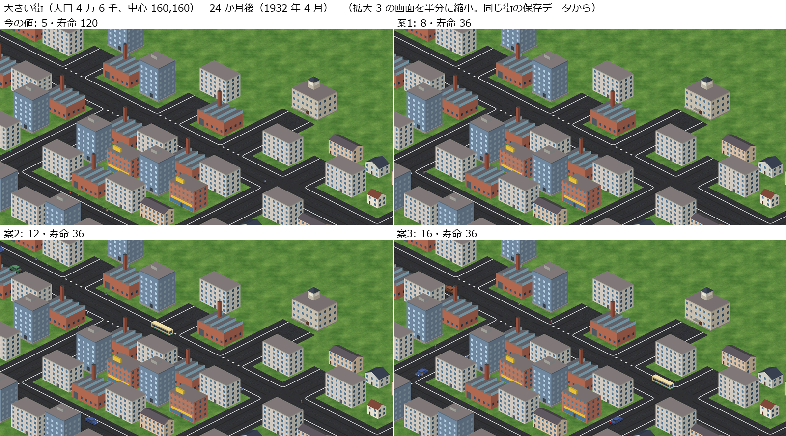
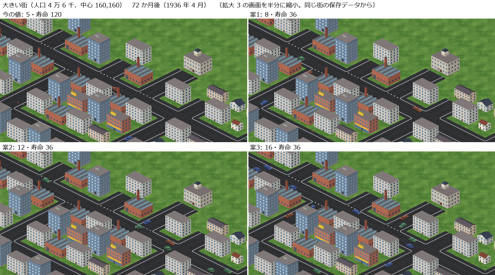
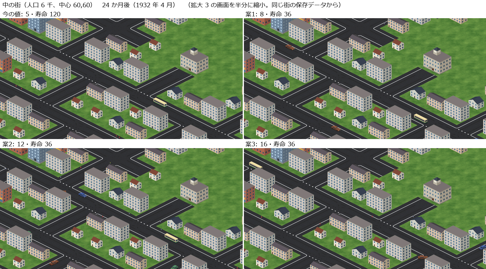
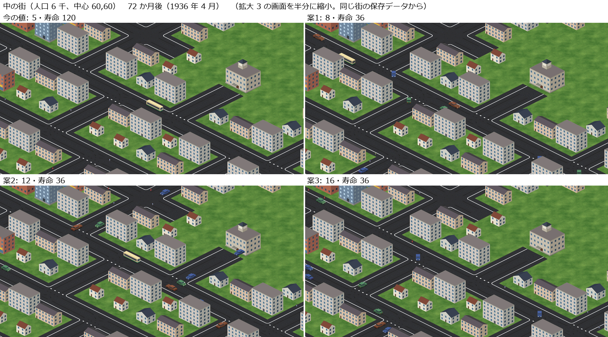

# 2026-11-27 街の車の台数と寿命（#182）

[#182](https://github.com/128-bit-net/pak256/issues/182)。`citycar_level` と `default_citycar_life` を変えて、人口の違う街に何台走るか、バスが走れるかを OTRP v64 で測った。結果で 8・36 にした（式と期待値は [config.md](../config.md) の「街の車」）。

## 場面

- `flat_512_left_v64`（左側通行）に街を 3 つ置き、`change_size` で人口を足した: 小さい街（約 700 人）、中の街（約 6 千人、中心 60,60）、大きい街（約 4 万 6 千人、中心 160,160）。中と大きい街の道に、それぞれバス 2 台の路線を置いた（[setup.nut](2026-11-27_citycar-level/setup.nut)）。輸送で育てた街ではない。
- `citycar_level` は `settings.set_traffic_level` で渡して読み返した。保存データは自分の値（5・120）を持ち、pak の `simuconf.tab` より優先される。寿命は作業用の写しの保存データを書き換えた。
- 速さ 128 で早送りした（1 か月が約 4 秒）。スクリプトは [measure.py](2026-11-27_citycar-level/measure.py)・[mksave.py](2026-11-27_citycar-level/mksave.py)・[stress.py](2026-11-27_citycar-level/stress.py)、月ごとの値は同じフォルダの `*.jsonl`。画像の組み立ては [grid.py](2026-11-27_citycar-level/grid.py)。
- 各組 1 回ずつ。乱数の幅があるので、数台の違いは読まない。

## 台数

### 寿命 120（pak128 と同じ。街は組ごとに作り直した）

地図の街の車の合計。内訳は 95 か月までに出た台数（大きい街・中の街・小さい街。寿命が長く、消えた車はほぼ無い）。

| `citycar_level` | 6 か月 | 12 | 24 | 48 | 72 | 95 | 95 か月の内訳 |
|---|---|---|---|---|---|---|---|
| 5 | 1 | 2 | 5 | 10 | 16 | 21 | 21・0・0 |
| 8 | 8 | 15 | 27 | 53 | 76 | 98 | 49・26・22 |
| 12 | 19 | 29 | 56 | 98 | 135 | 164 | 88・56・18 |
| 16 | 24 | 40 | 76 | 143 | 197 | 234 | 117・95・18 |

- 台数は月ごとにほぼ一定の速さで増え、寿命の 約 240 か月まで積み上がる。式の期待値とほぼ合う（16 で 3 つの街の合計が月 3.5 台の期待に対し、実測は約 2.5 台。小さい街は 18 台で増えなくなった。道が少ないためと見ている）。
- 5（前の値）では、中の街にも小さい街にも 1 台も出ない。

### 寿命 36 と前の値（同じ街の保存データから）

| `citycar_level`・寿命 | 6 か月 | 12 | 24 | 48 | 72 | 95 | 72 か月の内訳（大・中・小） |
|---|---|---|---|---|---|---|---|
| 5・120（前の値） | 0 | 3 | 9 | 15 | 19 | 23 | 19・0・0 |
| 8・36 | 8 | 15 | 32 | 62 | 81 | 75 | 40・24・17 |
| 12・36 | 15 | 19 | 49 | 92 | 125 | 123 | 63・41・21 |
| 16・36 | 17 | 36 | 73 | 132 | 187 | 167 | 96・70・21 |

寿命 36 は約 72 か月で車が消え始め、台数が頭打ちになる。24 か月までは寿命 120 と変わらない。

## バスが走れるか

### 同じ街での、84〜95 か月の走行距離

バス 1 台・1 か月あたりの走行距離（84〜95 か月の 12 か月の平均、2 台の平均）と、前の値との比。

| `citycar_level`・寿命 | 中の街 | 大きい街 |
|---|---|---|
| 5・120（前の値） | 253（100%） | 237（100%） |
| 8・36 | 239（94%） | 208（88%） |
| 12・36 | 197（78%） | 166（70%） |
| 16・36 | 164（65%） | 135（57%） |

寿命 120 の組（街は別）は、95 か月の時点で 16 が約 130（前の値の約半分）で、まだ台数が増え続けている。

### 台数を置き足して測る

`citycar_level = 0` にして同じ街に `tool_add_citycar` で車を置き足し、各段で 2 か月置いてから 6 か月の走行距離を測った。道のタイル（半径内）は中の街 149、大きい街 328。この場面は `setup.nut` で作り直した街で（上の同じ街の保存データとは別）、人口は記録していない（同じ手順のほかの組では中の街 5.3〜6.0 千人、大きい街 約 4 万 6 千人）。`stress.jsonl` の setup 行の人口は `change_size` が効く前の値。

| 街あたりの台数 | 中の街のバス | 大きい街のバス |
|---|---|---|
| 0 | 242（100%） | 257（100%） |
| 25 | 225（93%） | 254（99%） |
| 50 | 170（70%） | 224（87%） |
| 100 | 95（39%） | 172（67%） |
| 129（中の街は置ける所がほぼ尽きた） | 67（28%） | — |
| 200 | — | 117（45%） |
| 281 | — | 75（29%） |

中の街の 200・300 の段は 129・145 台までしか置けなかった（55・23%）。どの段もバスは止まらなかった。道のタイル 1 つあたり 0.3 台ほどで、走行距離は 7 割前後に落ちた。

寿命 120 のまま値を上げると、240 か月ぶん積み上がった台数（式の見込み: 8 で大きい街 約 120・中の街 約 80、16 で大きい街 約 360・中の街 約 240）が、この表の遅い段に当たる。寿命の長い組を 240 か月まで走らせては確かめていない。

## 画像

同じ街の保存データから、同じ月・同じ位置を撮った（拡大 3 の画面を半分に縮小）。

大きい街、24 か月後と 72 か月後:

中の街、24 か月後と 72 か月後:

- 24 か月では、どの値でも画面に映る車は数台。差がはっきり出るのは 72 か月。
- この大きさの画面では、車の重なり・欠け・建物への乱れは見えなかった。

## 8・36 にした理由

- 8 は、512 人以上の街に車が出る最小に近い値で（6 以上で中の街に出る）、バスの遅れが 1 割前後に収まる。
- 12・16 は車が多く見えるが、バスが 2〜4 割遅くなり、路線の収入に響く。
- 寿命 36 は本体の `simuconf.tab` の値。寿命 120 のままだと台数が 240 か月ぶん積み上がり、道を埋める見込み。

## 確かめていないこと

- 本家 125.0.1、右側通行の地図、輸送で育てた街（輸送が増えると車は減る式）。
- 道路の種類が違う街（一般道・高速）。
- 寿命 120 を 240 か月まで走らせた台数。寿命 36 の組は 96 か月まで。
- 渋滞のメッセージが出るか。
