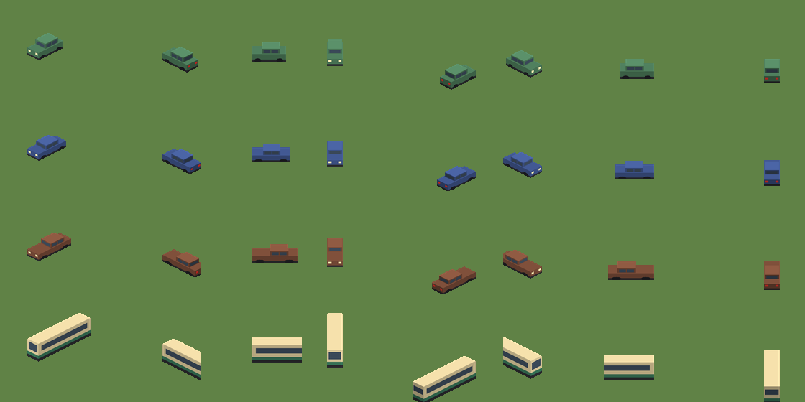
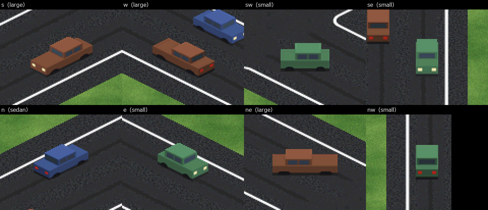
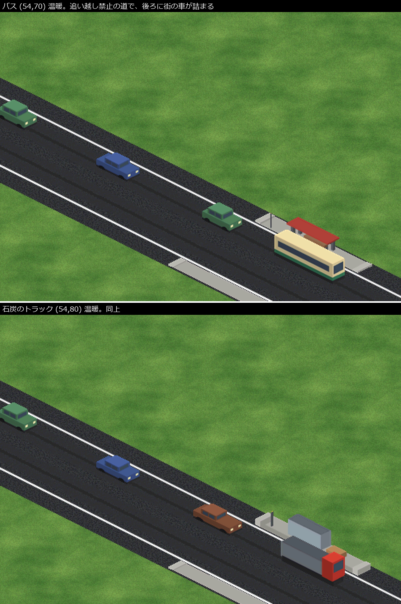
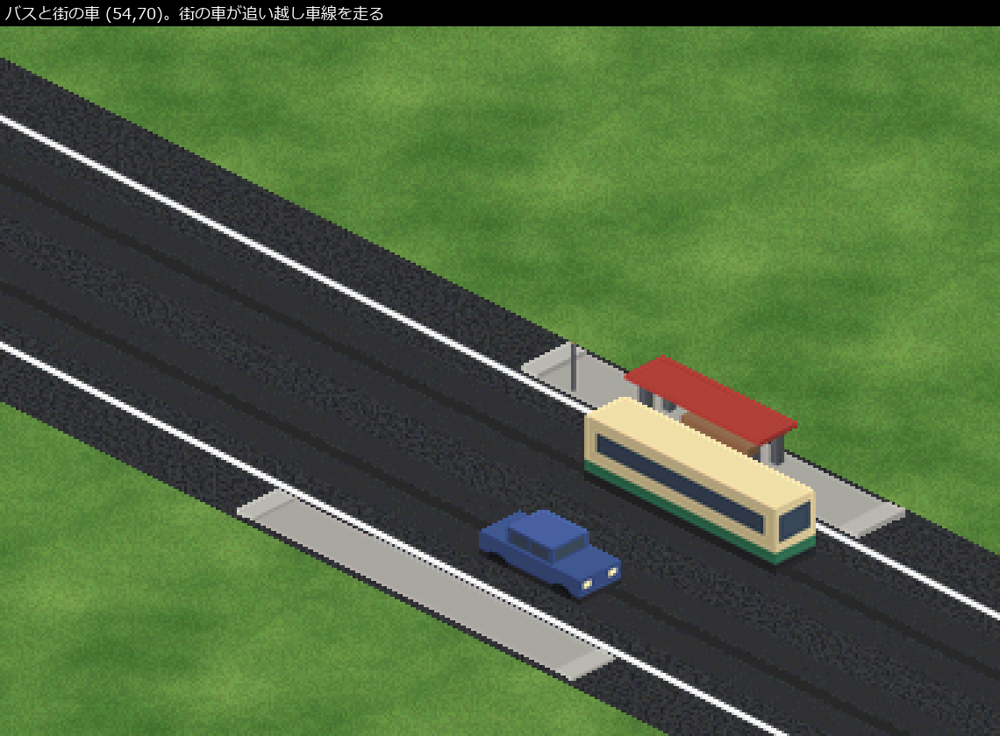
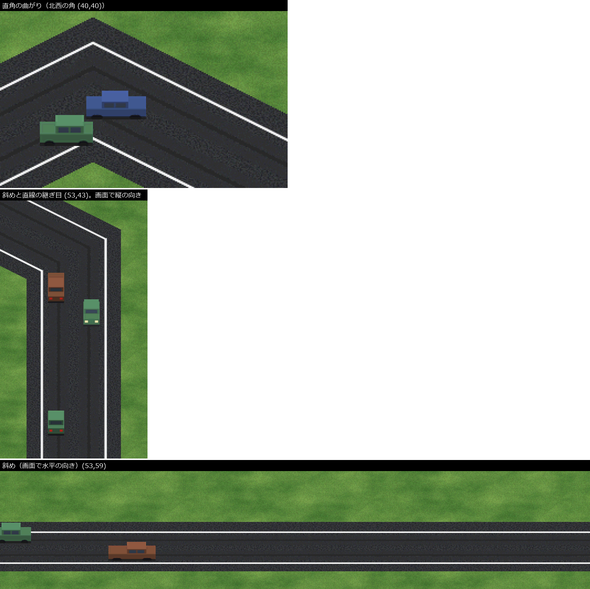
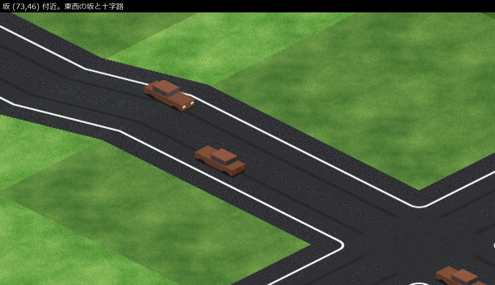
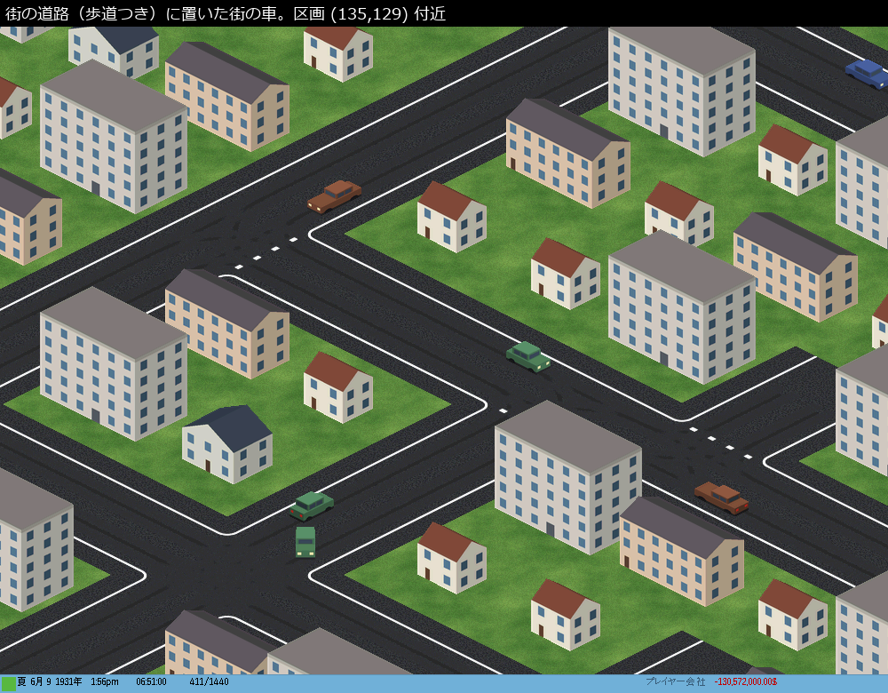

# 2026-11-27 街の車（#173）の確かめ

[#173](https://github.com/128-bit-net/pak256/issues/173)。街の車 3 種（`pak256_citycar_small`・`_sedan`・`_large`）を、OTRP v64、`flat_512_left_v64`（左側通行）で走らせて撮った。道路は AMI の 256 版の `ami_road_local`。決まりと表は [vehicles.md](../vehicles.md) の「街の車」。

## 絵

8 方向（左から s・w・sw・se・n・e・ne・nw）。上から小型・セダン・大型、いちばん下はバス（大きさの比べ用。列の端は切れている）。

ゲームの画面の中から、8 方向それぞれの絵と画素が一致する所（不透明な画素の 97% 超）を探して切り抜いた。8 方向とも映っていた。確かめたのは向きごとに 1 種で、3 種 × 8 方向の全部ではない。

## ゲームの画面

- 置き方: 直角の曲がりと斜めの階段を持つ道路の輪、台地を横切る十字の道、停留所で満載待ちのバスと石炭のトラックの道を作り、街の車は `tool_add_citycar` で名前を指定して置いた。
- 停留所の後ろ（追い越し禁止の道）では、街の車が 1 タイルに 1 台ずつ詰まって止まり、前の車や車両に重ならなかった。追い越せる道では、街の車が追い越し車線に出て抜いた。

- 曲がりと斜め: 車線（左側通行）の側を走る。直角の曲がりの頂点では、内側の白線に少し掛かることがある（下の「曲がり」の緑の車と、向きの sw）。直線と斜めでは、車体の高さの分が外側の白線に重なって見える。地面の枠が白線の内側かどうかは、道路の車両の決まり（[vehicles.md](../vehicles.md) の「横の位置（車線）」）からの計算で、画面で枠だけを測ってはいない。

- 坂: 車体は道路の車両と同じく水平のまま。絵の欠けは見えなかった。

## 街の道路

大きくした街（`change_size` で足して早送り）の道路 140 タイル（全部が歩道つき。`has_sidewalk()`）に街の車を置いた。直線・交差点を走り、建物に重なる絵の乱れは見えなかった（建物の陰に隠れる車はある）。

## 街が自分で出す車

- 人口を `change_size` で足した街（約 6 万人）を 5 か月ほど早送りすると、街が自分で 1 台を出した（`world.get_citycars()` が 1）。人口は輸送で増えたものではない。
- 本体は月の変わり目に `simrand(log10(輸送されない人口) × citycar_level) / 16` 台を出す（`simcity.cc` の `new_month`。`log10` は整数に切り捨て、割り算も整数）。`citycar_level = 5`（pak128 と同じ）では、輸送されない人口が 1 万人未満だと 0 台で、それ以上でも月に 1 台出ないことが多い。人口 4,799 の街では 3 回の早送りで 0 台だった。街の車の多さは変えていない。この式は OTRP の fork のもの（`simconst.h` の `DESTINATION_CITYCARS` が無効）で、本家の動きは確かめていない。

## ユーザーが確かめる項目

1. 車線の位置: 横の幅（22px）と車線の基準点はバスと同じなので、横の張り出しはバスと同じ。左側通行で、直線・斜めの車体の高さの分と、曲がりの頂点が白線に掛かる程度でよいか。
2. 長さと幅: バス・石炭のトラックと並べた見え方。幅は手本の決まりどおりバスと同じ 22px。
3. 8 方向・曲がり・坂・十字路で、絵の欠けやはみ出しが気にならないか。
4. 仮の絵の見た目（箱を組んだ形・色）。

## 確かめていないこと

- 右側通行の地図、本家 125.0.1。
- 雪の気候の道路、橋・トンネル、一般道・高速道路の上。
- 追い越しの途中の重なりの細かい見え方。
