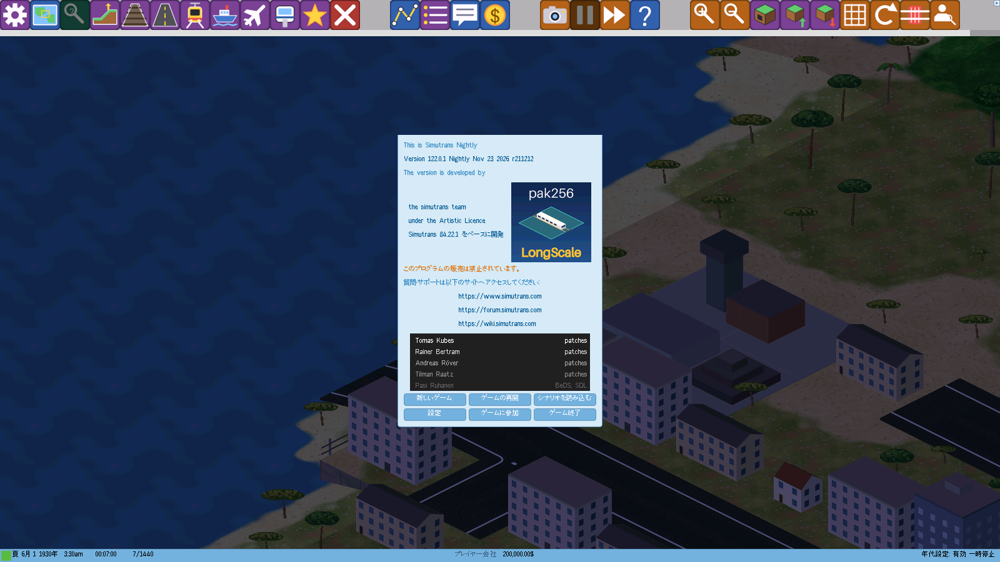
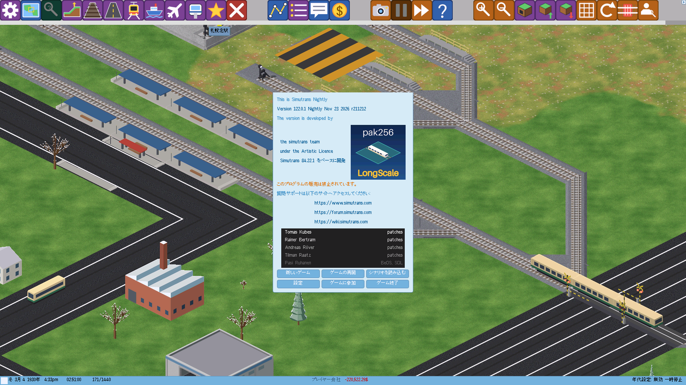

# 初期マップ demo.sve を入れた確かめ（#79）

2026-11-27、OTRP v64（`sim-WinGDI64-OTRPv64.exe`）、Windows の GDI 版。決まりは [layout.md](../layout.md) の「初期マップ」。

## 保存データ

- ユーザーが v0.4.0 の pak で作った物（2026-11-26）。そのまま `demo/demo.sve` に入れた。688,660 バイト（gzip）、SHA-256 `44470b3a33db6dbe84d64b0128265381a82da1431b1da5f69d124cdbe022bb3d`。
- 256×256、1930 年 3 月、街 16、産業 4、停留所 3、編成 4。
- 展開した中身に、手元のパスやメールアドレスらしい文字列は無かった（読める 4 文字以上の並びを一覧にして見た）。

## 今の pak で読めるか

比べたのは、v0.4.0 のタグから組んだ pak（AMI は alpha.6）と、`350100b` の main から組んだ pak（AMI は alpha.8。路面電車・船・飛行機・モノレール・川の後）。道路名は書き換えずに読んだ（`rewrite_roads=False`）。

- どちらも読めた。今の pak で `-load` したとき、「足りない物」の窓は出なかった。
- 地面の物（`square_x.get_ground_tile` の物。車両などの動く物は除く）を種類と名前ごとに数えると、38 項目・85,211 個で完全に同じ。街の人口と産業の名前も同じ（[census.py](2026-11-27_demo-map-screens/census.py)）。トンネル・高架の段は数えていない。
- 保存データが使う `pak256_`・`ami_` の名前 52 個は、全部今の pak にある（`tools/check_demo.py`）。バスの pak を抜いた写しでは `pak256_bus` が無いと出る。
- 速さ 32 で 20 秒進めると、4 編成の位置が変わった。

### 版に関係ないログ

次の行は v0.4.0 の pak でも同じに出た。

- `crossing_t::finish_rd: way/ground missing at 112,87 => ignore`（と 113,87）。読んだ後の 2 マスには道路・線路・踏切の物がある。原因は追っていない。
- `symbol.BigLogo.pak' failed!` と `MonorailGround not found`。

## 起動の画面

保存データの無い環境（実行ファイル・DLL・`config/` などと、配布の zip の `pak256/` だけ）を、`-load` を付けずに起動した（[demo_shot.py](2026-11-27_demo-map-screens/demo_shot.py)）。

直す前（`demo.sve` を抜いた zip。本体が作る 64×64 の地図）:

直した後（`demo.sve` が映る。位置は保存した時のまま）:

分かったこと:

- 起動の窓が出ている間は MCP が答えない。`capture_screen` が使えないので、起動した窓の中身を読むだけの [wincap.py](2026-11-27_demo-map-screens/wincap.py) で撮った（入力は送らない）。一度、真っ黒の画面を撮った回があり、撮り直しを足した。
- 起動の窓の間は世界が一時停止している（`simwin.cc` の `modal_dialogue` が `set_pause(true)`。状態の帯にも「一時停止」と出る）。車両は後ろで走らない。
- 画面の上の中ほどに、建設中の縞が 1 つ映る。保存した時に建てた直後の建物があったためで、ゲームを進めると車庫になる。一時停止なので、起動の画面では消えない。
- 状態の帯に、保存した会社の所持金（負の値）が出る。

## 確かめていないこと

- 起動の窓のボタンを押した後の動き（新しいゲーム・ゲームの再開など）。
- v64 以外の本体。保存データは v64 の形で、ほかの版では読めない見込み。
- ほかの画面の大きさ（1600×900 だけで撮った）。
