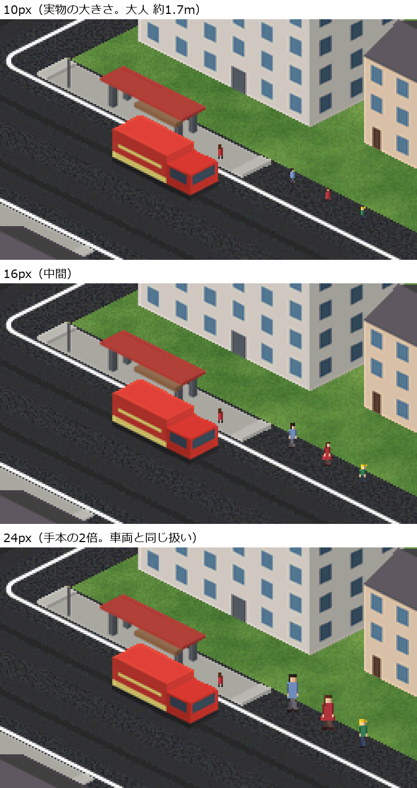
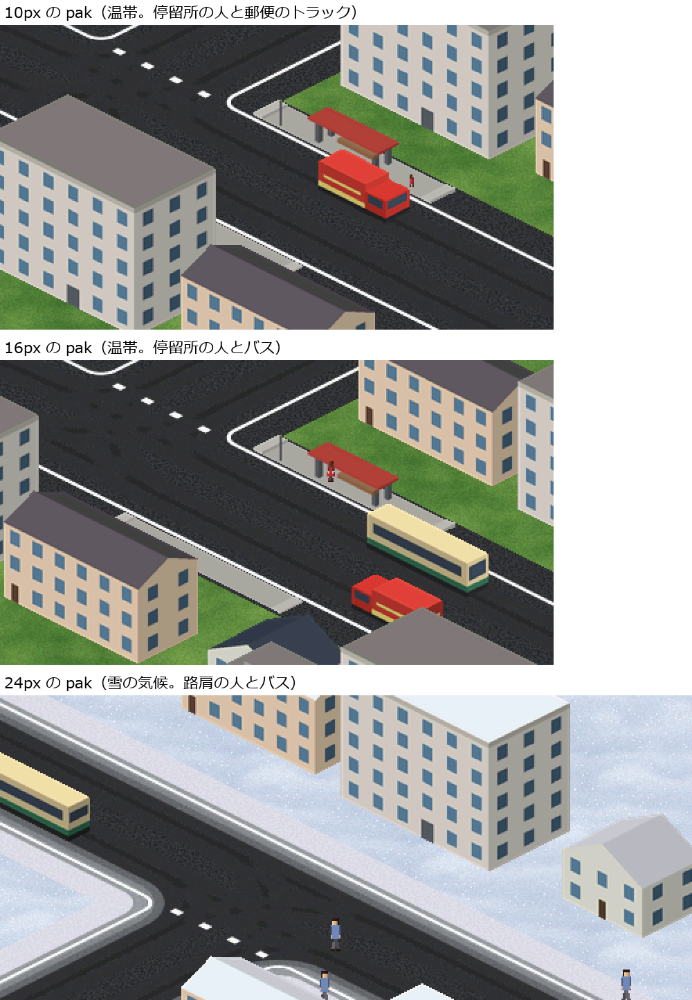
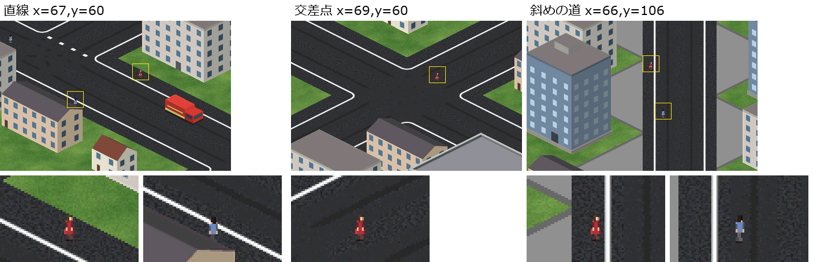

# 歩行者の確かめ（2026-11-27、#172）

決まりは [pedestrians.md](../pedestrians.md)。OTRP v64（検証環境の写し）、`flat_512_left_v64`、拡大 3（等倍）。撮影は `2026-11-27_pedestrians-screens/` の `scene.py`（大きさ・気候）・`walk.py`（歩く位置と周回路）・`diagonal.py`（階段の道）・`positions.py`（位置の測定）、大きさ違いと印の pak は `variants.py`、画像の切り出しは `figures.py`。`figures.py` のコマの名前と座標は記録した回の物で、撮り直すと変わる。

## 大きさの比べ

同じ画面（温帯のバス停・郵便のトラック・建物）の路肩の同じ位置に、男性・女性・子どもの絵を貼って比べた（ゲームが描いた物ではなく、絵を貼った比べ。停留所の中の小さい 1 人はゲームで出た物）。

手本の背丈の測り方は [pedestrians.md](../pedestrians.md) の「大きさ」。10px・16px・24px のそれぞれの pak でも、同じ手順でゲームを撮った（歩行者の出る場所は回ごとに違う）。

## ゲームで歩いた画面（16px）

## 8 方向の絵（組んだ pak から取り出した物）

左から `s`・`w`・`sw`・`se`・`n`・`e`・`ne`・`nw`、上から男性・女性・子ども（`tools/pakimage.py`）。

## 歩く位置

16px の pak で、直線・交差点・斜めの道（1 タイルごとに曲がる並び）を撮った。黄色の枠の人の 3 倍の切り抜きを下に並べた（`walk.py places`）。

直線の道では、向き色の印の pak（背丈 24px。足元の位置は背丈で変わらない）で、画面の足元の位置をタイルの座標に直した（`positions.py`。出力は [positions.log](2026-11-27_pedestrians-screens/positions.log)）。34 件のうち 33 件は道路の端から 0.043〜0.105 タイルで、種類の `offset`/256（子ども 0.047・男性 0.070・女性 0.094）の前後だった。残る 1 件は 0.156（白線の位置。タイル 51,61 の `s`）で、理由は確かめていない。最初の回で停留所のタイルに出た大きく外れた値（0.3 前後）は、隣のタイルの人を拾った物で、測定に含めていない。

## ゲームで見えた向き

- 直線の道路と交差点で `s`・`w`・`n`・`e` を見た。
- `nw` は、角のある小さな周回路（`walk.py loops`）と 1 タイルごとに曲がる道で見た。周回路では角の内側の路肩にいた。
- `sw`・`se`・`ne` は、ゲームの画面では見ていない。斜めの絵は角を短い側に曲がる間だけ出る。pak に絵があることは上の取り出しと `tools/test_pedestrians.py` で確かめた。

## 気づいた点

- 24px の最初の案は、男性の紺の服が暗い路面に埋もれた。明るい青に変えた。
- 斜めの道路（1 タイルごとに曲がる並び）では、車線の上にいる歩行者がいる。
