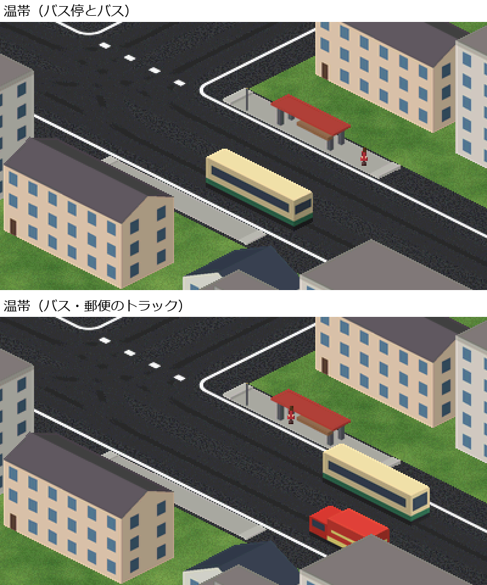
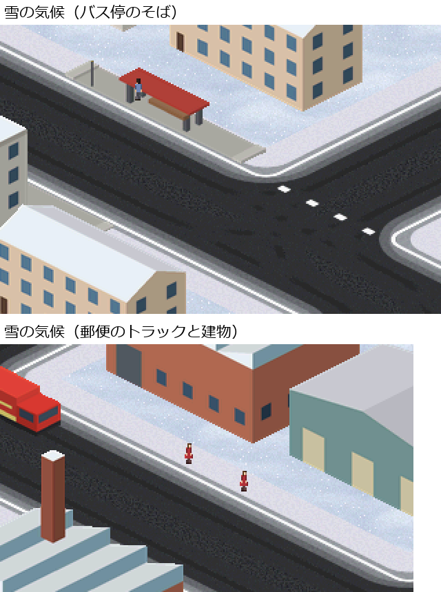
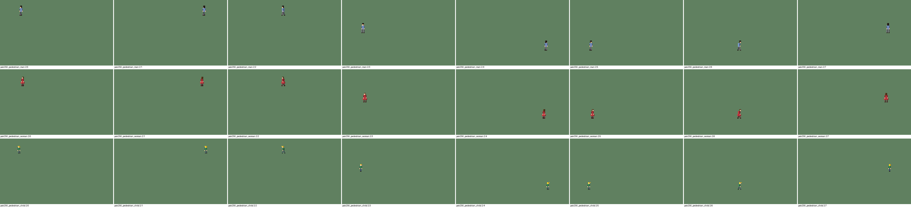

# 歩行者の確かめ（2026-11-27、#172）

決まりは [pedestrians.md](../pedestrians.md)。OTRP v64（検証環境の写し）、`flat_512_left_v64`、拡大 3（等倍）。撮影は `2026-11-27_pedestrians-screens/` の `scene.py`・`diagonal.py`、画像の切り出しは `figures.py`。

## 大きさの比べ

同じ画面（温帯のバス停・郵便のトラック・建物）の路肩の同じ位置に、男性・女性・子どもの絵を貼って比べた（ゲームが描いた物ではなく、絵を貼った比べ。停留所の中の小さい 1 人はゲームで出た物）。

10px・16px・24px のそれぞれの pak でも、同じ場面をゲームで撮って確かめた。

## ゲームで歩いた画面（16px）

## 8 方向の絵（組んだ pak から取り出した物）

左から `s`・`w`・`sw`・`se`・`n`・`e`・`ne`・`nw`、上から男性・女性・子ども（`tools/pakimage.py`）。

## 歩く位置

向きごとに色を変えた絵（`draw_pedestrians.py --marker`。背丈 24px の回。足元の位置は背丈で変わらない）で、直線の道路の歩行者の画面の位置をタイルの座標に直した。道路の端からの距離は、女性 0.094・男性 0.066〜0.074・子ども 0.047 タイル前後で、`offset`/256（0.094・0.070・0.047）と合い、両側とも路肩（0〜0.156）だった。南北の道路は、撮影の画面の中心の見立てがずれていた分（白線の位置から測って 0.085 タイル）を直して読んだ。

## ゲームで見えた向き

- 直線の道路と交差点で `s`・`w`・`n`・`e`、1 タイルごとに曲がる道で `nw` を見た。
- `sw`・`se`・`ne` は、ゲームの画面では見ていない。斜めの絵は角を短い側に曲がる間だけ出る。pak に絵があることは上の取り出しと `tools/test_pedestrians.py` で確かめた。

## 気づいた点

- 24px の最初の案は、男性の紺の服が暗い路面に埋もれた。明るい青に変えた。
- 斜めの道路（1 タイルごとに曲がる並び）では、歩行者が車線の上に見える。
