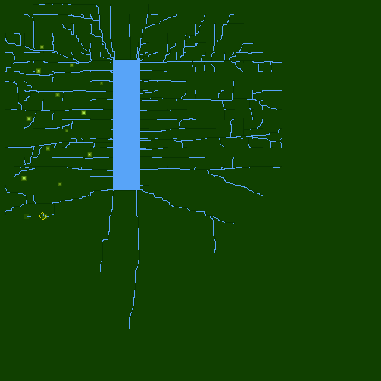
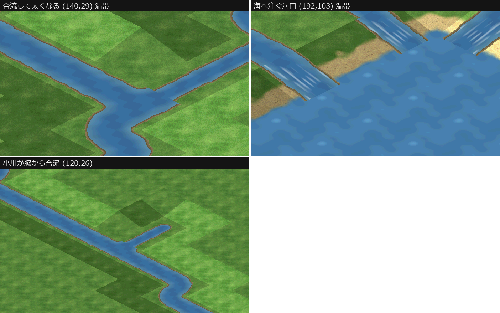
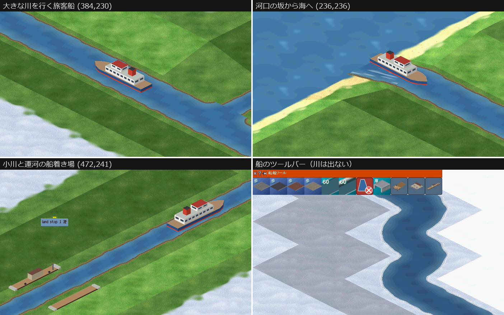
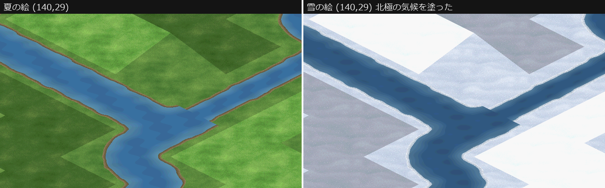
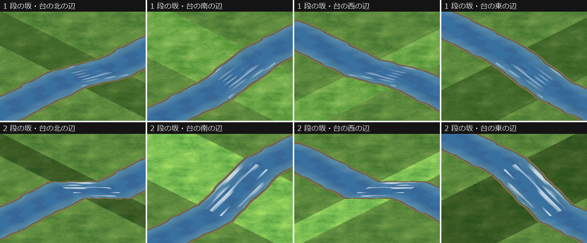
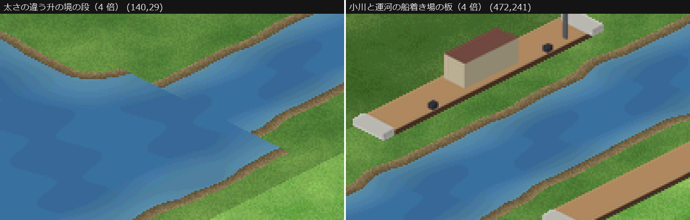

# 2026-11-27 川を入れる（#158）

環境: OTRP v64（`sim-WinGDI64-OTRPv64.exe`）、保存データ `flat_512_left_v64`、`tools/game.py`（MCP のポート 47920）、AMI の 256 版は `ami-256-alpha.7`。物の決まりは [config.md](../config.md) の「川」。

## 足した物

- `objects/river/`: 川 3 段（`pak256_river_30`・`_20`・`_10`）。向き 16 通りと、1 段・2 段の坂の 4 方向、雪の版。絵は仮。
- `config/simuconf.tab` の `river_type[0]`〜`[2]`、日本語・英語の名前、`tools/test_river.py`。
- AMI の 256 版は調べたが、川には使わなかった。`ami_canal` は `system_type=0` の石の岸の運河で、川の物は無い。

## 地図に川ができた

起動の画面の「新しい地図」はスクリプトで操作できないので、**地図の拡大**で川を引かせた（拡大も、新しい地図と同じ `karte_t::distribute_groundobjs_cities` の中で `create_rivers` を呼ぶ）。

1. `tools/vehicle_check/river_run.py --port <ポート> terrain`: 平らな地図に、海（x 190〜235、y 100〜319）と丘 12 個を作る。
2. `river_run.py --port <ポート> enlarge`: 拡大の窓で 640×640 にし、気候の窓の河川の数を増やして（9 回押すと 256）拡大する。窓の部品は `gui.get_window_components` で探して `gui.click` で押す。

川の升は、大きな川 3137・川 1141・小川 3764。ミニマップ（全体。四角が海）:

拡大で作る地形には、窓の「山の高さ」は効かなかった（本体の `enlarge_map` は、地形の高さを世界の今の設定で作る）。海が無いと川はできない。

## 船が通れた

`river_ship.nut`: 海に接する川の升から、いちばん遠い源まで（270 升。大きな川 241・川 17・小川 12、坂 1）をたどり、源に AMI の船の車庫、手前に運河の船着き場を置いて、旅客船を海と船着き場の間で往復させた。

**ただし、川を引いた直後の同じ回では、船は海から川へ入れなかった**（`NO_ROUTE`。河口の海の升の向きに、川の側が入っていなかった）。保存して読み直すと、海の升の向きに川の側が入り（`get_way_dirs` が 13 → 15）、同じ編成が走り出した。本体のソースを読むと、`way_builder_t::build_river` の始めの「海岸を探す」ループは、地面の高さが水面と同じ升を先頭から続けて飛ばすので、海と同じ高さの河口の陸の升まで進み、手前の海の升の向きを計算し直さないまま川を敷く、と読める（実行を追っては確かめていない。読み直しで直ることは値と動きで確かめた）。ソースを読んだ範囲では、川を引いた後に水の升の向きを計算し直す処理は新しい地図の側にも見当たらないので、同じになる見込み（起動の画面の「新しい地図」では確かめていない）。pak の側では直せない。

読み直しの手順: 川を引いた回で `world.save_game("river158")` を実行し、作業フォルダの `save/river158.sve` と、検証環境の実行ファイル・DLL・`config/`・`font/`・`themes/`・`text/`・`script/`・`music/` を 1 つのフォルダに写して、そのフォルダを `tools/game.py --env`・`--save river158` に渡す。読み直した回で、`river_ship.nut` が出した編成が走り出す。

## 雪・坂

坂は `river_slopes.nut` で台を作り（先頭に `local OX = 40, OY = 360, H = 1, WAY = "pak256_river_30";`、2 段は `OX = 70`・`H = 2`）、`tool_build_way` で川を敷いて、1 段と 2 段の 4 方向の坂の升を 1 つずつ見た（本体の坂の番号は 1 段が 4・36・12・28、2 段が 8・72・24・56）。見たのは大きな川だけで、隙間・重なりは見つからなかった。

## 見た目で気づいた点

- 太さの違う升の境では、岸に段が出る（本体は隣の太さを見ないので、絵では隣に合わせられない）。合流の升の脇で角ばって見える。
- 運河の船着き場は運河の幅に合わせた絵なので、小川では板が水から離れて、草の上に出る。
- 旅客船は小川の水面の幅いっぱいで走る。
- 川の水は動かない（道の絵なので、海のようには動かない）。

## 確かめていないこと

- 起動の画面の「新しい地図」での川（上のとおり、拡大で確かめた）。
- 川をまたぐ道路・線路の橋、街どうしの道路が川を越えるか。
- 川の脇の産業（炭鉱などの置き場所の決まり）。
- 本家 125.0.1、右側通行の地図、季節ごとの絵（雪は北極の気候を塗って見た）。
