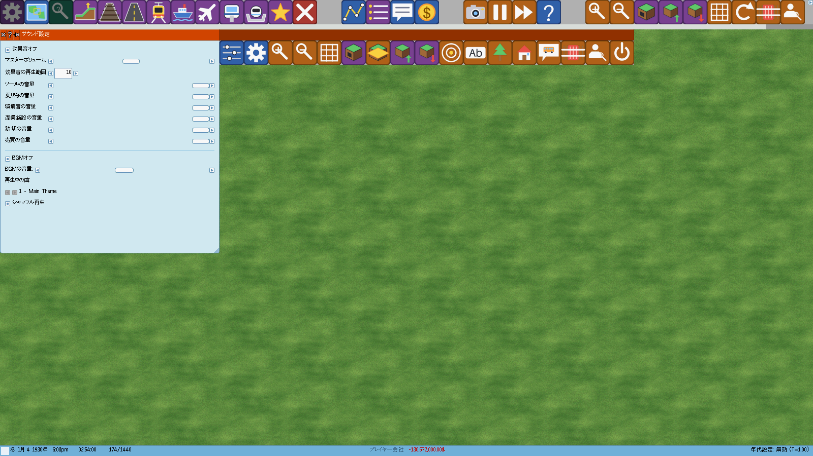

# サイトの直し（#214）

2026-11-27。[#214](https://github.com/128-bit-net/pak256/issues/214)。公開したサイトを読んだユーザーの指示で、導入方法を本体の版に依らない書き方にし、特別な色に見本を足し、読み手の呼び方を「アドオン作者」にそろえた。

## 導入方法に書いた本体の動き

OTRP の fork のコードを読み、音の窓はゲーム（OTRP v64）でも開いて確かめた。

- `-sound` が無いと本体は消音で始まる（`simmain.cc`）。前の回に窓で外していても、起動し直すと消音に戻る（コードを読んだ内容。起動し直しては試していない）。
- pak を指定しないと、pak を選ぶ画面が出ることがある（`simmain.cc`・`gui/pakselector.cc`。pak が 1 つだけなら出ないことがある）。ゲームでは試していない。
- 保存データの場所は、`config/simuconf.tab` の `singleuser_install` が 1 なら本体のフォルダ（`simmain.cc`）。
- `-mute` も `-sound` も無い起動で、ツールバーの左端の歯車から「サウンド設定」の窓が開き、「効果音オフ」にチェックが入っていた。窓が出る前の「ゲームオプション」の並び（スピーカーのボタン）は [GUI の絵の画面](2026-11-25_toolbar-icons-screens/2_settings.png)。

## 配布元の「最新版」

2026-11-27 の時点で、配布元（`teamhimeh/simutrans`）の一覧の一番上の v64 はプレリリースで、GitHub が「Latest」とする版は v63_5。pak256 を確かめたのは v64 で、v63_5 では確かめていない。サイトの導入方法のリンクは一覧（`/releases`）にした。

## 画面

組んだサイトを手元で配り、Edge の画面なしの撮影で撮った（幅 1280px。`5_drawing_narrow` は 500px、`4_drawing_dark` は暗い表示）。

- [導入方法](2026-11-27_site-fixes-screens/1_install.png)
- [絵の共通の決まり](2026-11-27_site-fixes-screens/2_drawing.png)
- [仕様の入口](2026-11-27_site-fixes-screens/3_spec-index.png)
- [絵の共通の決まり（暗い表示）](2026-11-27_site-fixes-screens/4_drawing_dark.png)
- [絵の共通の決まり（狭い幅）](2026-11-27_site-fixes-screens/5_drawing_narrow.png)
