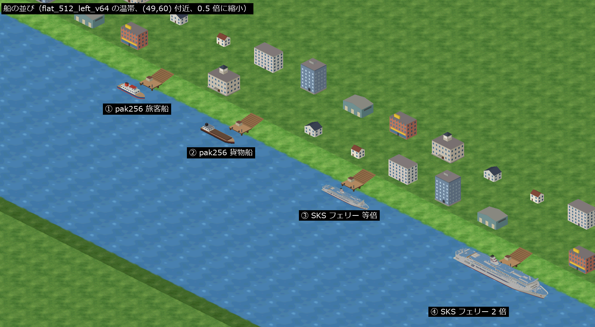
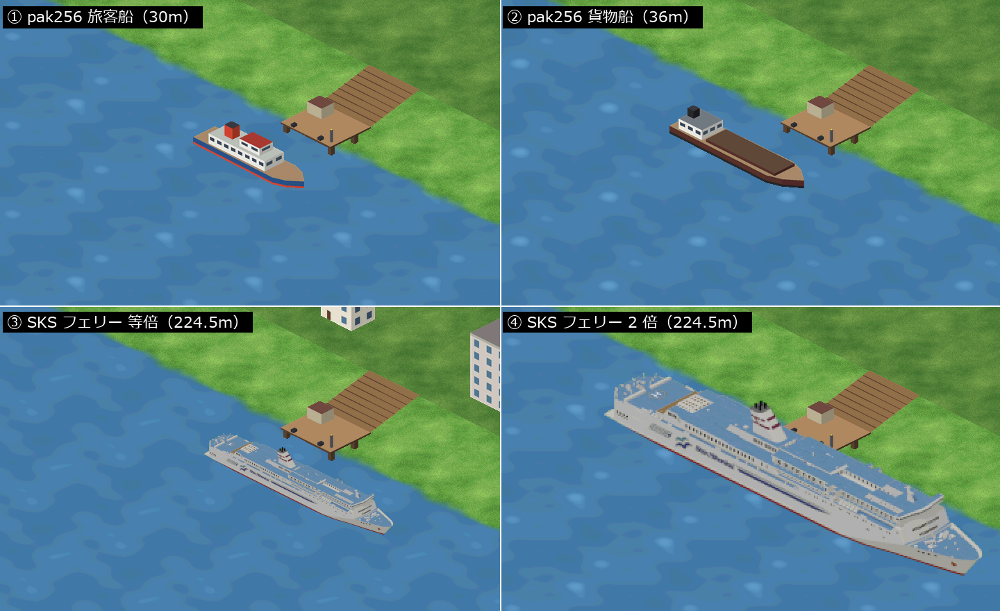
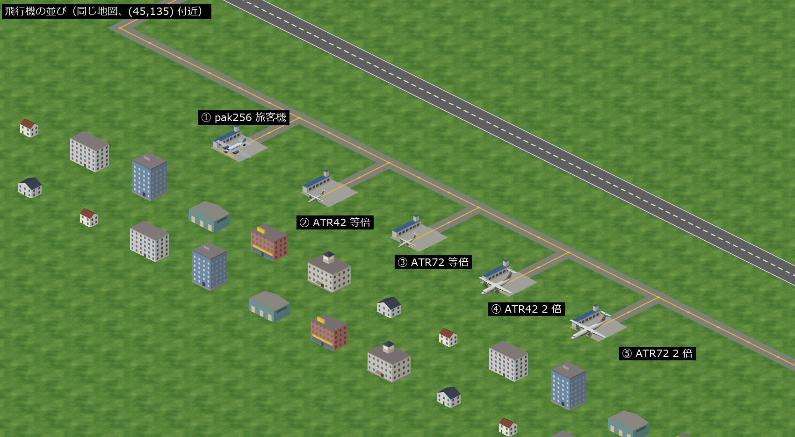
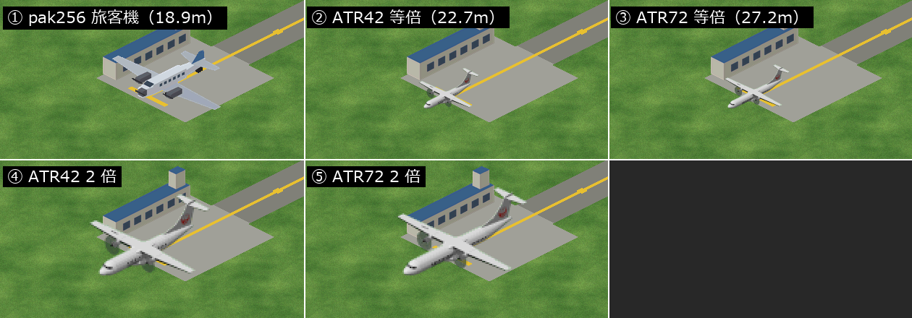

# 船と飛行機の大きさを SKS のアドオンと並べて比べる（2026-11-27、#164）

[#164](https://github.com/128-bit-net/pak256/issues/164)。大きさの手本として渡された SKS 氏の 128 向けアドオンを、256 の地図に pak256 の仮の船（#154）・旅客機（#155）と並べて撮った。**決まりを直すかはユーザーが決める**。この記録は材料と案で、[standards.md](../standards.md) は直していない。

## 使った物

| 名前 | 中身 | 許諾 |
|---|---|---|
| `SKS_ATR_ver1`（`SKS_ATR_1`） | 小型プロペラ機 ATR42-600・ATR72-600。使ったのは JAL 系の塗装の旅客機 2 種 | CC0（同梱の readme） |
| `SKS_SNF_ver1.1`（`SKS_SNF_1_size384`） | 新日本海フェリーのセット。使ったのは「あかしあ」の先頭の車両の絵 | CC0（同梱の readme） |

SKS のファイル（pak・dat・元の絵）はリポジトリに入れていない（検証用のフォルダの展開した写しを読み、組んだ pak は一時の場所に置いた）。下の画面には SKS の絵が写っている。

## 256 の地図に置ける形

配られている `.pak` をそのまま読み込むことはしていない。128 の絵は基準点の位置が 256 と違うので、dat と png から組み直した（[build_sks.py](2026-11-27_sks-scale-screens/build_sks.py)）。

- **等倍**: 画素はそのままで、基準点を 256 の地図の基準点に合わせた。
- **2 倍**: 画素を最近傍で 2 倍にして、同じく基準点を合わせた。
- フェリーは客室・車両甲板（長さ 0 の連結する車両）を外し、先頭の車両だけにした。

## 画面

OTRP v64、`flat_512_left_v64` の温帯、昼、名札なし。撮り方は [scene.py](2026-11-27_sks-scale-screens/scene.py)、切り抜きと札は [montage.py](2026-11-27_sks-scale-screens/montage.py)。全体は 0.5 倍に縮小、並べた切り抜きは等倍。

船（北の岸の桟橋の手前に東向きで停泊）。並びは左から ① pak256 の旅客船、② pak256 の貨物船、③ SKS フェリー等倍、④ SKS フェリー 2 倍。

飛行機（空港の駅に南向きで駐機。(38,135) から 3 升おき）。① pak256 の旅客機、② ATR42 等倍、③ ATR72 等倍、④ ATR42 2 倍、⑤ ATR72 2 倍。

## 実物の寸法との突き合わせ

絵の外接枠を、車両の大きさと同じ測り方（[standards.md](../standards.md) の 4 章「大きさ」の測り方）で測った（[measure.py](2026-11-27_sks-scale-screens/measure.py)）。pak256 の実物比例は、横向きで 1m = 6.86px。「実物比」は、測った長さ ÷（実物の長さ × 6.86）。

| 物 | 実物の長さ | 横向きの長さ | 実物比 |
|---|---|---|---|
| pak256 旅客船 | 30m | 204px | 0.99 |
| pak256 貨物船 | 36m | 249px | 1.01 |
| SKS フェリー 等倍 | 224.5m | 361px | 0.23 |
| SKS フェリー 2 倍 | 224.5m | 722px | 0.47 |
| pak256 旅客機（Junkers Ju 52） | 18.9m | 125px | 0.96 |
| SKS ATR42-600 等倍 | 22.67m | 94px | 0.60 |
| SKS ATR72-600 等倍 | 27.17m | 107px | 0.57 |
| SKS ATR42-600 2 倍 | 22.67m | 188px | 1.21 |
| SKS ATR72-600 2 倍 | 27.17m | 214px | 1.15 |

翼の幅は、正面向きの外接枠の横で ATR42 2 倍が 196px（実物 24.57m、1m = 7.98px）、ATR72 2 倍が 214px（実物 27.05m、7.91px）、pak256 旅客機が 200px（実物 29.25m、6.84px）。

実物の寸法の出典: ATR は [ATR の資料](https://www.atr-aircraft.com/wp-content/uploads/2020/07/2018_06_atr_72_marketing_booklet_153.pdf)（検索で確かめた。2026-11-27）、フェリーの長さ 224.5m は SKS の readme の値（検索では 224m・224.8m とする資料もある）。フェリーの幅と高さの実物の値は確かめていないので、突き合わせていない。Ju 52 は [airport.md](../airport.md)。

## 見たこと

- **飛行機**: 2 倍の ATR は、実物比例より 15〜21% 大きいだけで、pak256 の決まり（実物比例）に近い。等倍は約 0.6 倍で、駅（1 タイル）の駐機場の中で小さく見える。2 倍の ATR72 は翼の幅が駐機場の舗装の幅くらいで、機体が駅の建物に一部重なる。pak256 の旅客機は、実物の長さの差（18.9m と 22.7〜27.2m）の分だけ胴が短い（翼の幅は Ju 52 のほうが大きい）。
- **船**: SKS のフェリーは、2 倍でも長さが実物の約半分（pak256 の換算で約 105m、軸の向きで約 4 タイル）。2 倍で、街の建物と並べて大きな船に見え、1 タイルの桟橋は船体に大きく隠れる。等倍は pak256 の貨物船（36m）の約 1.45 倍の長さで、224m の船には見えにくい。
- 224.5m を実物比例で描くと、横向きで約 1540px（タイル 6 枚分の幅。軸の向きで約 8.5 タイル）になる。SKS 2 倍の約 2.1 倍。
- 768px のセル 1 枚で描いた約 4 タイル分の船は、停泊中の東向きでは欠けずに描かれた（[standards.md](../standards.md) の 8.2「船が複数タイルにまたがる絵」の材料。ほかの向き・航行中は見ていない）。
- SKS の絵は車両の基準点が絵の中ほどに当たり、pak256 は船首・機首が基準点。同じ升に止めても前後の位置がずれる。

## 決まりを直す案

| 案 | 中身 | 良い点 | 悪い点 |
|---|---|---|---|
| A | 今のまま（船も飛行機も実物比例） | 決まりが単純。小さい物は今の絵のまま | 大型船は 1500px 級になり、セルも地図の上の場所も大きい |
| B（おすすめ） | 飛行機は実物比例のまま。船は 60m まで実物比例、超える分は 1/3 に縮める（描く長さ = 60 + (実物 − 60) ÷ 3。幅と高さにも同じ割合を掛ける） | 今の仮の船と旅客機は変わらない。224.5m は約 115m になり、手本の 2 倍（約 105m）に近い。長い船ほど長い順は保たれる | 決まりが 1 つ増える。大型船は街の建物との比が実物と違う |
| C | 船は一律で実物の約半分（手本の 2 倍の割合） | 手本にいちばん近い | 30m 級の小さい船が半分になり、今の仮の絵を描き直す |

B をおすすめする理由: 飛行機は手本（2 倍）と今の決まりの差が小さい。船は手本が大型船をおよそ半分に縮めていて、実物比例のままだと大型船を置ける場所が限られる。小さい船は実物比例でも画面で小さすぎないので、縮めるのは大型船だけでよい。B の 60m と 1/3 は、上の画面から置いた値で、この式で描いた絵はまだ試していない。

案を選んだら、[standards.md](../standards.md) の 4 章「船・飛行機」と [vehicles.md](../vehicles.md) の「船」を直す。

## 確かめていないこと

- 配られている `.pak` を組み直さずに読み込んだ見え方。
- 航行中・飛行中、ほかの向き、雪の気候、右側通行の地図、本家 125.0.1。
- 「すずらん」「はくおうⅡ」、ほかの塗装と貨物機。
- 大型の旅客機（60〜70m 級）と今の滑走路・駅の幅の釣り合い。手本は小型機だけ。
