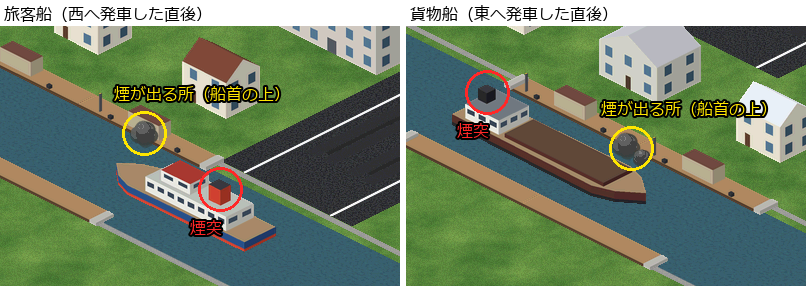
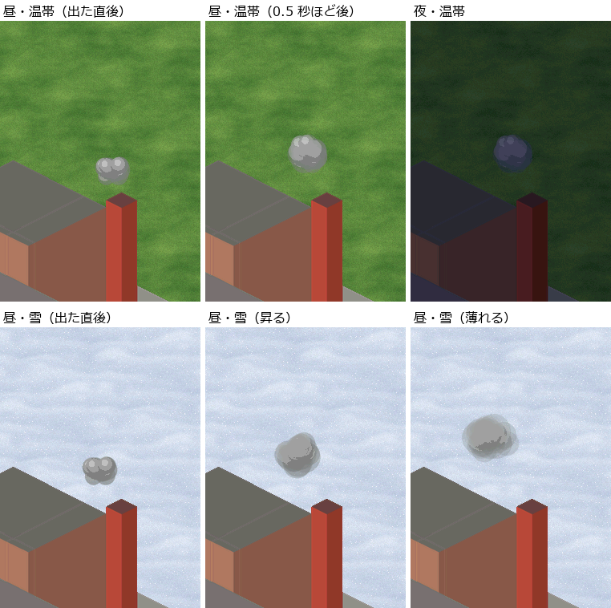
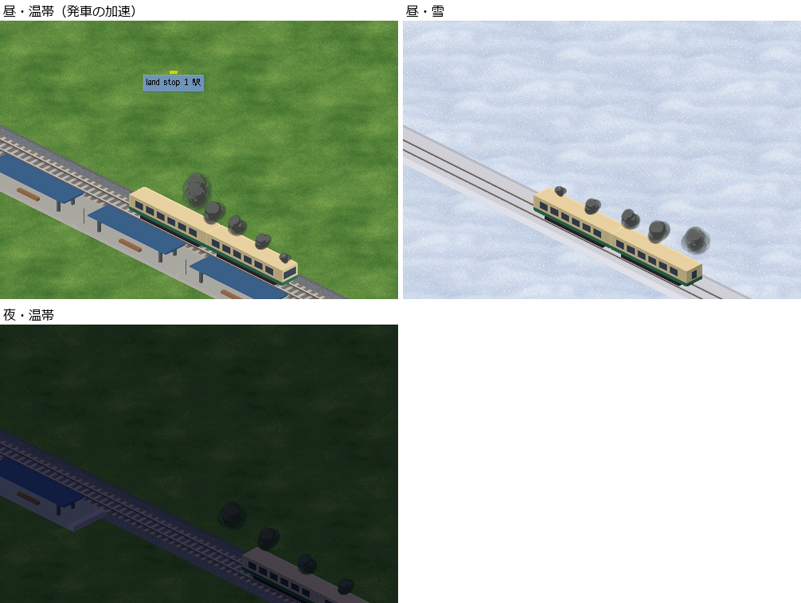
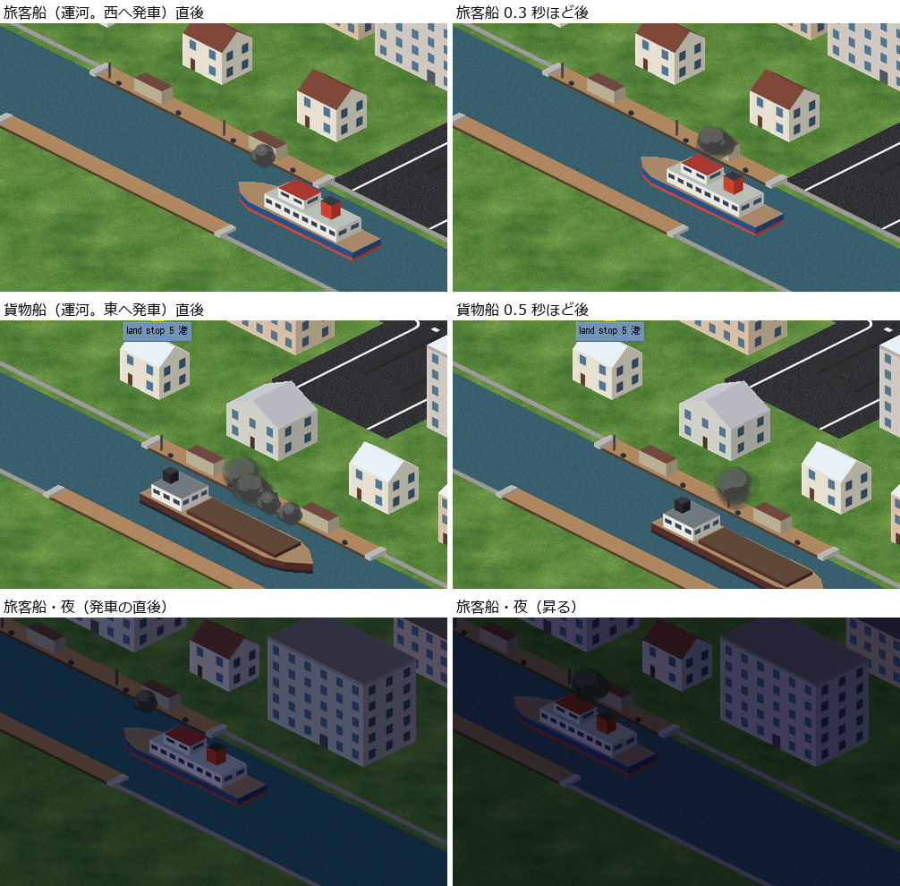

# 煙を入れた確かめ（#174）

2026-11-27。OTRP v64、`flat_512_left_v64`、`gui.set_zoom(3)`、画面は等倍の切り抜き。`tools/game.py --interactive` で開いて、命令で場面を置いて撮った。決め事は [煙](../smoke.md)。

## 場面

- 石炭の連鎖: `tools/vehicle_check/road_stop_coal.nut`。温帯は `OX=60`、雪は `OX=300`（y=60。発電所はその 22 タイル東）。発電所が石炭を受け取ってから撮った。
- 気動車: `tools/vehicle_check/rail.nut`。y=130、温帯は x=40〜100、雪は x=280〜340。
- 船: `tools/vehicle_check/ship.nut` の運河（y=104。旅客船）。貨物船は運河の車庫 (85,105) から 1 隻足して、船着き場 (74,104)・(97,104) の間を往復させた。
- 夜は `--night` で起動して撮った。昼夜は止めない起動では、画面の明るさが撮るたびに入れ替わることがあった（理由は調べていない）。

撮り直しは [run.py](2026-11-27_smoke-screens/run.py)（場面 `plant`・`rail`・`ship`、`--snow`・`--night`）。下の画面は、開いたまま命令を送って撮ったコマと、`run.py` の船の夜（`--scene ship --night`）のコマから選んだ。発電所と気動車の「昼・温帯」は、`--night` で起動した回の明るいコマ。

## 画面

煙の出る所と煙突（印を付けた船の発車の直後）:

発電所（昼・夜・雪）:

気動車（昼・雪・夜）:

船（発車の直後と夜）:

## 見えたこと

- 発電所: 煙は煙突の口から出て、左上へ流れながら大きく薄くなった。昼の温帯・雪の地面の上で見分けられた。夜はほかの物と一緒に暗くなり、光る画素は見えなかった。
- 気動車: 発車の加速の間、先頭の端の屋根の上から出て、後ろへ並んだ。
- 船: 発車のたびに数個出た。船首の側で生まれ、船が進むので船の中ほどから後ろの上に残った。**煙突の口からは出ない**（本体に位置の指定が無い）。夜の旅客船の煙も、暗くなって光る画素は見えなかった。

## 確かめていないこと

- 船の雪の気候。
- 大きさと色を今の値にした後の海の船（撮ったのは運河。海は大きさを変える前の値で 1 回見た）。
- 本家 125.0.1、右側通行、地図の回転。
