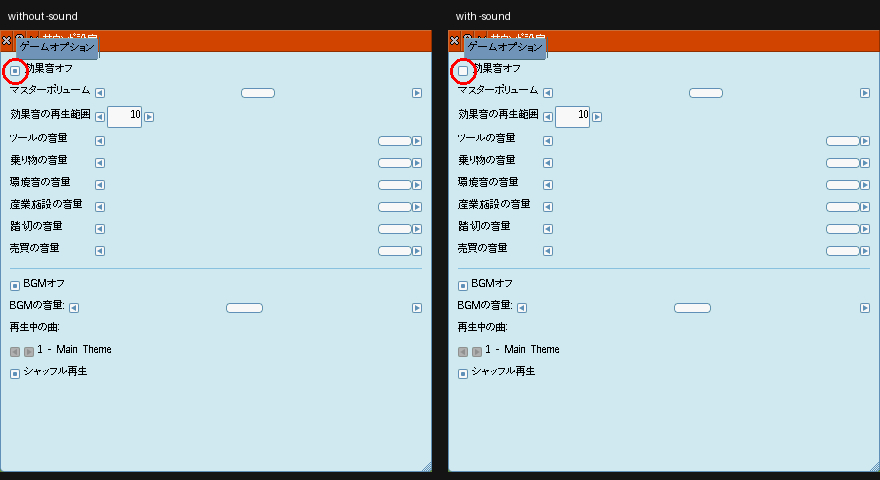

# 音の確かめ（2026-11-27、#175）

OTRP v64（`sim-WinGDI64-OTRPv64.exe`）、`flat_512_left_v64`、このブランチで組んだ pak（AMI あり）。

- `-mute` なし・`-sound` なし・`-debug 3` で起動し、ログで 9 個の WAV が全部 `Successfully loaded`。`not found` は環境の音の名前だけ。
- 音の設定の窓の「効果音オフ」は、`-sound` なしではチェックが入り、`-sound` を付けると外れる（下の画像）。
- `tools/vehicle_check/sound_run.py --check` で、8 場面（`bus`・`coal`・`plant`・`rail`・`tram`・`monorail`・`air`・`ship`）のどれも、画面の中央の近くの停留所（縦横の和で 6 タイル以内）からの発車を読んだ。鳴らさない起動なので、音の再生そのものは通していない。
- スピーカーから鳴るかと音の聞こえ方は、耳で確かめていない。

