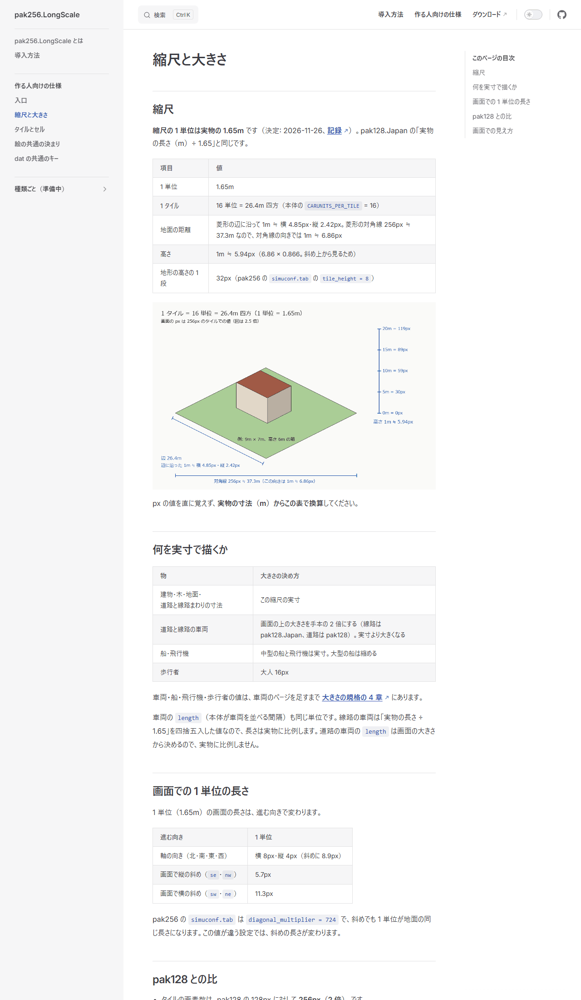
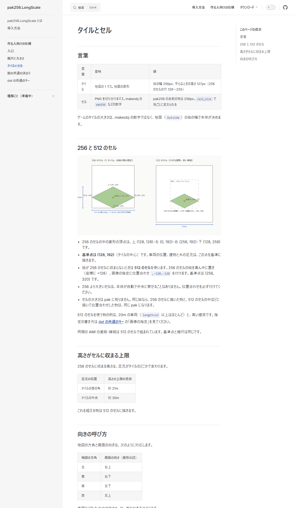
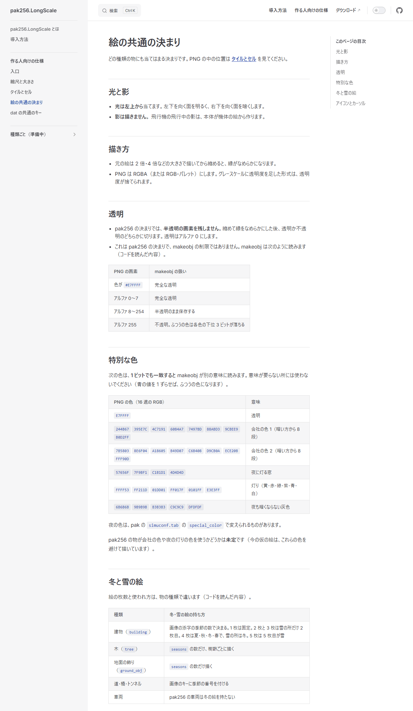
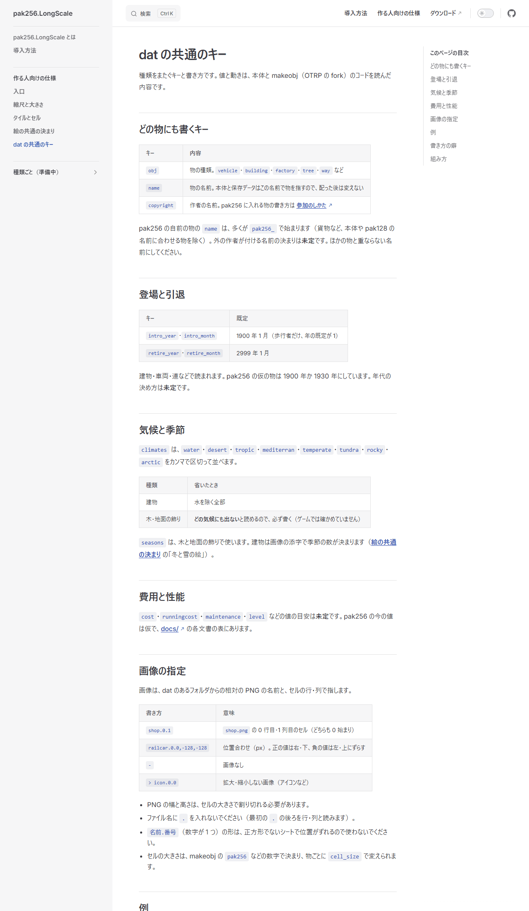

# 作る人向けの仕様の入口と共通の決まり（#177）

アドオンを作る人向けの仕様を公開のサイト（`site/spec/`）へ移し始めた。2026-11-27。

## 決めた構成（ユーザーの答え）

- 文書は消さず改名もしない。決まりはサイトの `site/spec/`、値の表と手順は `docs/`、経緯は `docs/records/` に置く。検査が `docs/` の表を読み、記録からのリンクが切れると文書の検査が落ちるため。
- 検査が読む寸法の表は `docs/` に残し、サイトでは取り込んで出す。取り込めなければ表をサイトへ移し、検査のパスだけを直す。
- 古い記述は、共通のページと開発の文書の分を #177 で、種類ごとの分はそれぞれの issue で直す。
- 種類ごとのページは、線路の車両、道路の車両と歩行者、駅と信号、船・空港・川、建物と産業、木と地面、GUI、煙と音の順。

## `docs/` の表の取り込み

VitePress 1.6.4 で、`site/` の外の `../docs/standards.md` を `<!--@include: …{58,68}-->` で取り込むと、組んだ HTML に表の中身が出た（手元の `npm run build`）。CI（`.github/workflows/site.yml`）は `sparse-checkout: site` なので、取り込みを使うページを足すときは、取り込むファイルも取り出すようにする。今回は取り込みを使っていない。

## `standards.md` の 1〜3 章にあった経緯

移す前の 1〜3 章の本文は、このコミットの親の `docs/standards.md` にある。サイトに残さなかった主な物は次のとおり。

- 縮尺 1 単位 = 1.65m は [concept.md](../concept.md) の 3 章 C の決定で、2026-11-26 に確定した（[#104](https://github.com/128-bit-net/pak256/issues/104)、[記録](2026-11-26_scale-check.md)）。
- 色の一覧の元は `objects/ground/temperate/draw_ground.py` の `_SPECIAL`。本体の `descriptor/image.cc` の `rgbtab` の 31 色に `E7FFFF` を足した物と一致した。
- 「半透明の画素は切る」は pak256 の決まりで、makeobj の制限ではないと分かった（`descriptor/writer/image_writer.cc`）。

## サイトの図と画面

- 寸法の図: `site/figures/draw_spec_figures.py`。
- 画面: [2026-11-26_scale-check-screens/run.py](2026-11-26_scale-check-screens/run.py) を今の pak で流し（OTRP v64、`flat_512_left_v64`）、`A_road_z3.png` の (240, 240)-(1500, 878) と `B_rail_z3.png` の (240, 200)-(1500, 800) を切り出して 256 色にした。

## 直した古い記述

- `layout.md`: 「物の種類」の表の重なった `objects/station/` の行を消し、道具の表に抜けていた道具と検査を足した。
- `roadmap.md`: 必須の地面から `Shore` を外し、駅の種類の記号の注意、停留所を pak256 の物に戻したこと、歩行者と煙を入れたこと、段階 3 の後の版の見方を直した。
- `config.md`: ツールバーの見た目を確かめ済みにし、車両の長さの言い方と、AMI の停留所の記述を直した。
- `concept.md`: 冒頭に今の決まりの場所を足し、曲がり・斜め・坂の「未確認」を直した。
- `standards.md`: 冒頭の説明と、高さの上限の重なりを直した。7 章の地面の寸法は、地面のページを書くときに移す。

## 本体のコードで確かめた事

特別な色（`descriptor/image.cc`）、透明の扱いと画像の指定（`descriptor/writer/image_writer.cc`）、登場年と気候の既定（`descriptor/intro_dates.h`、各 writer）、建物の季節（`obj/gebaeude.cc`）、車両の 8 方向（`dataobj/ribi.h`、`descriptor/writer/vehicle_writer.cc`）、画面への投影（`display/viewport.cc`）。木と地面の飾りは `climates` を省くと、気候が 1 つも無い値になる。makeobj 60.12 で、省いた pak と `climates=` を空にした pak は同じで、`climates=temperate` の pak とは気候の値の 1 バイトが違った（`tabfileobj_t::get` はキーが無いと空文字を返すので、writer の「北極を除く」の分岐は通らない）。ゲームでは確かめていない。`dat.md` の車両の例も 60.12 で警告なく組めた。

## 組んだサイトの画面

手元の `vitepress preview` を Edge の画面なしの撮影（幅 1280px）で撮った。

