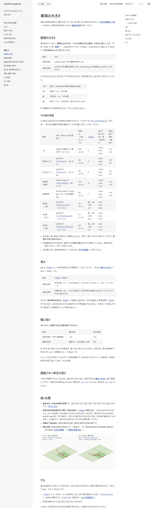
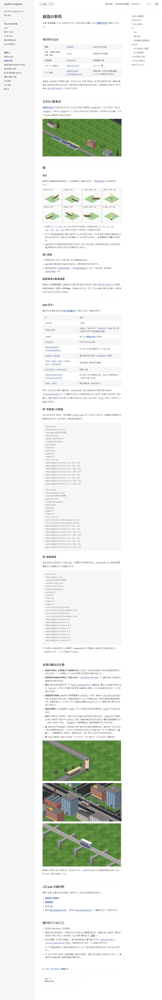

# 作る人向けの仕様: 車両の大きさと線路の車両（#204）

道路と線路の車両に共通の決まりと、線路の車両（列車・路面電車・モノレール）の決まりを、公開のサイト（`site/spec/vehicle-size.md`・`vehicle-rail.md`）へ移した。2026-11-27。構成は [#177 の記録](2026-11-27_spec-common.md)。

## 表の取り込み

`standards.md` の 4 章「大きさ」の表は `docs/` に残し、サイトでは `<!--@include: …#vehicle-size-table-->`（region の印）で取り込む。行番号の指定は表がずれると壊れるので使わない。VitePress 1.6.4 は、取り込むファイルが無いと何も出さず（印の注釈がそのまま残る）、region が見つからないとファイル全体を出し、どちらもビルドは失敗しない（コードを読んだ内容）。そのため `site.yml` に、表の行があることと、`standards.md` の別の章が混じらないことを確かめる段を足した。`site.yml` の取り出しは、`docs/records` の画像を取らないように cone を切って `ci.env`・`site/`・`docs/standards.md` を指定した。

## サイトに移し、`docs/` から消した経緯と確かめ

- 線路の車両の高さ（`RAIL_WHEEL_DROP_PX = 0`）: AMI の線路は新描画位置でレールが地面より下がる（レールの基準面が `Datum(4,1)`、256 版は 2 倍）が、ゲームで撮ると、車輪の下端が地面のままで車体の下の暗い帯の下端がレールの上に乗って見えた（[記録](2026-11-25_rail-train.md)）。
- 20m の車体は、横の斜め（11.3px/単位）で 136px 伸びて 256 のセルに収まらないので、512 のセルにした。makeobj は警告なく組め、512 のセルの車両が線路の上の決まった位置に出ることを東西の直線で確かめた。
- 道床の見立て（約 3.4m）より車体の幅（3.9m）が広いが、駅のホームには当たらない（[記録](2026-11-26_scale-check.md)）。
- 隣の線路（#104）: 太くした車両を、1 タイル隣り合う 2 本の線路の 90° の曲がりで走らせても、はみ出しは隣の線路に届かなかった（同じ記録）。
- 曲がり・坂（#71。[記録](2026-11-25_rail-leftovers.md)）: 20m の車体は角の外へはみ出して草地に掛かる。直さないのは、短くして両数を増やすか曲がり用の絵を足すしかなく、仮の絵の段階では釣り合わないため。
- 路面電車の曲がりと坂（[#153](2026-11-26_tram.md)・[#176](2026-11-27_standards-8-2.md)）: `length=7` は AMI の路面軌道の 90° の曲がりで内側へ少し寄るが舗装の中。2 両連結の継ぎ目は折れない。1 段の坂（東西の向き）で目立つ沈みや浮きは無い。
- 路面電車の架線（#189。[記録](2026-11-27_ami189.md)）: 架線は線路のツールバーの架線に並び（本体が `tram_track` の way-object を `track` として扱う）、撤去も線路の架線の撤去。架線が無いと車庫から出ない。道路の区間と車庫だけに張ると、切れる手前の停留所で止まり「運行できる経路がありません」と出る。

## 本体のコードで確かめた事（OTRP の fork を読んだだけ）

- `waytype` の名前: `track`・`tram_track`・`monorail_track`・`maglev_track`・`narrowgauge_track`（`descriptor/writer/get_waytype.cc`）。

- 向きの絵の代わり: 画像が無い向きは `dir - 4`（`descriptor/vehicle_desc.h` の画像の取り出し）。
- 連結の指定: `constraint` が 1 つも無ければ何でもつながる。`none` は車両の無い参照（`can_follow`・`can_lead`）。
- 電化: 動力のある車両がすべて `electric` の編成だけが電化した軌道を要る（`simconvoi.cc` の `check_electrification`）。
- 路面電車は `tram_wt` で `rail_vehicle_t`（`bauer/vehikelbauer.cc`）。
- 左側通行のずれを足すのは道路の車両だけ（`simvehicle.cc` の `road_vehicle_t::get_screen_offset`）。

## dat の例

`vehicle-rail.md` の 2 つの例は、仮の形の画像を使って makeobj 60.12 で組み、`Warning` と `ERROR` の行が無いことを確かめた（[組むスクリプト](2026-11-27_spec-rail-vehicles-screens/page_dat.py)）。ゲームでは試していない。例を直したら流し直す。

路面電車の架線の置き・撤去はスクリプトで確かめた。ツールバーのボタンを押して置く操作と、車庫の窓で架線の無い車庫の電車が買えるかは確かめていない。

## 組んだサイトの画面

手元の `vitepress preview` を Edge の画面なしの撮影（幅 1280px）で撮った。

## 画面と図

- 図: `site/figures/draw_spec_figures.py`（基準点と車体の位置、8 方向の絵）。8 方向の図は、このリポジトリの仮の気動車のシートを使う。
- 画面: `tools/vehicle_check/rail_curve_run.py`・`tram_run.py`・`monorail_run.py` を OTRP v64、`flat_512_left_v64` で流し（2026-11-27、pak は `tools/build.py` で組んだ今の物と AMI `ami-256-alpha.9`）、`corner_ne_01`・`road_stop_0`・`elevated` を切り出して 256 色にした。`monorail_run.py` は制限時間で打ち切り、ツールバーと財務の窓の画像は撮れていない（ページに使わないので撮り直していない）。
