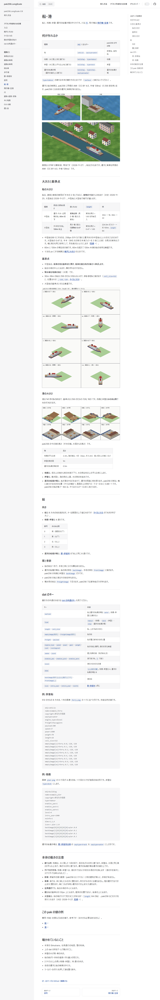
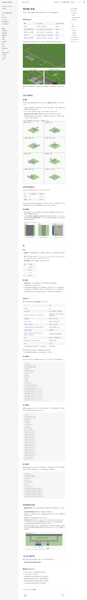
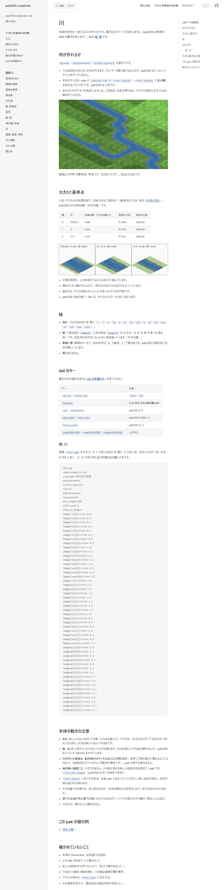

# アドオン作者向けの仕様: 船・港・飛行機・空港・川（#207）

船・港、飛行機・空港、川の決まりを、公開のサイト（`site/spec/ship.md`・`air.md`・`river.md`）へ移した。2026-11-27。構成は [#177 の記録](2026-11-27_spec-common.md)。

## 置き場の分け方

- 値の表と道具の手順は `docs/vehicles.md`・`docs/stations.md`・`docs/airport.md`・`docs/config.md` に残した（検査が名前で行を読む）。
- `docs/standards.md` の 4 章「船・飛行機」は、見出しを残して（コードの注釈が引く）行き先のリンクにした。
- site/spec/ の版を固定した書き方（`ami-256-alpha.9` の 5 か所と、`scale.md` の「OTRP v64」）を、版に依らない書き方にした（ユーザーの指示、#214）。

## 元の文書の古い記述

`docs/stations.md` の「港」の「川は確かめていない。川の物が pak に無いため。#158 で行う」は、#158 が済んで古くなっていた。川の物（`objects/river/`）と船が通る確かめは [川の記録](2026-11-27_river.md) にある。

## 本体のコードで確かめた事（OTRP の fork を読んだだけ）

サイトのページには根拠の書き添えを付けない。根拠はここに残す。

- 桟橋と岸壁の型の名前（`descriptor/writer/building_writer.cc`）: `habour` が坂の岸の桟橋、`dock` が平らな岸の岸壁。
- 建てる所（`simtool.cc` の `tool_station_dock_aux`・`tool_station_flat_dock_aux`）: 桟橋は 1 方向の坂で、その先が水の升。岸壁は平らな何も無い土地で、隣に同じ高さの水がある升。
- 駅と格納庫を滑走路に置けないこと（`simtool.cc`。駅は `Flugzeughalt muss auf Runway liegen!`、格納庫は `Depots cannot be built on runways!`）。
- 飛行の高さ（`vehicle/simvehicle.cc` の `air_vehicle_t::calc_altitude_level`）: `allow_higher_flight`（設定の既定は有効。`dataobj/settings.cc`）なら `max(5, speed / 33)` 段で上限 30、無効なら 3 段。
- 影（`get_outline_image`・`get_outline_colour`）: 飛んでいる間、機体と同じ絵を黒の半透明（75%）で地面に描く。OTRP と本家 125.0.1 で同じ。本家 125.0.1 の高さは、ソースの読みでは 3 段（96px）で、速さによらない（ゲームでは確かめていない）。
- 地図の端の近くの空港は、読みでは着陸の経路が作れない（確かめていない）。
- 川（`bauer/wegbauer.cc` の `way_builder_t::build_river`）: 新しい川はいちばん下（最後の番号）の物で引き、合流のたびに下流の升を 1 段太くする。
- 船（`vehicle/simvehicle.cc` の `water_vehicle_t::check_next_tile`）: 水の升か、速さの上限が 0 より大きい水の道を通れる。
- `river_type[0]`〜`[9]`（`dataobj/settings.cc`）。本体が pak にあることを確かめるのは最後の名前だけで（`simworld.cc`）、合流で太らせるときは確かめずに使う。

## 大型船と飛行機の大きさの経緯

`docs/standards.md` の 4 章にあった内容。

- 船と飛行機は、道路と線路の車両の「手本の 2 倍」を当てはめない（2026-11-25、ユーザーの決定。船の大型船は 2026-11-27 に直した）。
- 船は中型船と大型船で縮尺を分ける。ユーザーの言葉（2026-11-27、[#164](https://github.com/128-bit-net/pak256/issues/164)。[記録](2026-11-27_sks-scale.md)）:「256で作ったものは運河向けの中型船ぐらいの感じでよさそう。外洋向けの大型船はSKS2倍サイズが見栄えするね」。
- **0.47** は、手本（SKS 氏の新日本海フェリーを 2 倍にした版）の長さの実物比。幅と高さの実物比は確かめておらず、形を崩さないために長さと同じ倍率にした。224.5m のフェリーは約 105m、`length` 64、横向き約 720px。
- **境の 60m と 130m** はどちらも仮の値。60m は、船を試すと決めていた範囲（30〜60m）の上限に合わせた。130m は、0.47 倍にしても中型船の上限より短くならない長さ（130 × 0.47 = 61m）で、実物が長い船ほど絵も長い順が保たれる。境を 60m の 1 本にすると、61m の船が約 29m で描かれて順が逆になるので、2 本にした。
- 大型船の絵の欠けは受け入れる（2026-11-27、ユーザー「欠けを受け入れる」。#176）。欠ける境（車両のタイルから横に約 1 タイル幅より遠い所）はコードの読みで、実験では確かめていない。画面と条件は [記録](2026-11-27_standards-8-2.md)。
- 飛行機は実物比例で、機体は 512 のセルに描く。滑走路・誘導路は、AMI に物が無いので pak256 の物を使う（#155。2026-11-26、ユーザーが起票を承認）。

## dat の例

3 ページの例 6 つは、仮の形の画像を使って makeobj 60.12 で組み、`Warning` と `ERROR` の行が無いことを確かめた（[組むスクリプト](2026-11-27_spec-ship-air-screens/page_dat.py)）。ゲームでは試していない。例を直したら流し直す。

## 図と画面

- 図: `site/figures/draw_spec_figures.py`（船と旅客機の 8 方向、桟橋と岸壁の 4 通り、空港の幅と並び、川の 3 段）。
- 画面: [`shoot.py`](2026-11-27_spec-ship-air-screens/shoot.py)（OTRP v64、`flat_512_left_v64`、`tools/build.py` で組んだ今の物と同梱の AMI `ami-256-alpha.9`、MCP のポート 47900〜47902）で撮り、[`crop.py`](2026-11-27_spec-ship-air-screens/crop.py) で切り出した。空港は、街の建物が駅を隠すので、街を置かない回で全体と停車を撮り、離陸の画面は街を置いた回の物を使った。
- 運河の船着き場の画面では、手前の板と運河の岸の間に草と岸の線が見えず、板は水の縁に沿って見えた。
- 川の画面（地図の拡大で引いた川）では、太さの違う升の境に岸の段があり、1 か所では水面がまっすぐに切れて見える升がある。直していない（ページには段が出ることを書いた）。

## 確かめていないこと

- 本家 125.0.1、右側通行、雪の気候。
- ページの dat の例をゲームで動かすこと。
- 岸壁の水が南・東の向き、2 タイル以上の長い桟橋・岸壁、16 通りの向き、`harbour` の綴り。
- 大型船の基準点とセル、60m を超えて 130m 未満の船。
- 起動の画面の「新しい地図」で引いた川、アドオンの側から `river_type` に足す方法。
- 地図の端の近くの空港、`allow_higher_flight` を無効にした地図。

## 組んだサイトの画面

手元の `vitepress preview` を Edge の画面なしの撮影（幅 1280px）で撮った（ゲームの画面ではない）。

