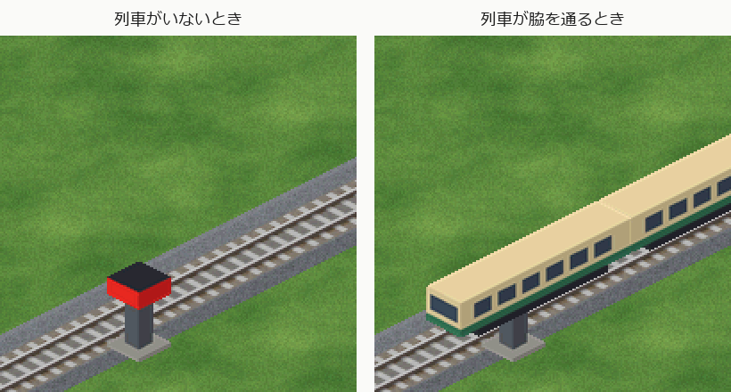
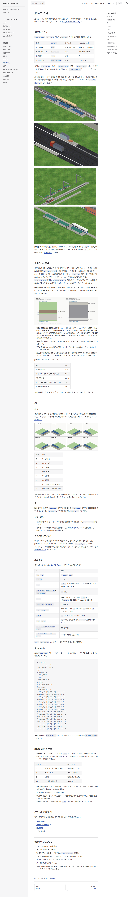
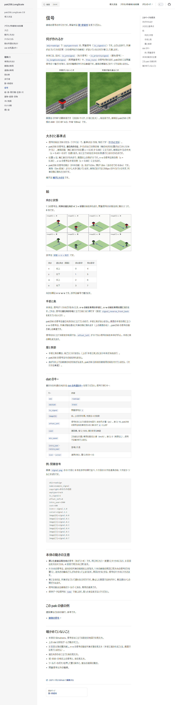

# アドオン作者向けの仕様: 駅・停留所・信号（#206）

駅・停留所と信号の決まりを、公開のサイト（`site/spec/station.md`・`signal.md`）へ移した。2026-11-27。構成は [#177 の記録](2026-11-27_spec-common.md)。

## 置き場の分け方

- 停留所・駅・信号の値の表と道具の手順は `docs/stations.md`・`docs/signals.md` に残した（検査が名前で行を読む）。
- 港と道路の車庫の節は動かしていない（港は船・港のページで扱う）。
- 共通のページ（`dat.md`・`drawing.md`）の「コードを読んだ内容」などの根拠の書き添えを外した（ユーザーの指示、#214）。`dat.md` の木の `climates` の根拠（makeobj 60.12 で、省いた pak と `climates=` を空にした pak が同じ）は [#177 の記録](2026-11-27_spec-common.md) にある。

## 本体のコードで確かめた事（OTRP の fork を読んだだけ）

サイトのページには根拠の書き添えを付けない。根拠はここに残す。

- 停留所の向きの数と置ける升（`simtool.cc` の `tool_build_station_t::tool_station_aux`）: 2・8・16 は直線の道（行き止まりを含む）、4 は行き止まりの升。それ以外の数は FATAL ERROR。坂は向きの数が 48 を超える物だけ置ける（このページは 48 以上の数を扱わない）。
- 置き換え（同じ関数）: 古い停留所の容量が新しい物以上なら「Upgrade must have a higher level」。Ctrl を押すと外れる（ページには書いていない）。
- 容量は `level` × 32（`descriptor/writer/building_writer.cc`）。`allow_underground` は 0 が地上だけ、1 が地下だけ、2 が両方（`descriptor/building_desc.h`）。
- 信号の絵（`obj/signal.cc` の `signal_t::calc_image`）: 1 方向だけの信号は、向きの添字が n = 0・s = 1・w = 2・e = 3。e と n は手前の絵（`foreground_image`）、s と w は奥の絵。`offset_left` が 0 でなく、信号を左に立てる地図では、絵がずれて前後も入れ替わる。
- 名前で書く形（`image[e][0]` など）は、書き出しの順が n・s・e・w で、番号の順（n・s・w・e）と e と w が入れ替わる（`descriptor/writer/roadsign_writer.cc`）。makeobj 60.12 で組んで確かめてはいないので、ページには番号の形だけを書いた。
- `min_speed`・`cost`・`offset_left` の既定と、信号の種類のキー（`roadsign_writer.cc`）。
- 手前と奥の順は、設定 `signal_reverse_front_back`（既定は無効）で入れ替わる（`obj/signal.cc`）。OTRP の本体は信号の手前用・斜め用の絵を読めるが、`roadsign_writer.cc` にそのキーは無い。

## ゲームで確かめた事（OTRP v64、`flat_512_left_v64`）

- 停留所の向きの数（[`layouts_check.py`](2026-11-27_spec-stations-screens/layouts_check.py)）: 線路の駅の dat の `dims` を変えた物を makeobj 60.12 で組んで（警告なし）置いた。

  | `dims` | 直線の中ほど | 行き止まり | 曲がり |
  |---|---|---|---|
  | `1,1,2` | 置けた | （試していない） | No through station here! |
  | `1,1,4` | No terminal station here! | 置けた | No terminal station here! |
  | `1,1,8` | 置けた | 置けた | No through station here! |
  | `1,1`（3 つめ無し） | FATAL ERROR「check_l1 has wrong number of layouts」で本体が止まる | | |

  容量が同じ停留所を重ねると「Upgrade must have a higher level」。
- **信号の手前と奥**: 周回の線路（`tools/vehicle_check/signal.nut`）で、画面の手前の側に立つ s（左の辺、南向き）と w（上の辺、西向き）の信号の脇を列車が通ると、頭が列車の陰に隠れた。pak256 の信号は進む向きの左に立てているので、本体の「e・n は手前、s・w は奥」の順（右に立てた絵に合う）と合わない。前の `docs/signals.md` にあった「実物（柱と頭で 5m 前後）どおりだと、256px のタイルでは小さすぎて、列車の陰に隠れたため」（大きく描いた理由）は、この順も原因と見られる（大きさを変えて比べてはいない）。直し方は決めていない。e・n の信号の脇を列車が通る画面は撮っていない。

  

## docs から消した経緯

`docs/stations.md` にあった次の内容。

### AMI の停留所の扱い

- pak256 の停留所は [#44](https://github.com/128-bit-net/pak256/issues/44) で仮に作り、[#72](https://github.com/128-bit-net/pak256/issues/72) で AMI の 256 版（`ami_road_bus_stop`・`ami_road_truck_stop`）に置き換え、[#94](https://github.com/128-bit-net/pak256/issues/94) で pak256 の物に戻した。線路の駅は [#46](https://github.com/128-bit-net/pak256/issues/46) で仮に置き、[#73](https://github.com/128-bit-net/pak256/issues/73) で pak256 の駅として使い続けることにした（2026-11-26、ユーザー）。
- AMI の停留所は AMI の `ami_road.pak`（`ami-256-alpha.3` 以降の 256 版の zip）に入っていて、pak256 の側からは外せない（pak は makeobj が束ねた 1 つのファイル）。そこで AMI の側で外した（AMI #305）。pak256 は `ami-256-alpha.6`（[#111](https://github.com/128-bit-net/pak256/issues/111)）で取り込んだ。alpha.5 との比較で、`ami_road.pak` から無くなった物はこの 2 つだけ。
- 停留所の置き方の経緯: [#115](https://github.com/128-bit-net/pak256/issues/115) で白線に重ならない並びに描き直した。白線は c = 0.156〜0.172 と 0.828〜0.844（画面の画素から測った）。バス停の歩道は [#139](https://github.com/128-bit-net/pak256/issues/139) でタイルの端まで伸ばした。AMI の 256 版 alpha.7 では、歩道の奥に残る路面の暗い行は c = 0.015 から始めると 3〜4 行、c = 0 から始めると 1〜2 行（alpha.6 で c = 0.015 のときは 0〜2 行）。alpha.8 は帯と道路の縁の形が alpha.7 と同じ（[記録](2026-11-26_ami159.md)）。alpha.9 の行数は数えていない。
- 道具の絵の灰色のアイコンは [#71](https://github.com/128-bit-net/pak256/issues/71)（[記録](2026-11-25_rail-leftovers.md)）。

### 保存データへの影響

保存データは物の名前で引く。
- α0.2（v0.2.0）・α0.3（v0.3.0）の保存データで、仮の停留所（`pak256_bus_stop`・`pak256_truck_stop`）を置いてあれば、名前が再び見つかるので、停留所は戻る見込み（#72 の版で読み込んで保存し直した保存データは戻らない。`gebaeude_t::rdwr` の読みで、置いて確かめてはいない）。
- #72 以降の main や v0.3.1 で AMI の停留所を置いた保存データは、AMI の停留所を外した版を入れた後、その停留所が消える見込みだった。
- v0.3.1 の保存データを v0.4.0 で読んで確かめた（[記録](2026-11-26_v040-check.md)）: AMI の停留所は消え、本体は止まらない。ダイヤが指していた所は経由地になって編成は走り続け、同じ升に pak256 の停留所を置き直すと収入が戻った。地図の上に名札の跡が残ることがある。

### そのほかの細目

- pak256 の線路の駅のホームは c = 0.66〜0.98（`objects/station/rail_stops/draw_stops.py` の `RAIL_NEAR`）。物の名前 `pak256_train_station` は #73 で変えなかったので、前の保存データは今までどおり読める。
- #94（道路の停留所を pak256 の物に戻す）と #73（線路の駅と信号を pak256 の物にする）は 2026-11-26 のユーザーの決定（pak256 は基本のアドオンを自分で作り、当面は絵より動くことを優先する）。
- 奥の車線に車が停まると、待合・小屋は車の陰に一部隠れる。荷役所の高さ 1m の積み降ろし場は道路の奥の縁を覆うので、帯は c = 0.015 から始める。
- 道路の停留所の道具の絵は、後ろの絵だけから作る。手前の歩道まで入れると、収める倍率が下がって小さくなる（#115）。
- 信号は、日本の左側通行に合わせて進む向きの左に立てた。大きく描いた理由は上の「信号の手前と奥」。

## 信号の置き直し

`docs/signals.md` にあった「置いたときの動き」の細目。置くと両方向になり、同じ所に重ねると片方向、3 回目は反対の片方向、4 回目で両方向に戻る（OTRP の `simtool.cc` の `place_sign_intern` の読み。2 回目まではゲームで確かめた。[記録](2026-11-26_rail-signal.md)）。本体の中の信号の向きは「通れない向き」の ribi で、東西の線路の 2 回目は列車が西へ、南北の線路の 2 回目は南へ進む。

## dat の例

2 ページの例は、仮の形の画像を使って makeobj 60.12 で組み、`Warning` と `ERROR` の行が無いことを確かめた（[組むスクリプト](2026-11-27_spec-stations-screens/page_dat.py)）。ゲームでは試していない。例を直したら流し直す。

## 図と画面

- 図: `site/figures/draw_spec_figures.py`（設備を置く帯、駅の 8 通りの向き、信号の 8 枚）。駅と信号の図は、このリポジトリの仮のシートを使う。
- 画面: 駅・信号・荷役所は [`shoot.py`](2026-11-27_spec-stations-screens/shoot.py)、路面電車は `tools/vehicle_check/tram_run.py`、モノレールは `monorail_run.py` を流し（OTRP v64、`flat_512_left_v64`、`tools/build.py` で組んだ今の物と AMI `ami-256-alpha.9`）、[`crop.py`](2026-11-27_spec-stations-screens/crop.py) で切り出した。バス停にバスが停まる画面は「道路の車両」の画面を使う。

## 組んだサイトの画面

手元の `vitepress preview` を Edge の画面なしの撮影（幅 1280px）で撮った（ゲームの画面ではない）。

## 確かめていないこと

- 本家 125.0.1、右側通行。
- ページの dat の例をゲームで動かすこと。
- 16 通りの向き、坂に建てられないこと、`type=extension` の建物。
- 信号を左に立てる設定の地図、e・n の信号の脇を列車が通る画面。
