# standards.md 8.2 の未確認の前提を確かめる（2026-11-27、#176）

[#176](https://github.com/128-bit-net/pak256/issues/176)。[standards.md](../standards.md) の 8.2 に並んでいた 7 項目を、本体のコードの読みとゲーム（OTRP v64、検証環境の写し、`flat_512_left_v64`、左側通行、昼）で確かめた。**決まりを直す案は、ユーザーが決めるまで決まりに入れていない。**

本体のコードの場所は、OTRP の fork（`128na/simutrans`）の `5505075fd` を読んだもの。ゲームの exe と同じコミットとは限らないので、動きはゲームで確かめた。本家 125.0.1 は読んでも起動してもいない。

画面の試験用の物（番号つきの箱の建物、1 枚の長いバス、船の形の箱）は仮で、[build_test.py](2026-11-27_standards-8-2-screens/build_test.py) が手元にだけ組む。pak256 の配布には入らない。

## 結果の一覧

| 項目 | 結果 |
|---|---|
| 産業の足跡の上限 | 確かめた。4×4・6×6 を置けた。3×3 の制限は街の建物だけ |
| 複数タイルの駅舎 | **`type=stop` ではできない**。`type=extension` なら 2×1・2×2 が置けた（直し方の案あり） |
| 大型船の絵 | **本体の既定の描画では、長い絵が欠けることがある**（直し方の案あり）。港の建物との釣り合いは確かめられない |
| AMI の停留所・駅の幅 | 確かめた。道路 4 種の停留所、線路 4 種の駅 |
| 太くした車両 | すれ違いとトラックの曲がりは #116 で確かめていた。雪の気候は今回確かめた。冬の地面は見ていない |
| 曲がり・分岐・斜め・2 段以上の坂 | 分岐・斜め・1 段の坂が 2 つ続く所・路面電車の坂を撮った。1 タイルで 2 段の坂は見ていない |
| 連節バスの曲がり | pak256 に連節バスは無い。1 枚の長いバス（`length=14`）の仮の物で撮った |

## 1. 産業の足跡の上限

- 本体が足跡で止めるのは街の建物（`res`・`com`・`ind`）だけ。`bauer/hausbauer.cc` の `hausbauer_t::successfully_loaded` が、街の建物で `x>3` か `y>3` なら起動で止める。産業の建物（`descriptor/writer/building_writer.cc` は大きさ 0 だけを断る）に、同じ制限は読んだ範囲では見当たらない。
- ゲーム: 4×4 と 6×6 の産業を `tool_build_factory`（公共のプレーヤー）で置き、全部のタイルにその建物があることをスクリプトで確かめた（[place.py](2026-11-27_standards-8-2-screens/place.py)）。

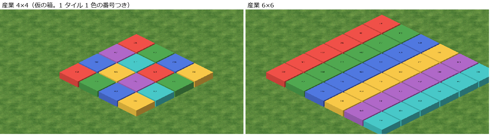

- 確かめていない: 地図を作るときに自動で置かれるか、街の中に置く産業（`location: City`。本体は役場の近くで空いた場所を探すので、大きいほど見つかりにくいと見ている）、品の入出力を持つ大きな産業、保存と読み込み。

## 2. 複数タイルの駅舎

- `type=stop` の建物は、駅の道具が**道のある 1 タイルだけ**に置く。`simtool.cc` の `tool_build_station_t::tool_station_aux` から `hausbauer_t::build_station_extension_depot_with_complete_layout_bits`（`bauer/hausbauer.cc`）を通り、`get_tile(layout, 0, 0)` の 1 枚しか置かない。費用は `dims` のタイル数を掛けて取る。
- ゲーム: `dims 2,1` の `type=stop` を線路に置くと、置いたタイルにだけ建物ができ、隣は空のままだった（makeobj は警告を出さずに組む）。
- `type=extension` は、`tool_build_station_t::tool_station_building_aux` が足跡の分の空きを調べ、`hausbauer_t::build` が全部のタイルを置いて停留所に足す。ゲームで、`pak256_train_station` の脇に 2×1 と 2×2 の `extension` を置け、同じ停留所になった。道や停留所の上には置けない（同じ `build` の中で断る）。

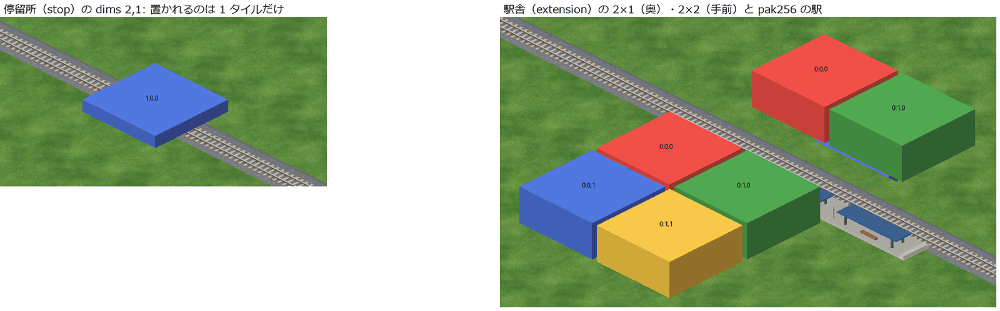

### 直し方の案（未決定）

| 案 | 中身 | 良い点 | 悪い点 |
|---|---|---|---|
| A（おすすめ） | 大きな駅舎は `type=extension`（線路の脇に置く 2×1・2×2 の建物）にし、`type=stop` の 1×1 のホームと組み合わせる | 1 つの建物の駅舎という決定（2026-11-25）の形が残る | 駅舎は線路をまたげず、ホームと一体の絵にできない。置く向きと位置はプレーヤーが選ぶ |
| B | 駅舎も 1×1 の `type=stop` を並べる（8.2 に書いてあった戻し方） | 線路の上の駅として扱える | 大きな駅舎を 1 つの建物にできず、つなぎ目の絵が要る |

## 3. 大型船の絵

試した物は、`length=64`（224.5m を 0.47 倍）の船の形の箱 2 つ。基準点が船首の先の物と、船の中ほどの物（[build_test.py](2026-11-27_standards-8-2-screens/build_test.py)。1536px のセル）。海を掘り、八角形の経由地を回らせた（[ship.py](2026-11-27_standards-8-2-screens/ship.py)）。

- `length=64` の船は組めて、走った（dat の `length` は 1 バイトの値で、組むときの上限は読んだ範囲では無い）。
- 撮れたのは 7 方向（進む升の向きが北の分は撮れていない）。
- **本体の既定の描画では、基準点が船首の先の箱の端が、画面の縦の線で切れることがある。** `threads = 1`（`simuconf.tab`）で起動すると、撮った 7 方向すべてで欠けなかった。
- 本体の `display/simview.cc` の `main_view_t::display` は、画面をスレッドの数の縦の帯に分け、各帯は帯の少し外までのタイルしか描かない（`IMG_SIZE/2` を足した範囲）。読みでは、車両のタイルの中心から横に約 1 タイル幅（拡大 1 倍で 256px）より遠い画素は、帯の境がそこに掛かると描かれないことがある。
- 船の中ほどを基準点にした箱は、今回の画面では欠けなかった。ただし横の半分が約 362px で約 1 タイル幅を超えるので、帯の境の位置しだいで欠けるはず（読み。欠けた画面は撮っていない）。

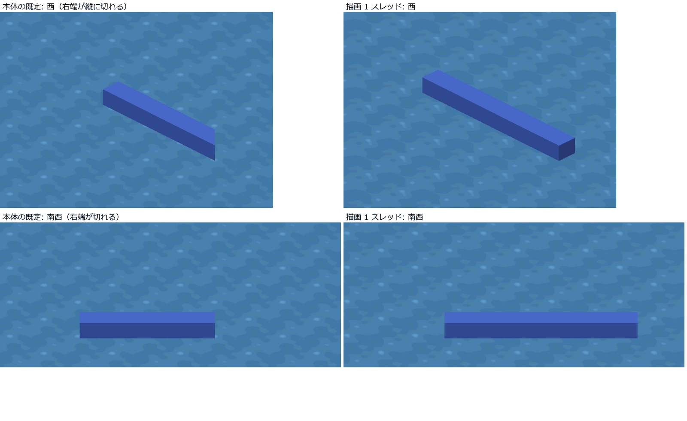

基準点が船首の先:

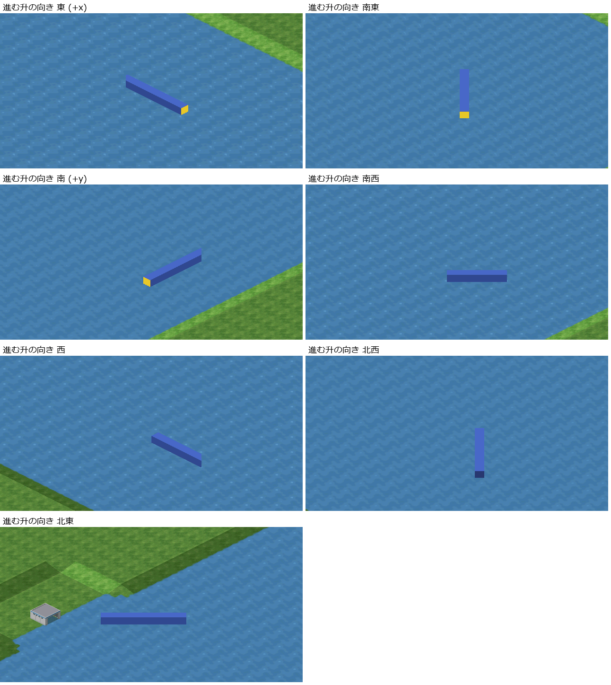

船の中ほどが基準点:

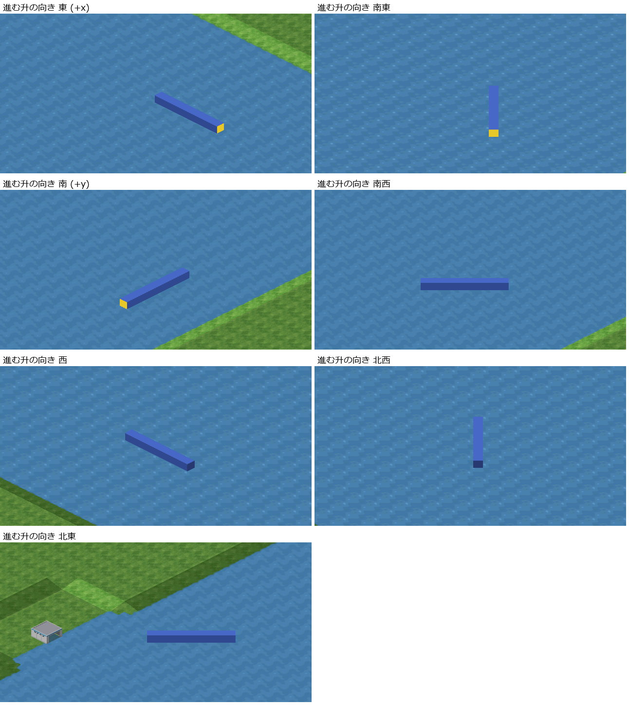

- 確かめられない: 港の建物との釣り合い（実物比例の大型の港の建物がまだ無い）。本物の絵の見え方（大型船の絵は作るときに描く。手本の絵はリポジトリに置けない）。基準点とセルは、下の案が決まってから決める。

### 直し方の案（未決定。大型船を作るときまでに決めればよい）

| 案 | 中身 | 良い点 | 悪い点 |
|---|---|---|---|
| A（おすすめ。作るときに試す） | 大型船を短い車両に分けて連結し、1 両の絵を車両のタイルから横に約 1 タイル幅以内にする | 0.47 倍の大きさを保てる | 試していない。曲がりで区切りが折れて見える |
| B | 欠けを受け入れる | 手間が無い | 画面を動かすと船の端が出たり消えたりする |
| C | 描く大きさを抑える。基準点を中ほどにして横の半分を 256px 以内にすると `length` は約 45（約 74m。0.47 倍で実物約 158m まで） | 欠けない見込み（試していない） | 224.5m 級は入らず、4 章の「手本の大きさ」と合わない |
| D | pak の `simuconf.tab` に `threads = 1` を書く | 絵の作り方は変わらない | 全部の描画が 1 スレッドになって遅くなる。利用者の設定が勝つかは確かめていない |

## 4. AMI の停留所・駅の幅

- 道路 4 種（`ami_road_local`・`ami_road_general`・`ami_road_trunk`・`ami_road_expressway`）の直線に、pak256 のバス停と荷役所を置いた。どれも停留所は白線の外の路肩にあった（画像はバス停）。

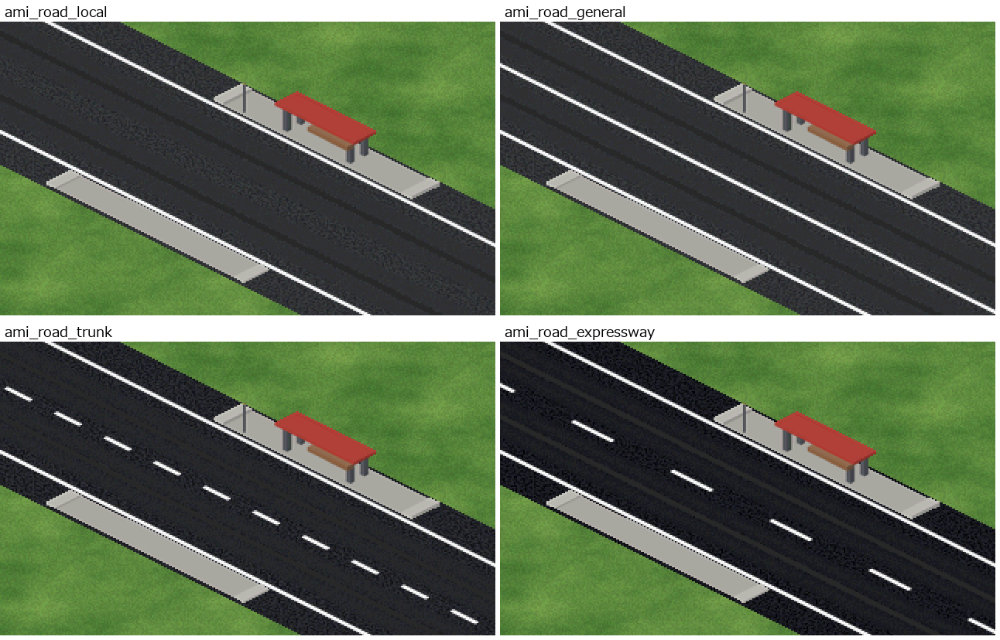

- 線路 4 種（`ami_rail_ballast`・`ami_rail_concrete`・`ami_rail_slab`・`ami_rail_ladder`）の直線に `pak256_train_station` を置いた。どれもホームは手前のレールに掛からず、レールのすぐ脇にあった。列車は停めていない。

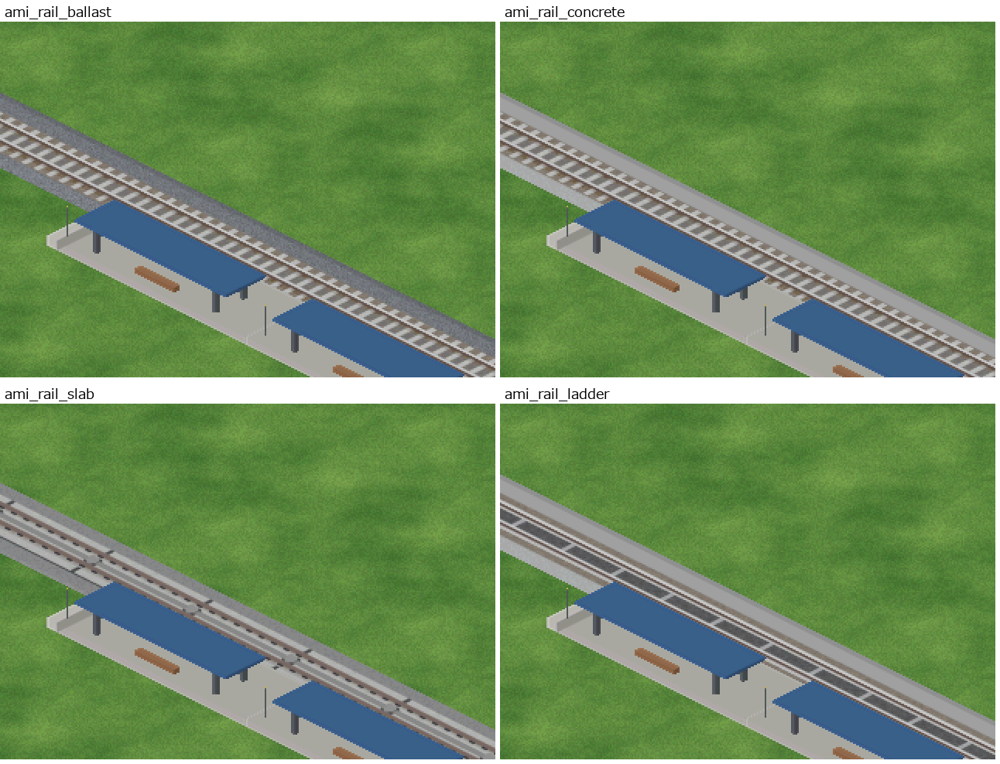

- 確かめていない: 曲がり・南北の向き以外の停留所、信号との並び。

## 5. 太くした車両

- 編成どうしのすれ違いと、郵便・石炭のトラックの曲がりは、[#116 の記録](2026-11-26_truck-curves-passing.md)で確かめてあった。8.2 の書き方が直っていなかった。
- 雪の気候（x≥256）の道路の輪で、郵便と石炭のトラックを撮った（`tools/vehicle_check/run.py --origin 300,40`）。8 方向と西南の角で、沈み・浮き・色のつぶれは見当たらない。画面で横向きの道では、奥の車線の車体が白線に掛かって見える（車輪の下端は舗装の上。#116 の温帯と同じ見え方）。

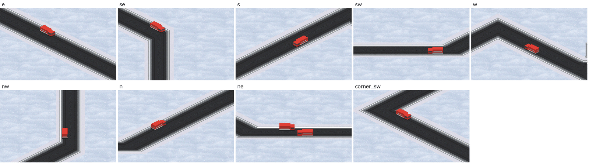
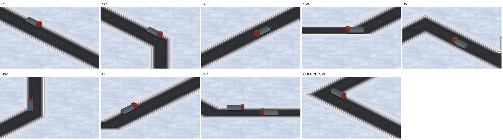

- 確かめていない: 冬の温帯の地面や木との組み合わせ（pak256 の車両の dat は季節の絵を持たないので、車両の絵は変わらない）、雪の線路の列車とバス、郵便の西北の角。

## 6. 曲がり・分岐・斜め・2 段以上の坂

[rail.py](2026-11-27_standards-8-2-screens/rail.py)。線路は `ami_rail_ballast`、気動車 + 付随車の 1 編成。路面電車は 1 両。

- **1 段の坂が 2 つ続く所**（高さ 0→2→0）: 車体は水平のまま走り、坂の変わり目の継ぎ目に段差と隙間が出る。坂の変わり目では、台車の暗い帯の片端がレールから外れて手前の草地に掛かって見える瞬間がある。地面や線路への大きな沈みは見当たらない。
- **斜め**（画面で横向きの階段）: 車体はレールの上をまっすぐ走る。画面で縦向きの斜めは撮っていない。
- **分岐**（T 字）: 直進と、分かれた先の線を走る所を撮った。分岐のタイルで車体が斜めの絵になる瞬間は撮れていない。
- **路面電車の坂**（道路に重ねた軌道と専用の軌道、1 段）: 車体は水平のまま走る。目立つ沈みや浮きは無い。東西の向きだけ。

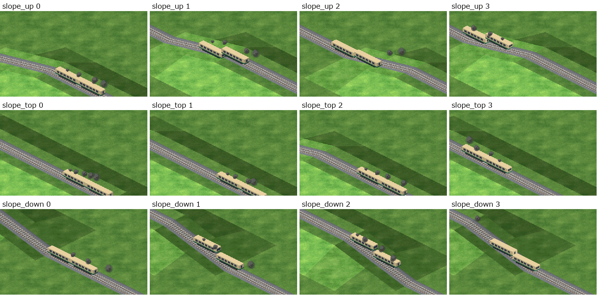
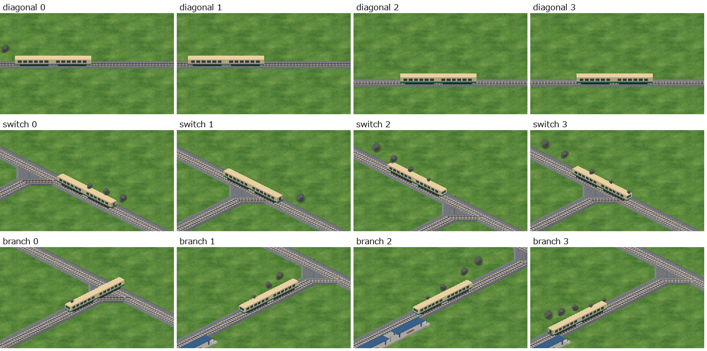
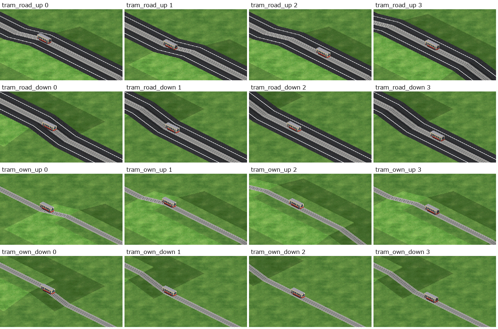

- 確かめていない: 1 タイルで 2 段上がる坂。

車体を 1 枚の絵で描くのは本体の決まりで、[vehicles.md](../vehicles.md) の「曲がり・坂」の「直さない」の判断を変える材料は出ていないと見ている。

## 7. 連節バスの曲がり

- pak256 に連節バスは無い。実物 18m の車体をバスと同じ比にした `length=14` の 1 枚の箱を、512 のセルに描いて道路の輪を走らせた（`tools/vehicle_check/run.py --vehicle t8_longbus --extra-pak …`）。
- 直線の 8 方向と西南の角で、車体の下端は舗装の上にあった。角では車体は折れず、片方の辺の向きのまま描かれる。画面で横向きの道では、向かい合う 2 台が重なって見える。

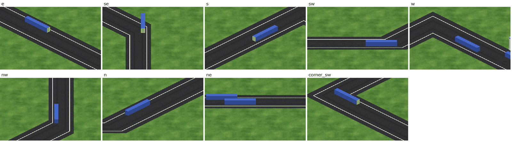

- 確かめていない: 西北の角、2 両に分けて連結した形の連節バス、停留所に止まった所。

## 手順

```
python -X utf8 tools/build.py
python -X utf8 docs/records/2026-11-27_standards-8-2-screens/build_test.py work/t8
python -X utf8 docs/records/2026-11-27_standards-8-2-screens/place.py <検証環境> work/t8 work/s1 47880
python -X utf8 docs/records/2026-11-27_standards-8-2-screens/ship.py <検証環境> work/t8 work/s2 47881
python -X utf8 docs/records/2026-11-27_standards-8-2-screens/ship.py <検証環境> work/t8 work/s3 47882 1
python -X utf8 docs/records/2026-11-27_standards-8-2-screens/rail.py <検証環境> work/s4 47886
python -X utf8 tools/vehicle_check/run.py --env <検証環境> --save flat_512_left_v64 --port 47883 --origin 300,40 --vehicle pak256_mail_truck --out work/snow_mail
python -X utf8 tools/vehicle_check/run.py --env <検証環境> --save flat_512_left_v64 --port 47885 --vehicle t8_longbus --extra-pak work/t8/pak/t8_longbus.pak --out work/longbus
```

画像は、撮った画面（拡大 3。船は拡大 5）を切り抜いて並べ、色数を減らした物（[crop.py](2026-11-27_standards-8-2-screens/crop.py)）。
