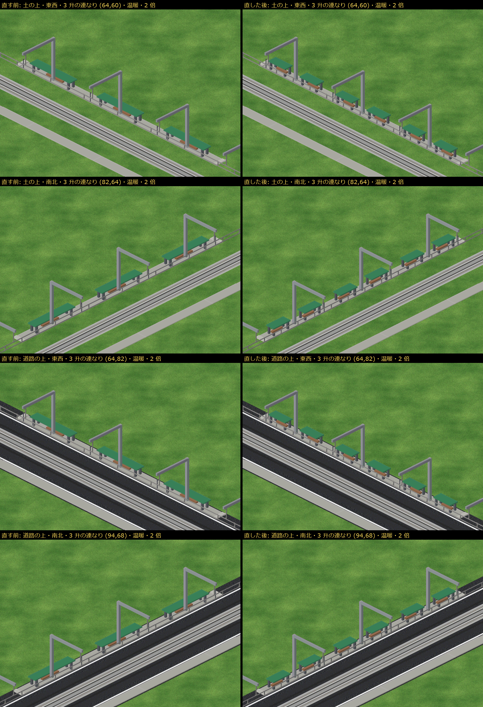
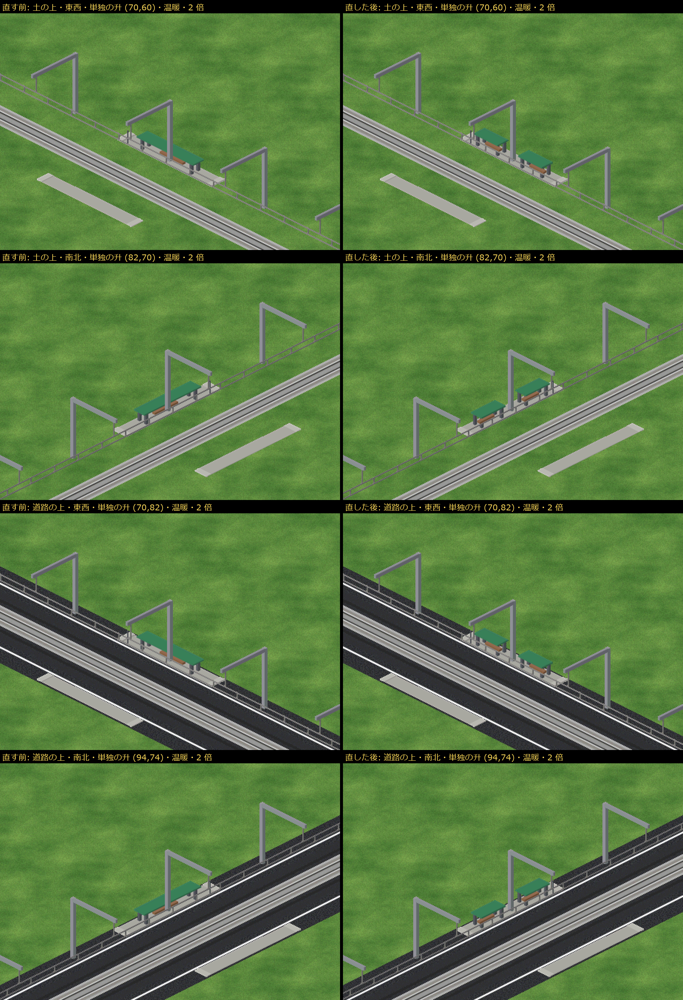
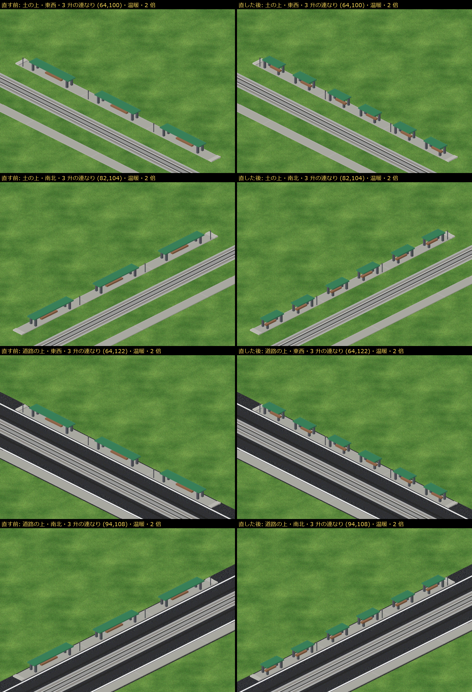
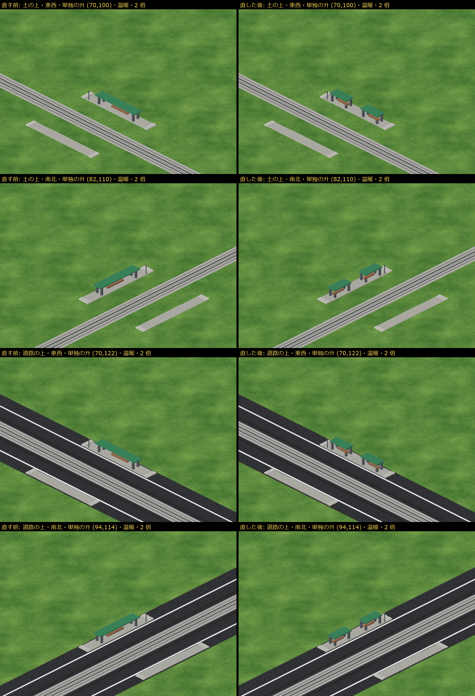
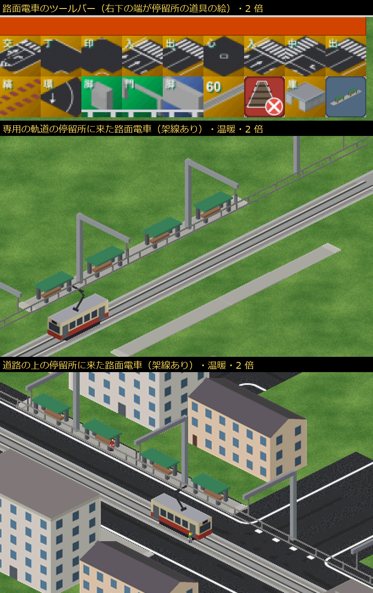

# 路面電車の停留所の上屋を架線の柱が貫く（2026-11-27）

[#195](https://github.com/128-bit-net/pak256/issues/195)。

## 原因

AMI の `ami_tram_catenary` の柱は、直線の升の中央（軸の向き a = 0.5）、軌道の中心から 0.42 タイル奥（c = 0.08）に立つ。停留所の待合の屋根は a = 0.20〜0.80・c = 0.018〜0.132 で、その真ん中を柱が通っていた。南北と東西の両方で同じ。ゲームでは柱が屋根の上に描かれた。

## 直し方

停留所の側で直した。屋根を a = 0.14〜0.39 と 0.61〜0.86 の 2 つに分け、柱の列を空けた。ベンチと柱も屋根ごとに置いた（`objects/station/tram_stops/draw_stops.py` の `ROOFS`）。AMI の曲がりの柱の件（[AMI #393](https://github.com/128na/simutrans-addon-dev/issues/393)）は直線の升の柱を変えない予定で、停留所は直線の升にしか置けない。

## 撮り方

OTRP v64（`addon_check` の写し）、`flat_512_left_v64`、温暖、昼、`gui.set_zoom(3)`（等倍）。直す前は main の `38e33c3` の絵、後はこの直しの絵。AMI は同じ `ami-256-alpha.9`。場面は [scene.py](2026-11-27_tram195-screens/scene.py)（土の上と道路の上、南北と東西、3 升の連なりと単独の升、架線ありとなし）、並べるのは [montage.py](2026-11-27_tram195-screens/montage.py)。

## 画面

架線あり。3 升の連なりと単独の升。

架線なし。

## ツールバーと路面電車

路面電車のツールバーに停留所の道具の絵が出た（[toolbar.py](2026-11-27_tram195-screens/toolbar.py)）。`tools/vehicle_check/tram_run.py --catenary 1 --run 20` で、路面電車が道路の上と専用の軌道の停留所を回り、2 つの停留所の出発の数が 4 になった。画像は [montage_run.py](2026-11-27_tram195-screens/montage_run.py) で並べた。

## 確かめていないこと

- 本家 125.0.1、右側通行。
- 降雪（停留所の絵に雪の絵は無く、同じ絵が出る見込み）。
