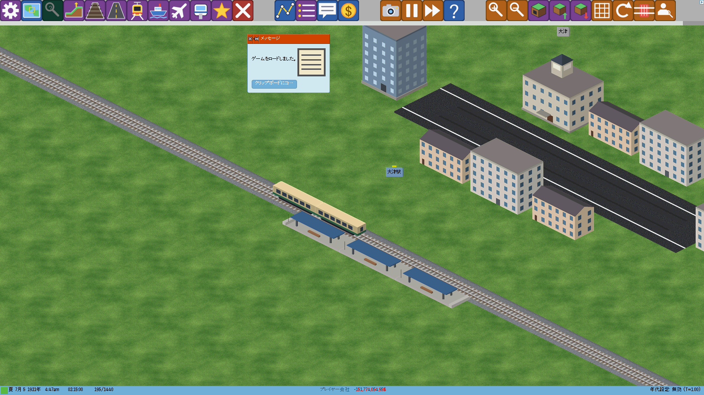
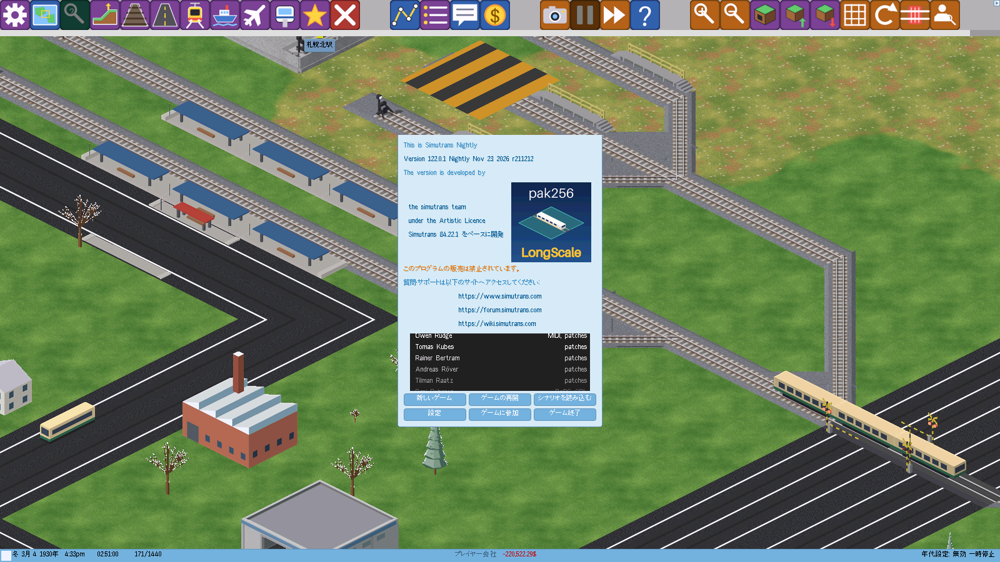
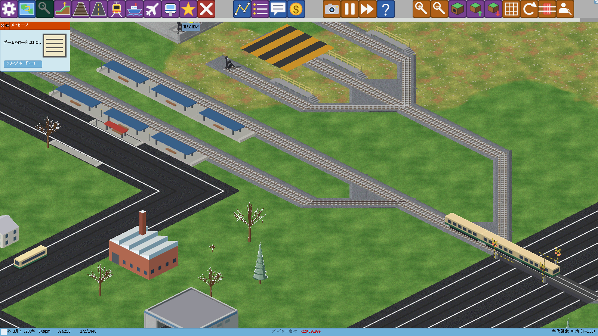

# v0.5.0 の起動・運送・保存データの互換の確かめ（2026-11-27）

[#157](https://github.com/128-bit-net/pak256/issues/157)。main（`0f59b83`）の CI（run 45866069055）が作った配布の zip（`pak256-dev-0f59b83.zip`）と、v0.4.0 の Release の zip（`pak256-v0.4.0.zip`）を展開し、中の `*.pak`・`ami_license.txt` と `config/`・`text/` だけで起動した（借り物なし。`Game(build=…, root=…)`）。検証環境は `addon_check`（OTRP v64）、昼夜は止めてある。MCP のポートは 47900〜47905。

スクリプトはリポジトリの直下から流し、展開した zip は `work/a05/v040/` と `work/a05/ci/` に置く。展開と名前の比べは [prep_zips.py](2026-11-26_v040-check-screens/prep_zips.py)、保存データを置いた環境の写しは [mkenv.py](2026-11-26_v040-check-screens/mkenv.py)（v0.4.0 の記録の物をそのまま使った）。流した順は次のとおり。引数は各スクリプトの先頭の「使い方」。

1. `prep_zips.py`
2. [make_save.py](2026-11-27_v050-check-screens/make_save.py)（v0.4.0 で `compat040` を作る）
3. `mkenv.py`（`compat040.sve` を `work/a05/env2/` に）
4. [load_save.py](2026-11-27_v050-check-screens/load_save.py) を `ci` と `v040` の 2 回、[difflog.py](2026-11-27_v050-check-screens/difflog.py)
5. [new_run.py](2026-11-27_v050-check-screens/new_run.py) `run`
6. `tools/title_shot.py --zip <今の zip>`（起動の画面）
7. `mkenv.py`（zip の `demo.sve` を `work/a05/envdemo/` に）と `new_run.py demo`
8. [ship_toolbar.py](2026-11-27_v050-check-screens/ship_toolbar.py)

## v0.4.0 → v0.5.0 の物の名前の違い

pak の物を `makeobj list` で比べた（v0.4.0 は pak 23 個・物 217 個、今の zip は 36 個・241 個）。

| 違い | 物 |
|---|---|
| 無くなった | なし |
| 増えた（pak256） | 車両 `pak256_tram`・`pak256_monorail`・`pak256_ferry`・`pak256_cargo_ship`・`pak256_airliner`、停留所・建物 `pak256_tram_stop`・`pak256_monorail_station`・`pak256_pier`・`pak256_quay`・`pak256_canal_wharf`・`pak256_airport`・`pak256_hangar`、道 `pak256_runway`・`pak256_taxiway`・`pak256_river_30`・`_20`・`_10` |
| 増えた（AMI、alpha.6 → alpha.8） | `ami_mark_center_yellow`・`ami_mark_junction4_c`・`ami_mark_paving_blue`・`ami_mark_paving_green`・`ami_mark_paving_red`・`ami_mark_paving_red_striped`・`ami_rail_turntable` |

## v0.4.0 の保存データを今の zip で読む

保存データは、[α0.3 の setup.nut](2026-11-25_alpha03-screens/setup.nut)（道路・街・炭鉱と発電所・バス停と荷役所・道路の車庫・バスと石炭のトラック・線路・駅・線路の車庫・気動車）と木 3 本を v0.4.0 の pak で置き、約 1.5 年走らせて保存した物（`compat040`）。読み込むときは道路名を書き換えない。

- **今の zip で読めて、本体は止まらない。** 「足りない物」の窓は出なかった（読み込んだ直後の画面は「ゲームをロードしました」だけ）。
- 読み込んだ直後の、停留所と車庫の升の物・道・木、停留所 6 つの一覧は、v0.4.0 で読んだときと同じ。約 2.6 年走らせた後も同じ。
- 3 つの編成は残り、走り続けた。直近 12 か月の運んだ数は、今の zip の 12 回の読みでは毎回 0 でなかった（v0.4.0 の側は、気動車が 0 の読みが 2 回あった）。多い少ないは比べていない。
- ログ（`-log -debug 3`）の `Warning`・`ERROR` の違いは、今の版だけの `delta_t … too large`（早送りの追いつきの知らせ）1 件と、作業フォルダの名前が違うだけの `symbol.BigLogo.pak` の 1 件。物が見つからないという行は無い。

## 今の zip だけで起動して運ぶ

[new_run.py](2026-11-27_v050-check-screens/new_run.py) `run`: setup.nut を新しい状態で流した（バス停は α0.3 の setup.nut が場所をずらして探すので、(61,60)・(101,60) に置かれた）。12 回の読み（約 2.4 年）で、バス・石炭のトラック・気動車は直近 12 か月の運んだ数が毎回 0 でなかった。

路面電車・船・飛行機・モノレール・川は、この回では走らせていない。それぞれの記録（[路面電車](2026-11-26_tram.md)・[船](2026-11-26_ships.md)・[飛行機](2026-11-26_air.md)・[モノレール](2026-11-26_monorail.md)・[川](2026-11-27_river.md)）が確かめ。

## 初期マップ（demo.sve）

- 保存データの無い環境で、`-load` を付けずに配布の zip で起動すると、起動の窓の後ろに地図が映る。起動の画面では「足りない物」の窓はもともと出ない（[layout.md](../layout.md) の「初期マップ」）。
- zip の `demo.sve` を `-load` で読んでも「足りない物」の窓は出ず、ログに物が見つからないという行は無かった。ログの踏切の `way/ground missing`（112,87・113,87）は [#79 の PR](https://github.com/128-bit-net/pak256/pull/168) で、v0.4.0 の pak でも出ると確かめた物。

## 船のツールバー

AMI の `waytype=water` の歩道 4 種が、運河より前に並ぶ（[船の記録](2026-11-26_ships.md) の「ツールバー」と同じ。今の zip でも同じ）。

## 確かめていないこと

- 本家 Simutrans 125.0.1、右側通行の地図、起動の画面の「新しい地図」。
- v0.4.0 の保存データは、道路・線路の場面だけで確かめた。v0.3.1 より前の版の保存データ。
- 路面電車・船・飛行機・モノレールは、この版の zip では走らせていない（各 issue の記録は手元の pak）。
- ツールバーから置く・買う操作（船のツールバーは開いて撮っただけ）。
